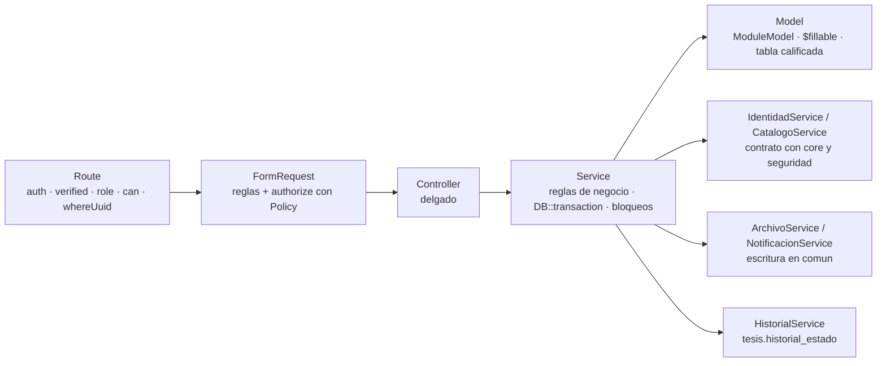
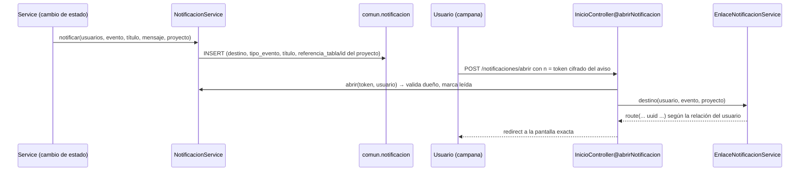
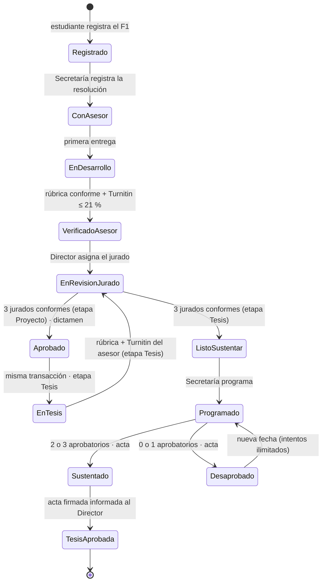

# Manual de arquitectura

Módulo **Tesis y Proyecto de Tesis** del monolito modular `project-portal-gestion-direccion-escuela` (Laravel 13, PHP 8.4, PostgreSQL 17, Blade + Alpine.js).

## Contenido

1. [Ubicación en el monolito](#ubicación-en-el-monolito)
2. [Estructura de carpetas](#estructura-de-carpetas)
3. [Capas](#capas)
4. [Rutas](#rutas)
5. [Servicios y reglas de negocio](#servicios-y-reglas-de-negocio)
6. [Modelos y tablas del esquema tesis](#modelos-y-tablas-del-esquema-tesis)
7. [Migraciones de ajuste](#migraciones-de-ajuste)
8. [IdentidadService: el contrato con core y seguridad](#identidadservice-el-contrato-con-core-y-seguridad)
9. [uuid públicos](#uuid-públicos)
10. [Seguridad aplicada](#seguridad-aplicada)
11. [Archivos](#archivos)
12. [Notificaciones](#notificaciones)
13. [Estados del proyecto](#estados-del-proyecto)
14. [Seeders](#seeders)
15. [Pruebas](#pruebas)
16. [Decisiones de diseño](#decisiones-de-diseño)
17. [Limitaciones conocidas](#limitaciones-conocidas)

---

## Ubicación en el monolito

| Dato | Valor |
|---|---|
| Carpeta | `app/Modules/TesisProyectoTesis/` |
| Vistas | `resources/views/modules/tesis-proyecto-tesis/` |
| Pruebas | `tests/Feature/TesisProyectoTesis/`, `tests/Unit/TesisProyectoTesis/` |
| URL / nombre de ruta | `/tesis-proyecto-tesis`, `tesis-proyecto-tesis.*` (API: `/api/tesis-proyecto-tesis`, `api.tesis-proyecto-tesis.*`) |
| Esquema PostgreSQL | `tesis` (nombres siempre calificados: `tesis.proyecto_tesis`) |
| Alias Git | `tesis-proyecto-de-tesis` |

El portal descubre el módulo mediante `ModulesServiceProvider`: carga `Routes/web.php`, `Routes/api.php` y las migraciones de `Database/Migrations/`. Para migrar se usa el comando del portal:

```bash
php artisan module:migrate tesis-proyecto-tesis
php artisan module:migrate:status tesis-proyecto-tesis
```

**Límites que respeta el módulo:**

- No importa clases de otros módulos.
- No crea FK hacia esquemas de otros módulos (solo `tesis`, `core`, `seguridad`, `comun` y `public`).
- No modifica archivos fuera de sus tres carpetas.

`ModuleStructureTest` y `ModuleSchemaIsolationTest` lo verifican.

## Estructura de carpetas

```text
app/Modules/TesisProyectoTesis/
├── Controllers/        9 controladores delgados: uno por carril (Alumno, Asesor, Director,
│                       Jurado, Secretaria), Inicio, Archivo, TesisController (API) y BaseController
├── Database/
│   ├── Migrations/     3 migraciones originales de gestión + 19 de ajuste (2026_11_10_0000NN)
│   └── Seeders/        TesisDatabaseSeeder, RubricaSeeder, TipoSolicitudSeeder,
│                       DemoTesisSeeder, EscenariosTesisSeeder, LineasInvestigacionSeeder
├── Docs/               estos manuales e img/ con capturas
├── Models/             23 modelos (ModuleModel, incluido Registro) + Concerns/UsaUuid
├── Policies/           ProyectoPolicy
├── Requests/           18 FormRequest sobre TesisFormRequest (mensajes en español): 13 de escritura y 5 de filtros/consultas
├── Routes/             web.php, api.php
├── Services/           21 servicios con las reglas de negocio
└── Support/            Estados, Parametros, Identidad (DTO), PdfSimple, DuracionCronograma

resources/views/modules/tesis-proyecto-tesis/
├── layout.blade.php    documento propio del módulo (como layouts.calidad): menú lateral por rol, barra superior con campana, tema y menú de usuario
├── inicio, portada     selección de rol / portada pública sin datos
├── alumno/  asesor/  director/  jurado/  secretaria/      una carpeta por carril
└── partials/           estado, ficha, línea de tiempo, rúbrica, observación, estilos…
```

## Capas



| Capa | Responsabilidad | Ejemplo |
|---|---|---|
| Route | Autenticación, rol Spatie por carril, Policy por proyecto, parámetros solo uuid | `can:verComoAsesor,proyecto` + `whereUuid('proyecto')` |
| FormRequest | Valida el formato y vuelve a autorizar con la Policy | `VerificarRubricaRequest::authorize()` decide entre `verComoJurado` y `verComoAsesor` según la ruta |
| Controller | Une el Request con el Service, sin lógica de negocio | `AsesorController@guardarVerificacion` |
| Service | Reglas de negocio, transacción, bloqueo, historial y avisos | `RubricaService::verificar()` |
| Model | Mapeo de la tabla, `$fillable` explícito, `uuid` como route key | `Revision` → `tesis.revision` |

Las vistas no contienen reglas: reciben arreglos preparados por los servicios (`SeguimientoService`, `PanelService`, `NavegacionService`).

## Rutas

Prefijo `/tesis-proyecto-tesis`, nombre `tesis-proyecto-tesis.`. Todo, salvo la portada, exige `auth` + `verified`. La columna «Autorización» indica la Policy (`ProyectoPolicy`) que se aplica en la ruta (`can:`), en el FormRequest o en el controlador.

### Comunes

| Método | URI | Nombre | Rol | Autorización |
|---|---|---|---|---|
| GET | `/` | `index` | Ninguno (portada sin datos) / cualquiera | Inicio por rol |
| POST | `/notificaciones/leer` | `notificaciones.leer` | Cualquiera | Solo los avisos propios |
| POST | `/notificaciones/abrir` | `notificaciones.abrir` | Cualquiera, `throttle:60,1` | Token cifrado del aviso propio |
| GET | `/archivos/{tipo}/{uuid}` | `archivos.descargar` | Cualquiera | `ver` (relación con el proyecto); `tipo` ∈ proyecto, entrega, resolucion, reporte, acta-firmada |
| GET | `/api/tesis-proyecto-tesis` | `api.tesis-proyecto-tesis.index` | Ninguno | Solo `{module, schema}` |

### Estudiante (`role:alumno`)

| Método | URI | Nombre | Autorización |
|---|---|---|---|
| GET | `/alumno` | `alumno.panel` | Proyecto propio (`IdentidadService`) |
| GET | `/alumno/proyecto` | `alumno.proyecto` | Proyecto propio |
| GET | `/alumno/proyecto/registrar` | `alumno.proyecto.registrar` | Rol |
| POST | `/alumno/proyecto/registrar` | `alumno.proyecto.guardar` | `RegistrarProyectoRequest` (alumno con vínculo de estudiante) |
| GET | `/alumno/coautor` | `alumno.coautor` | Rol, `throttle:20,1` |
| GET | `/alumno/avances` · `/alumno/observaciones` | `alumno.avances` · `alumno.observaciones` | Redirigen al proyecto vigente |
| GET | `/alumno/proyecto/{proyecto}/avances` | `alumno.proyecto.avances` | `can:verComoAlumno` |
| POST | `/alumno/proyecto/{proyecto}/avances` | `alumno.proyecto.avances.subir` | `can:verComoAlumno` + `SubirEntregaRequest` |
| GET | `/alumno/proyecto/{proyecto}/observaciones` | `alumno.proyecto.observaciones` | `can:verComoAlumno` |
| POST | `/alumno/observaciones/{observacion}/responder` | `alumno.observaciones.responder` | `ResponderObservacionRequest` → `verComoAlumno` del proyecto de la observación |

### Asesor (`role:profesor` con designación activa)

| Método | URI | Nombre | Autorización |
|---|---|---|---|
| GET | `/asesor/proyectos` | `asesor.proyectos` | Solo sus asesorías activas |
| GET | `/asesor/proyectos/{proyecto}` | `asesor.proyecto` | `can:verComoAsesor` |
| GET / POST | `/asesor/proyectos/{proyecto}/entregas/{entrega}/revisar` | `asesor.revisar` / `.guardar` | `can:verComoAsesor` + `scopeBindings` + `RevisarAvanceRequest` |
| POST | `/asesor/proyectos/{proyecto}/observaciones/{observacion}/levantar` | `asesor.observaciones.levantar` | `can:verComoAsesor` + solo su autor |
| GET / POST | `/asesor/proyectos/{proyecto}/verificar` | `asesor.verificar` / `.guardar` | `can:verComoAsesor` + `VerificarRubricaRequest` |
| GET / POST | `/asesor/proyectos/{proyecto}/similitud` | `asesor.similitud` / `.registrar` | `can:verComoAsesor` + `RegistrarSimilitudRequest` |

### Director (`role:director_escuela`)

| Método | URI | Nombre | Autorización |
|---|---|---|---|
| GET | `/director` | `director.panel` | Rol |
| GET | `/director/proyectos` | `director.proyectos` | Rol (`FiltrarProyectosDirectorRequest`) |
| GET | `/director/proyectos/{proyecto}` | `director.proyecto` | `can:gestionarComoDirector` (ficha con el detalle del F1) |
| GET / POST | `/director/proyectos/{proyecto}/solicitar-asesor` | `director.asesor.solicitar` / `director.asesor.enviar` | `can:gestionarComoDirector` / `SolicitarAsesorRequest` |
| GET | `/director/solicitudes/{solicitud}/oficio` | `director.oficio` | `Gate::authorize('gestionarComoDirector')` en el controlador (oficio imprimible) |
| GET / POST | `/director/proyectos/{proyecto}/jurado` | `director.jurado` / `director.jurado.asignar` | `can:gestionarComoDirector` / `AsignarJuradoRequest` |
| POST | `/director/proyectos/{proyecto}/jurado/reemplazar` | `director.jurado.reemplazar` | `ReemplazarJuradoRequest` |

### Jurado (`role:profesor` con asignación activa)

| Método | URI | Nombre | Autorización |
|---|---|---|---|
| GET | `/jurado/proyectos` | `jurado.proyectos` | Solo sus jurados activos |
| GET | `/jurado/sustentaciones` | `jurado.sustentaciones` | Solo sus jurados activos |
| GET / POST | `/jurado/sustentaciones/{sustentacion}/resultado` | `jurado.resultado` / `.registrar` | `verComoJurado` (controlador / `RegistrarResultadoRequest`) |
| GET / POST | `/jurado/proyectos/{proyecto}/verificar` | `jurado.verificar` / `.guardar` | `can:verComoJurado` + `VerificarRubricaRequest` |
| POST | `/jurado/proyectos/{proyecto}/observaciones/{observacion}/levantar` | `jurado.observaciones.levantar` | `can:verComoJurado` + solo su autor |

### Secretaría (`role:secretaria`)

| Método | URI | Nombre | Autorización |
|---|---|---|---|
| GET | `/secretaria/resoluciones` | `secretaria.resoluciones` | Rol |
| POST | `/secretaria/resoluciones/{solicitud}` | `secretaria.resoluciones.registrar` | `RegistrarResolucionRequest` → `gestionarComoSecretaria` |
| GET | `/secretaria/sustentaciones` | `secretaria.sustentaciones` | Rol |
| GET / POST | `/secretaria/sustentaciones/programar/{proyecto}` | `secretaria.sustentaciones.programar` / `.guardar` | `can:gestionarComoSecretaria` / `ProgramarSustentacionRequest` |
| GET | `/secretaria/actas` | `secretaria.actas` | Rol |
| GET | `/secretaria/actas/{acta}` | `secretaria.actas.ver` | `gestionarComoSecretaria` (controlador) |
| POST | `/secretaria/actas/{acta}/firmada` | `secretaria.actas.firmada` | `SubirActaFirmadaRequest` |
| POST | `/secretaria/actas/{acta}/informar` | `secretaria.actas.informar` | `gestionarComoSecretaria` (controlador) |

### ProyectoPolicy

| Habilidad | Regla |
|---|---|
| `verComoAlumno` | Rol `alumno` e integrante **activo** del proyecto |
| `verComoAsesor` | Rol `profesor` y asesor **activo** del proyecto |
| `verComoJurado` | Rol `profesor` y miembro **activo** del jurado. Un jurado reemplazado pierde el acceso |
| `gestionarComoDirector` | Rol `director_escuela` con vínculo académico |
| `gestionarComoSecretaria` | Rol `secretaria` con vínculo académico |
| `ver` | Cualquiera de las anteriores (expediente y archivos) |

La Policy se registra con el atributo `#[UsePolicy]` en el modelo `Proyecto`, sin tocar providers globales.

## Servicios y reglas de negocio

| Servicio | Responsabilidad y reglas principales |
|---|---|
| `IdentidadService` | Usuario actual → estudiante / docente (ver [contrato](#identidadservice-el-contrato-con-core-y-seguridad)). Búsquedas por código y usuarios a notificar. |
| `CatalogoService` | Líneas de investigación, especialistas por línea, periodo actual, semana del ciclo y ambientes, siempre por **código**. |
| `ProyectoService` | Registro F1: 1–2 integrantes, coautor existente y distinto de quien registra, ninguno con otro proyecto activo, título ≤ 20 palabras, código `PT-AAAA-NNN`. Usa advisory locks por estudiante y por numeración. |
| `SeguimientoService` | Ficha, pasos del proceso, historial, entregas y observaciones pendientes del estudiante. |
| `DesignacionService` | Solicitud al Decanato (solo en Registrado, sin otra pendiente, docente sugerido especialista de la línea). Resolución con número único, fecha no futura y PDF: asesor activo y pase a ConAsesor. |
| `AvanceService` | Entregas con versión correlativa por etapa, solo en estados que reciben entregas. La primera pasa ConAsesor → EnDesarrollo. Respuesta a observaciones con una versión posterior. |
| `RevisionService` | Una revisión de avance por entrega: Con observaciones / Sin observaciones / Proyecto culminado. Levantamiento solo por el autor y solo si la observación está Respondida. |
| `RubricaService` | Rúbrica vigente y criterios por etapa (18 Proyecto / 25 Tesis). La versión objetivo es la última Final o Culminada. Marcas completas, «no aplica» solo donde se permite, «no cumple» con observación, conformidad solo con todo cumple, una verificación por versión y docente. |
| `SimilitudService` | Turnitin: requiere la rúbrica del asesor conforme y ninguna observación suya abierta. Con ≤ 21 % y conformidad declarada: VerificadoAsesor (Proyecto) o EnRevisionJurado (Tesis). Con > 21 %: No apto y vuelve a los estudiantes. |
| `JuradoService` | Asignación: 3 docentes distintos, ninguno el asesor, cargos únicos, solo en VerificadoAsesor. Reemplazo con motivo. Consolidación: 3 conformes → dictamen + Aprobado + EnTesis, o ListoSustentar. Revisión intermedia desde la semana 8. |
| `SustentacionService` | Programación (ListoSustentar o Desaprobado; fecha desde hoy; 07:00–21:00; choques de aula, jurados y asesor; intento N+1). Resultado por jurado desde el día programado. Consolidación: unanimidad / mayoría / desaprobado, y mención si los 3 la proponen. |
| `ActaService` | Dictamen `DIC-AAAA-NNN` y acta `ACT-AAAA-NNN` (sin nota), documento imprimible, PDF firmado e informe al Director (acta aprobada → TesisAprobada). |
| `AsesorService` · `DirectorService` · `PanelService` | Bandejas y cifras por rol. Los tiempos promedio salen de `historial_estado`. |
| `ArchivoService` · `ExpedienteService` | Guardado y descarga de PDF (ver [Archivos](#archivos)). |
| `NotificacionService` · `EnlaceNotificacionService` | Avisos y su pantalla de destino (ver [Notificaciones](#notificaciones)). |
| `HistorialService` | `cambiarEstado()` bloquea el proyecto, valida y escribe `tesis.historial_estado` con usuario y fecha. |
| `NavegacionService` | Menú por rol, roles disponibles del usuario y datos de la campana. |

Los parámetros del proceso viven en `Support/Parametros.php`:

| Parámetro | Valor |
|---|---|
| Similitud máxima | 21 % |
| Integrantes máximos | 2 |
| Semana de la revisión intermedia | 8 |
| Aprobatorios mínimos | 2 |
| Duración de la sustentación | 120 min |
| Tamaño máximo de archivo | 10 MB |
| Palabras máximas del título | 20 |

## Modelos y tablas del esquema tesis

Todos los modelos extienden `App\Shared\Models\ModuleModel` y declaran la tabla calificada y un `$fillable` explícito. Los marcados con **uuid** usan `uuid` como route key (trait `Concerns/UsaUuid`).

| Modelo | Tabla | uuid |
|---|---|---|
| `Proyecto` | `tesis.proyecto_tesis` | ✔ |
| `ProyectoEstudiante` | `tesis.proyecto_estudiante` | |
| `Colaborador` · `ActividadCronograma` · `Recurso` · `PartidaPresupuesto` | `tesis.colaborador` · `actividad_cronograma` · `recurso` · `partida_presupuesto` | |
| `TipoSolicitud` · `Solicitud` | `tesis.tipo_solicitud` · `tesis.solicitud` | Solicitud ✔ |
| `Resolucion` | `tesis.resolucion` | ✔ |
| `AsesorProyecto` · `JuradoProyecto` | `tesis.asesor_proyecto` · `tesis.jurado_proyecto` | |
| `Entrega` | `tesis.entrega` | ✔ |
| `ReporteSimilitud` | `tesis.reporte_similitud` | ✔ |
| `Rubrica` · `CriterioRubrica` | `tesis.rubrica` · `tesis.criterio_rubrica` | |
| `Revision` · `DetalleEvaluacion` · `Observacion` | `tesis.revision` · `detalle_evaluacion` · `observacion` | Revision ✔, Observacion ✔ |
| `Sustentacion` · `ResultadoJurado` | `tesis.sustentacion` · `tesis.resultado_jurado` | Sustentacion ✔ |
| `Acta` | `tesis.acta` | ✔ |
| `HistorialEstado` | `tesis.historial_estado` | |
| `Registro` | `tesis.proyecto_tesis` | Lo exige `ModuleSchemaIsolationTest` |

Las tablas compartidas (`core.*`, `seguridad.*`, `comun.archivo`, `comun.notificacion`) **no tienen modelo en el módulo**: se leen o escriben solo desde los servicios de contrato.

## Migraciones de ajuste

Gestión creó el esquema `tesis` (`2026_11_03_030000` a `030200`) con un modelo basado en **puntajes y notas**. El Director pidió después:

- rúbrica **cumple / no cumple**;
- sustentación **aprobatoria / desaprobatoria**;
- **acta sin nota**.

La seguridad pidió además **identificadores públicos no numéricos**. Ninguna migración existente se editó. Hay 19 migraciones nuevas, una por tabla, con `DB::unprepared` y `down()` simétrico. Las columnas de nota y puntaje pasan a nullable sin borrarse, y la función `tesis.calcular_nota_sustentacion` queda obsoleta (no se usa ni se elimina).

| # | Tabla | Cambio | Por qué |
|---|---|---|---|
| 01 | `proyecto_tesis` | uuid; datos del F1 (enfoque, tipo, diseño, lugar, institución, duración, financiamiento); fechas de aprobación; `id_periodo_tesis`; `id_archivo_documento` | Registrar el F1 completo y el paso a la etapa Tesis |
| 02 | `proyecto_estudiante` | `orden_autor` (1–2), estado Activo/Retirado, fechas y motivo de retiro | 1–2 integrantes y un solo proyecto activo |
| 03 | `colaborador` | `id_persona` nullable + `nombres_completos` | Colaboradores en texto libre sin crear personas en `core` |
| 04 | `actividad_cronograma` | `horas_semanales` (1–60) | Cronograma del F1 |
| 05 | `recurso` | `cantidad`, tipos válidos, índice | Recursos del F1 |
| 06 | `partida_presupuesto` | `id_recurso` nullable, `id_proyecto`, clasificador, descripción | Presupuesto del F1: cada fila de «Recursos y presupuesto» es un `recurso` + su partida (`id_recurso`) |
| 07 | `solicitud` | uuid, destinatario, asunto, detalle, docente sugerido, `atendida_en`; `id_archivo` nullable | La solicitud de asesor la genera el sistema |
| 08 | `resolucion` | uuid, órgano emisor, dirigido a, quién registró; UNIQUE por solicitud | Una resolución por solicitud y trazabilidad |
| 09 | `asesor_proyecto` | fechas, motivo, estado; un asesor activo por proyecto (índice parcial) | Historial de designación |
| 10 | `jurado_proyecto` | cargos válidos, estado Activo/Reemplazado, quién asignó, fechas, motivo; cargo único activo | Jurado con cargos sin repetir y reemplazos |
| 11 | `entrega` | uuid, tipo Avance/Final, semana, comentario, entregado por, estado | Avances semanales y versión final |
| 12 | `reporte_similitud` | uuid, docente, indicaciones, resultado Apto/NoApto | Turnitin ≤ 21 % |
| 13 | `criterio_rubrica` | sección, `aplica_a`, estado, `permite_no_aplica`; puntaje nullable | Rúbrica única cumple / no cumple |
| 14 | `revision` | uuid, tipo Avance/Verificacion/Intermedia, rol, `cumple_todo`, `conforme`, `referencial`; UNIQUE (entrega, docente, tipo) | Revisión de avance y verificación sobre la misma entrega |
| 15 | `detalle_evaluacion` | `cumple`, `no_aplica`; puntaje nullable | Marcas por criterio |
| 16 | `observacion` | uuid, criterio, sección, respuesta, entrega de corrección, `respondida_en`; estados | Ciclo observación → respuesta → levantada |
| 17 | `sustentacion` | uuid, hora fin, número de intento, aprobatorios, resultado, modo, mención, programada por | Sustentación sin nota e intentos ilimitados |
| 18 | `resultado_jurado` | resultado Aprobatorio/Desaprobatorio, `propone_mencion`; nota nullable | Voto sin nota |
| 19 | `acta` | uuid, tipo Dictamen/Sustentacion, proyecto, resultado, condición, PDF firmado, fechas de firma e informe; columnas de nota nullable | Dictamen y acta sin nota |

## IdentidadService: el contrato con core y seguridad

El módulo no tiene modelos de `core` ni de `seguridad`. Toda lectura pasa por `IdentidadService` (personas, docentes, estudiantes, usuarios) y `CatalogoService` (líneas, periodos, ambientes). Seleccionan columnas concretas y devuelven datos simples.

```text
public.users.email → seguridad.usuario → core.persona → core.docente | core.estudiante
                                  └──────────────→ Support\Identidad { idUsuario, idPersona, nombre, idEstudiante?, idDocente? }
```

- `actual(User)` resuelve la identidad una vez por petición. Si la cuenta no tiene vínculo devuelve `null` y la pantalla muestra un mensaje claro, sin excepción.
- Los formularios nunca envían ids de catálogos. Cada dato viaja por su código: línea `LI-SW`, coautor por código universitario, docente `DOC-101`, aula `INFO-5`. El servicio traduce el código al id.
- Si el grupo de gestión publica otro contrato, por ejemplo modelos compartidos, solo cambian estos dos servicios.

## uuid públicos

Nueve tablas tienen `uuid UUID NOT NULL DEFAULT gen_random_uuid()` con UNIQUE: proyecto, solicitud, resolución, entrega, revisión, observación, sustentación, acta y reporte de similitud.

- Los modelos usan `uuid` como route key y las rutas lo restringen con `whereUuid`. Un id numérico responde 404.
- Los bindings anidados usan `scopeBindings`: una entrega de otro proyecto en la URL responde 404.
- Los criterios de la rúbrica viajan por su número de orden (1–26).
- Las notificaciones viajan con un token cifrado (`Crypt`).
- `comun.archivo` no tiene uuid: la descarga usa el uuid del registro dueño (`/archivos/entrega/{uuid}`).

## Seguridad aplicada

Resumen de la revisión hecha con los requisitos de seguridad del módulo:

| Requisito | Cómo se cumple | Verificación |
|---|---|---|
| `auth` + `verified` en todas las rutas | Grupo de rutas. Única excepción: la portada sin datos (la exige `ModularRouteTest`) | `SeguridadRutasTest` |
| Rol Spatie por carril | `role:alumno`, `profesor`, `director_escuela`, `secretaria` | `SeguridadRutasTest` |
| Policy por proyecto | `ProyectoPolicy` en ruta, FormRequest o controlador; acceso cruzado probado en cada fase | Pruebas de cada carril |
| Identidad solo por contrato | `IdentidadService`; sin vínculo → mensaje claro | `BaseModuloTest` |
| Solo uuid en URLs y formularios | `whereUuid`, códigos de catálogo, token de avisos | `SeguridadRutasTest`, `BaseModuloTest` |
| Exposición mínima | Columnas explícitas. La API solo devuelve `{module, schema}`. Sin DNI ni teléfono en pantallas. La búsqueda de coautor solo devuelve nombre, código y disponibilidad | `BaseModuloTest`, `RegistroProyectoTest` |
| FormRequest en cada escritura | 13 FormRequest de escritura (y 5 de filtros) con `authorize()`, `messages()` y `attributes()` en español; las reglas de negocio se repiten en el Service | `MensajesValidacionTest`, `RubricaFormularioTest` |
| `$fillable` explícito | Todos los modelos | `SeguridadRutasTest` |
| Doble envío y concurrencia | `DB::transaction` + `lockForUpdate` y `pg_advisory_xact_lock` (registro, numeraciones, agenda). El estado se verifica dentro de la transacción | Pruebas de doble envío |
| SQL seguro | Solo estático o con bindings | Revisión manual |
| Archivos | Solo PDF (extensión y MIME), 10 MB, nombre generado, disco privado, descarga con Policy | `BaseModuloTest` |
| Vistas | `{{ }}` y `@js`, sin `{!! !!}`; `@csrf`; escrituras solo por POST | `SeguridadRutasTest` |
| Trazabilidad | `tesis.historial_estado` en cada cambio de estado, con usuario y fecha | `FlujoCompletoTest` (12 transiciones) |
| Dependencias | `composer audit` reporta avisos en `laravel/framework` y `symfony/*`. Solo se reportan; no se cambian dependencias | — |

## Archivos

- `ArchivoService::guardar()` guarda el PDF en el disco `local` (`storage/app/private/tesis/`), fuera de `public`, con nombre `uuid.pdf`. Registra el nombre original saneado, el tamaño y el usuario en `comun.archivo`.
- `guardarContenido()` hace lo mismo con un contenido generado con `Support/PdfSimple`: los PDF de ejemplo de los escenarios y la constancia del oficio al Decanato (`tesis/oficios/`, enlazada en `tesis.solicitud.id_archivo`).
- `eliminar()` borra el archivo y su registro.
- La descarga entra por una sola ruta: `GET /archivos/{tipo}/{uuid}`. `ExpedienteService::ubicarArchivo()` busca el registro dueño (proyecto, entrega, resolución, reporte o acta firmada) y su proyecto, y el controlador exige la Policy `ver`.
- El dictamen y el acta se imprimen desde la vista (HTML + `window.print()`). La Secretaría sube luego el escaneo firmado.

## Notificaciones



- `comun.notificacion` es compartida y no tiene uuid ni URL, así que no se altera. Cada aviso se abre con un token cifrado.
- Un token ajeno, alterado o numérico responde 404.
- El destino se calcula en el servidor según el evento y la relación del usuario con el proyecto (alumno, jurado, asesor, Secretaría, Director). **No se acepta ninguna URL del cliente**, así que no hay redirección abierta.
- Cada cambio de estado notifica a los involucrados: estudiantes, asesor, jurado, Director o Secretaría, según el caso.

## Estados del proyecto

Columna `tesis.proyecto_tesis.estado`, con su etapa (`Proyecto` → `Tesis`). Las constantes están en `Support/Estados.php`.



| Estado | Etiqueta en pantalla | Etapa |
|---|---|---|
| `Registrado` | Registrado | Proyecto |
| `ConAsesor` | Con asesor | Proyecto |
| `EnDesarrollo` | En desarrollo | Proyecto |
| `VerificadoAsesor` | Verificado por el asesor | Proyecto |
| `EnRevisionJurado` | En revisión del jurado | Proyecto o Tesis |
| `Aprobado` | Proyecto aprobado | Proyecto (transitorio) |
| `EnTesis` | Tesis en desarrollo | Tesis |
| `ListoSustentar` | Listo para sustentar | Tesis |
| `Programado` | Sustentación programada | Tesis |
| `Sustentado` | Sustentado | Tesis |
| `Desaprobado` | Sustentación desaprobada | Tesis |
| `TesisAprobada` | Tesis aprobada | Tesis (final) |

Con Turnitin > 21 % el proyecto **no cambia de estado**: la entrega queda Observada y vuelve a los estudiantes.

## Seeders

| Seeder | Entorno | Qué hace |
|---|---|---|
| `TesisDatabaseSeeder` | Todos | Llama a `RubricaSeeder` y `TipoSolicitudSeeder`; en `local`/`testing` también a `DemoTesisSeeder` |
| `RubricaSeeder` | Todos | Rúbrica única v1 con 26 criterios (18 aplican a Proyecto y 25 a Tesis). Idempotente |
| `TipoSolicitudSeeder` | Todos | Designación de asesor, Designación de jurado, Programación de sustentación |
| `DemoTesisSeeder` | Solo `local`/`testing` | Facultad, escuela, periodo, líneas, ambientes y cuentas `*@portal.local` (inserta en `core`, `seguridad` y `public`) |
| `LineasInvestigacionSeeder` | Solo `local`/`testing` | Preparado para la lista oficial de líneas (`LINEAS`, vacía por ahora). En producción las carga gestión en `core` |
| `EscenariosTesisSeeder` | Solo `local`/`testing` | 11 proyectos `PT-DEMO-01…11` en cada punto del flujo, con PDF reales y avisos. Idempotente: además borra los proyectos de ensayo de las cuentas `nuevo@` y `est01…11@` y conserva los de otras cuentas (ver [Manual de flujos](MANUAL_FLUJOS.md#escenarios-pt-demo)) |

```bash
# Rúbrica, tipos y demo
docker compose exec -u www-data -e APP_ENV=local app php artisan db:seed --force \
  --class="App\Modules\TesisProyectoTesis\Database\Seeders\TesisDatabaseSeeder"

# Escenarios de prueba manual (incluye lo anterior)
docker compose exec -u www-data -e APP_ENV=local app php artisan db:seed --force \
  --class="App\Modules\TesisProyectoTesis\Database\Seeders\EscenariosTesisSeeder"
```

Siembra **dentro** del contenedor `app` y como `www-data`, para que los PDF queden en el disco del portal con el dueño correcto.

## Pruebas

| Suite | Cantidad |
|---|---|
| `tests/Feature/TesisProyectoTesis/` | 17 archivos de prueba (más el ayudante `EnviaFormularios`), 102 pruebas |
| `tests/Unit/TesisProyectoTesis/` | 1 archivo, 2 pruebas |
| `tests/Unit/ModuleStructureTest.php`, `ModuleSchemaIsolationTest.php` | Aislamiento entre módulos (globales) |

**Requisitos**

- PHP 8.4 con las dependencias de desarrollo.
- PostgreSQL con una base de pruebas migrada.

`phpunit.xml` usa SQLite en memoria: con SQLite las pruebas del módulo se marcan como **omitidas**. Por eso hay que pasar la conexión a PostgreSQL por variables de entorno:

```bash
# 1. Base de pruebas (una vez)
docker compose exec postgresql psql -U postgres -c "CREATE DATABASE portal_test"

# 2. Migrar todos los módulos en la base de pruebas
DB_CONNECTION=pgsql DB_HOST=127.0.0.1 DB_PORT=5433 DB_DATABASE=portal_test \
  php artisan module:migrate all --force

# 3. Ejecutar
DB_CONNECTION=pgsql DB_HOST=127.0.0.1 DB_PORT=5433 DB_DATABASE=portal_test \
  vendor/bin/phpunit --filter=TesisProyectoTesis
vendor/bin/phpunit tests/Unit/ModuleStructureTest.php tests/Unit/ModuleSchemaIsolationTest.php
```

- Cada prueba corre en una transacción (`DatabaseTransactions`) y siembra `TesisDatabaseSeeder`.
- Los archivos usan `Storage::fake`.
- Si el equipo no tiene PHP 8.4, se pueden ejecutar los mismos comandos en un contenedor efímero con la imagen del portal y Composer, conectado a la red de `docker compose`.

## Decisiones de diseño

Resumen de las decisiones tomadas durante la implementación. Ante una duda se eligió la opción más conservadora.

**Seguridad y contrato**

- La portada `/tesis-proyecto-tesis` responde sin sesión porque la exige una prueba global, pero no muestra datos. Todo lo demás exige sesión, rol y Policy.
- La Policy se registra con `#[UsePolicy]`, sin tocar providers globales.
- No se crean modelos en `app/Shared`. `core`, `seguridad` y `comun` se leen o escriben solo desde `IdentidadService`, `CatalogoService`, `ArchivoService` y `NotificacionService`.
- El rol activo del profesor (asesor o jurado) se deduce de sus asignaciones activas. Si tiene varios, se le muestra la selección de rol.
- La búsqueda de coautor devuelve datos mínimos y tiene límite de 20 consultas por minuto, contra la enumeración de códigos.

**Esquema**

- Además del ajuste acordado se agregó solo lo que exige el flujo (datos del F1, estado de la entrega, historial de asesor y jurado, datos del acta firmada).
- Los colaboradores del F1 son texto libre.
- La UNIQUE de `revision` pasa a (entrega, docente, tipo), porque el asesor revisa el avance y además lo verifica con la rúbrica.
- Se añade el estado `TesisAprobada` (actividad 36). `Sustentado` significa «aprobada, pendiente de informar al Director».

**Proceso**

- Mientras la solicitud está en el Decanato el proyecto sigue en Registrado. El panel del Director la distingue por la solicitud pendiente.
- El docente sugerido por el Director es referencial y debe ser especialista de la línea. La Secretaría puede registrar a cualquier docente activo, porque decide el Decanato.
- «Secretaría informa al Director» (actividad 5) se cumple con la notificación automática al registrar la resolución.
- El F2 no tiene un formulario aparte: los datos del F1 se conservan y el documento F2 se entrega como avances y versión final de la etapa Tesis.
- Avances:
  - una revisión por entrega;
  - «Con observaciones» exige al menos una;
  - solo el autor levanta una observación, y solo si ya fue respondida;
  - la corrección debe estar en una versión posterior.
- Rúbrica: una verificación por docente y versión. El criterio 6 admite «no aplica», que cuenta como cumplido y, si lleva motivo, se guarda como observación ya levantada. Cuando el asesor da la conformidad, la versión final pasa a Culminada.
- Turnitin exige la rúbrica del asesor conforme y ninguna observación suya abierta. Hay un reporte por versión, y con más del 21 % el proyecto vuelve a los estudiantes sin cambiar de estado.
- Jurado:
  - la conformidad de cada miembro es su última verificación de la etapa;
  - un jurado ve el estado de los otros, pero no su detalle;
  - en la etapa Tesis, la conformidad del asesor envía la tesis directamente al mismo jurado, sin pasar por el Director;
  - un reemplazo no puede ser el asesor ni alguien que ya integró ese jurado.
- La revisión intermedia se habilita desde la semana 8 del periodo de tesis, una vez por jurado, y es siempre referencial.
- Sustentación: fecha desde hoy, de 07:00 a 21:00, duración estimada de 120 min para detectar choques de aula, jurados y asesor. Resultados desde el día programado, uno por jurado y sin nota. Los resultados individuales se muestran cuando están los tres.
- La mención honrosa se otorga solo si es por unanimidad **y** los tres la proponen.
- Numeración `DIC-AAAA-NNN` y `ACT-AAAA-NNN` con advisory lock. El documento se imprime desde HTML, sin librerías de PDF nuevas.

**Notificaciones y datos demo**

- Los avisos se abren con POST y un token cifrado, y el destino se calcula en el servidor (ver [Notificaciones](#notificaciones)).
- `EscenariosTesisSeeder` es un seeder aparte para no cargar 11 proyectos en cada prueba. Solo borra y recrea los `PT-DEMO-*`.
- Los PDF de ejemplo se generan con `Support/PdfSimple`, sin librerías nuevas.

**Accesibilidad**

- Controles de al menos 44 px y foco visible.
- Los estados llevan siempre texto además del color.
- Enlace «Saltar al contenido», etiquetas `label`/`legend` y roles ARIA en pestañas, barras de progreso y búsqueda.

**Correcciones de la prueba manual (19/11)**

- Los botones de envío de la rúbrica no llevan `name`: la acción viaja en un campo oculto que llena el clic. Al enviar, Alpine deshabilita los botones (anti doble envío) y un botón deshabilitado no envía su valor; eso producía «validation.required». En todos los formularios `enviando` se activa con `setTimeout`, después de armar los datos.
- Mensajes de validación en español desde `TesisFormRequest::mensajesBase()`, sin tocar `lang/`.
- «← Volver a …» en las pantallas de detalle; al guardar se vuelve a la lista de origen, salvo dos continuaciones (rúbrica conforme → Turnitin; acta firmada → informar).
- La respuesta a una observación puede adjuntar el PDF corregido: se registra con `AvanceService::subir` como avance de la semana actual y la observación queda «corregida en» esa versión.
- F1 según el formato de la Escuela: duración calculada (`DuracionCronograma`, el servidor no acepta la del formulario), catálogo del clasificador de gastos en `Parametros::CLASIFICADOR_GASTOS`, una fila = `recurso` + `partida_presupuesto`, sin migraciones.
- El Decanato no usa el sistema: la solicitud genera un oficio imprimible y su constancia en PDF; el número `NNN-AAAA-EPII-D` es el correlativo del año y se recalcula.

**Contenedor y tema**

- `layout.blade.php` es un documento HTML propio, como `layouts.calidad`: `@vite`, `@livewireStyles` y `@livewireScriptConfig` según `docs/DESIGN.md`, sin cargar Alpine aparte y sin la barra del portal. Menú lateral fijo de 248 px (72 px plegado) y contenido a todo el ancho; solo los párrafos largos tienen ancho máximo.
- El tema usa el mecanismo del portal: `data-theme` en `<html>` y la clave `portal-theme` de `localStorage`, leída en el `<head>` antes de pintar (con try/catch). Así la elección vale en todos los módulos.
- Los colores son variables `--tz-*` con valor claro y oscuro (paleta oscura de `docs/DESIGN.md`). Los pares texto/fondo cumplen WCAG AA (4,5:1 en texto y 3:1 en bordes y foco) en ambos temas. Para lograrlo, en tema claro el foco usa `#b45f00` y el borde de campo `#7f889c`, en lugar de `#f2a900` y `#bbc2ce` (1,8–2:1). El menú lateral queda navy en los dos temas, como en Calidad, y el acta imprimible se ve siempre en papel blanco.

## Limitaciones conocidas

| Limitación | Detalle | Qué hacer |
|---|---|---|
| **Archivos sin volumen persistente** | El servicio `app` de `docker-compose.yml` no tiene volumen para `storage/app`. Cada `docker compose up -d --build app` crea un contenedor nuevo y los PDF se pierden, mientras sus registros en `comun.archivo` siguen en PostgreSQL. Resultado: la descarga responde 404. Afecta a todos los módulos que suben archivos. | Se pidió al grupo de gestión un volumen con nombre `app_storage:/var/www/html/storage/app`. Mientras tanto, en desarrollo, volver a sembrar los escenarios dentro del contenedor. El módulo no puede cambiar `docker-compose.yml`. |
| **Indicadores I1 e I2 no calculados** | La titulación por cohorte necesita datos de egresados que el módulo no tiene (`core.estudiante.fecha_egreso` vacío). | El panel del Director muestra tiempos promedio por etapa (desde `historial_estado`) y la cantidad de tesis aprobadas. Calcular I1/I2 cuando gestión publique esos datos. |
| **Aviso de revisión intermedia sin tareas programadas** | El módulo no puede registrar tareas en el scheduler global. El aviso de la semana 8 (actividad 21) se envía una sola vez, cuando el estudiante sube una entrega o el jurado abre su bandeja a partir de esa semana. | Si nadie interactúa, el aviso se demora. Con autorización de gestión se puede mover a una tarea programada diaria. |
| **Rollback de migraciones** | `module:migrate` no tiene opción de rollback; habría que usar `php artisan migrate:rollback --path=app/Modules/TesisProyectoTesis/Database/Migrations`. Los `down()` restauran el modelo anterior (NOT NULL en notas y puntajes, UNIQUE antigua de `revision`, `id_archivo` obligatorio) y para lograrlo **borran las filas que no caben**: revisiones duplicadas, resultados y actas sin nota, solicitudes sin archivo, colaboradores sin persona, partidas sin recurso. | Revertir solo en bases sin datos reales o con respaldo previo. |
| **Pruebas globales ajenas al módulo** | 12 pruebas globales fallan en el entorno de pruebas por falta de `public/build/manifest.json` (Vite). | Las pruebas del módulo usan `withoutVite()`. Se resuelve en el pipeline de gestión. |
| **Avisos de `composer audit`** | Avisos en `laravel/framework` (bajo) y `symfony/*`. | Solo se reportan; actualizar dependencias corresponde a gestión. |
| **Parámetros como constantes** | Similitud, semana, integrantes y aprobatorios están en `Support/Parametros.php`. | Moverlos a `comun.parametro_sistema` cuando gestión lo autorice. |
