# Manual de usuario · Gestión de Tesis

Esta guía explica cómo usar la sección **Gestión de Tesis** del portal de la Escuela de Ingeniería Informática, paso a paso y según tu función: estudiante, asesor, Director, Secretaría o jurado.

## Contenido

- [Antes de empezar](#antes-de-empezar)
- [El camino de una tesis](#el-camino-de-una-tesis)
- [Qué significa cada estado](#qué-significa-cada-estado)
- [Estudiante](#estudiante)
- [Asesor](#asesor)
- [Director de Escuela](#director-de-escuela)
- [Secretaría](#secretaría)
- [Jurado](#jurado)
- [Mensajes frecuentes y qué hacer](#mensajes-frecuentes-y-qué-hacer)
- [Glosario](#glosario)

---

## Antes de empezar

1. Entra al portal con tu correo institucional y tu contraseña.
2. Abre **Gestión de Tesis**. El sistema te lleva directamente a tu página de inicio según tu función.
   - Si eres docente y a la vez asesor y jurado, primero eliges con qué papel entrar: **Entrar como asesor** o **Entrar como jurado**.
3. El módulo ocupa toda la pantalla. A la izquierda está el **menú**, con la marca **Gestión de Tesis** arriba y tus opciones debajo. Cada opción tiene un ícono, y la de la página en la que estás aparece resaltada. Un número amarillo junto a una opción indica cuántas cosas esperan tu atención.
   - El botón de tres rayas, arriba a la izquierda, **contrae el menú** para dejar solo los íconos y ganar espacio. Al pasar el mouse por un ícono, o al llegar a él con la tecla Tab, aparece su nombre. Pulsa el botón otra vez para **expandir el menú**. El portal recuerda tu elección en ese navegador.
   - Al pie del menú, **Cambiar de módulo** te lleva a la lista de módulos del portal.
   - En el celular el menú está oculto: ábrelo con el mismo botón. Se cierra al elegir una opción, al tocar fuera de él o con la tecla Esc.
4. En la barra superior están, de izquierda a derecha:
   - la ruta **Portal › Tesis y Proyecto de Tesis** (pulsa **Portal** para volver al inicio del portal);
   - la **campana** de avisos: el número indica los avisos sin leer; al pulsar un aviso («Ir a la acción →») llegas directamente a la pantalla donde debes actuar, y el aviso queda leído; **Marcar todas como leídas** limpia el contador;
   - el botón de **tema** (luna o sol), que cambia entre tema claro y oscuro. La elección se guarda en tu navegador y vale para todos los módulos del portal;
   - tu **menú de usuario** (nombre y rol): **Mi perfil**, **Cambiar rol** (solo si tienes más de un rol en el módulo) y **Cerrar sesión**.

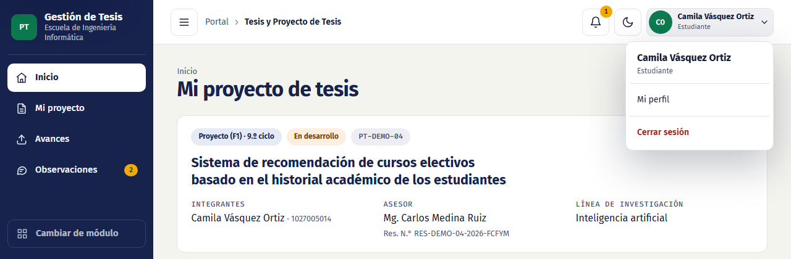

> Los documentos se suben siempre en **PDF de hasta 10 MB**. Solo pueden abrirlos las personas que participan en ese proyecto.

## El camino de una tesis

El proceso tiene dos etapas. Las mismas personas acompañan las dos: el mismo asesor y el mismo jurado.

**Etapa 1 · Proyecto de tesis (F1, 9.º ciclo)**

1. El estudiante registra su proyecto.
2. El Director pide un asesor al Decanato.
3. La Secretaría registra la resolución que nombra al asesor.
4. El estudiante sube avances cada semana y el asesor los revisa.
5. El asesor verifica la versión final con la rúbrica y con el reporte de Turnitin.
6. El Director asigna el jurado: presidente, secretario y vocal.
7. Cada jurado revisa con la rúbrica. Cuando los tres están conformes, se emite el **dictamen** y empieza la etapa 2.

**Etapa 2 · Tesis (F2, 10.º ciclo)**

1. El estudiante sigue subiendo avances. En la semana 8 el jurado hace una revisión intermedia, que solo orienta.
2. El asesor verifica la versión final con la rúbrica y con Turnitin.
3. El jurado hace la revisión final. Con los tres conformes, la tesis queda lista para sustentar.
4. La Secretaría programa la sustentación (fecha, hora y aula).
5. Cada jurado registra su resultado. El sistema prepara el **acta**.
6. La Secretaría sube el acta firmada e informa al Director: la tesis queda **aprobada**.

## Qué significa cada estado

| Estado | Qué significa | Quién debe actuar |
|---|---|---|
| **Registrado** | El proyecto ya está en el sistema. Se está gestionando el asesor. | Director y Secretaría |
| **Con asesor** | Ya tienes asesor oficial. | Estudiante: subir el primer avance |
| **En desarrollo** | Estás trabajando con tu asesor, semana a semana. | Estudiante y asesor |
| **Verificado por el asesor** | El asesor aprobó el proyecto con la rúbrica y Turnitin. | Director: asignar jurado |
| **En revisión del jurado** | Los tres jurados revisan el documento. | Jurado |
| **Proyecto aprobado** | Los tres jurados dieron su conformidad y se emitió el dictamen. | Nadie: pasa sola a la etapa 2 |
| **Tesis en desarrollo** | Etapa 2: trabajas la tesis con tu asesor. | Estudiante y asesor |
| **Listo para sustentar** | El jurado aprobó la tesis. | Secretaría: programar |
| **Sustentación programada** | Ya hay fecha, hora y aula. | Estudiante y jurado |
| **Sustentado** | Aprobaste la sustentación. Falta formalizar el acta. | Secretaría |
| **Sustentación desaprobada** | No se aprobó. Se programa otra fecha, sin límite de intentos. | Secretaría |
| **Tesis aprobada** | Proceso terminado. | — |

---

## Estudiante

Menú: **Inicio**, **Mi proyecto**, **Avances**, **Observaciones**.

### Ver cómo va tu proyecto

En **Inicio** ves:

- el estado actual;
- tu asesor y el número de su resolución;
- los 8 pasos del proceso (Registro, Asesor designado, Avances semanales, Verificación del asesor, Revisión del jurado, Dictamen, Tesis (F2) y Sustentación);
- tus últimas entregas;
- el historial de cambios.

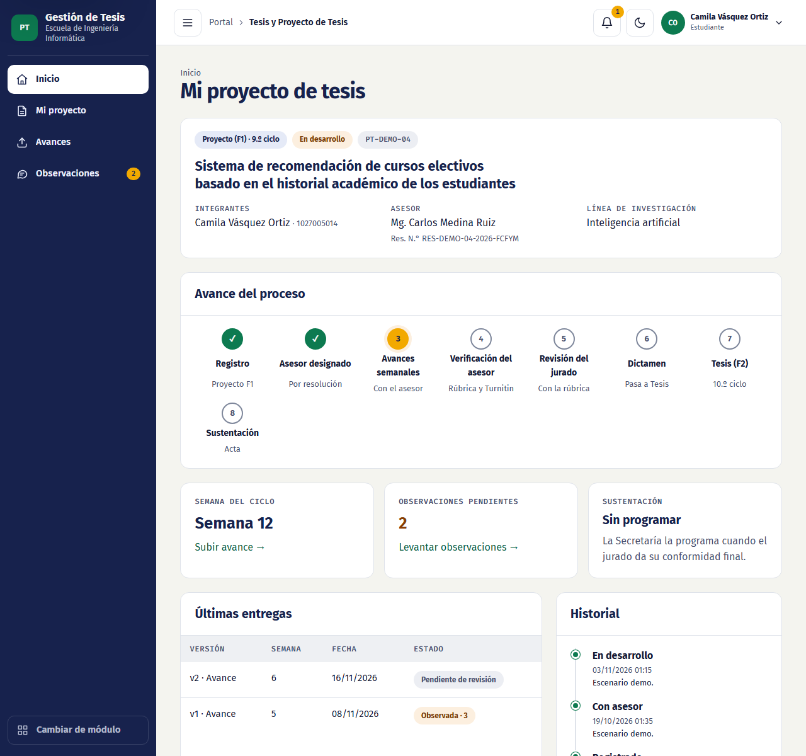

### Registrar tu proyecto (F1)

1. En **Inicio**, pulsa **Registrar proyecto (F1)**.
2. Completa los datos generales:
   - el título, de 20 palabras como máximo (un contador te avisa);
   - el resumen y la línea de investigación;
   - los datos de la investigación.
3. Si trabajas con un compañero, escribe su **código universitario** en «Coautor» y pulsa **Buscar**. Un proyecto puede tener como máximo 2 estudiantes.
   - Si está disponible, aparece un recuadro verde con su nombre y el texto «Se agregará como integrante 2 al registrar el proyecto». **No hay que pulsar otro botón**: quedará incluido cuando pulses **Registrar proyecto** al final.
   - Si te equivocaste de compañero, pulsa **Quitar** en ese recuadro y el campo queda vacío.
4. Llena el cronograma y, si corresponde, los recursos, colaboradores y presupuesto. Usa los botones **+ Agregar** para sumar filas.
5. Adjunta el documento F1 en PDF y pulsa **Registrar proyecto**.

Tu proyecto recibe un código (por ejemplo, `PT-2026-005`) y queda en estado **Registrado**. Tu coautor lo verá en su cuenta.

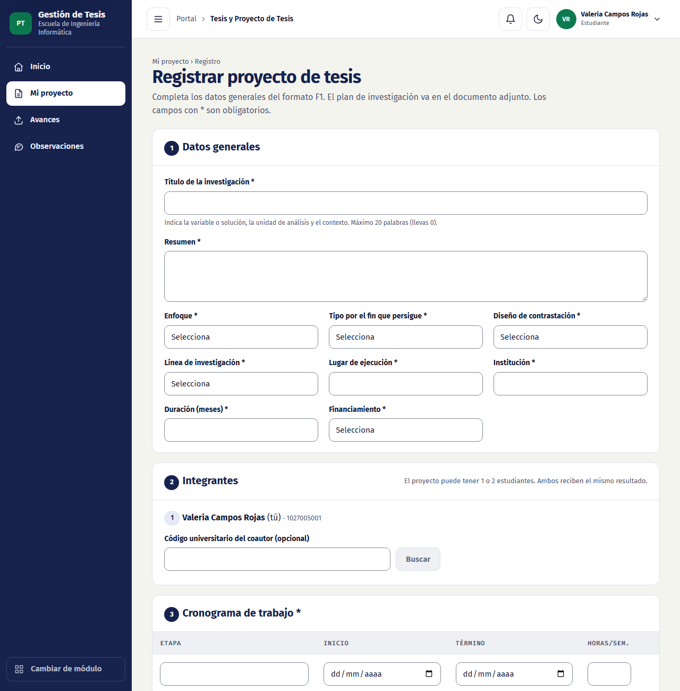

### Subir un avance o la versión final

1. Abre **Avances**.
2. Indica la semana y elige el tipo de entrega:
   - **Avance semanal o corrección**: el asesor lo revisa y te deja observaciones.
   - **Versión final (para verificación con la rúbrica)**: cuando tu asesor te indique que el documento está listo.
3. Adjunta el PDF. Si quieres, escribe un comentario para el revisor.
4. Pulsa **Enviar entrega**.

Cada envío crea una nueva versión (v1, v2, v3…). En «Historial de versiones» puedes ver y descargar todas.

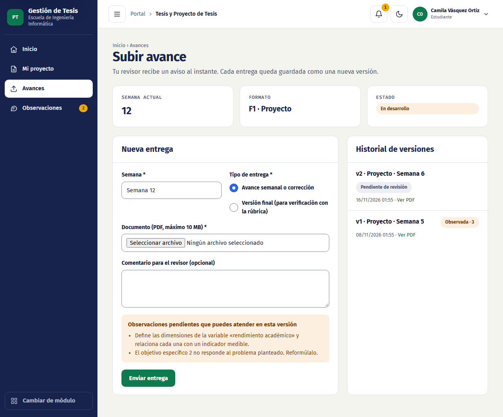

### Levantar observaciones

1. Abre **Observaciones**. Hay tres pestañas: **Pendientes**, **Respondidas** y **Levantadas**.
2. En cada observación pendiente, escribe en «Tu respuesta» qué corregiste.
3. En «Corregida en», elige la versión donde está la corrección. Debe ser una versión que subiste **después** de la observada.
4. Pulsa **Enviar respuesta**. La observación pasa a «Respondidas».
5. El asesor o el jurado revisa tu respuesta y la da por levantada. Mientras no lo haga, puedes cambiar tu respuesta con **Actualizar respuesta**.

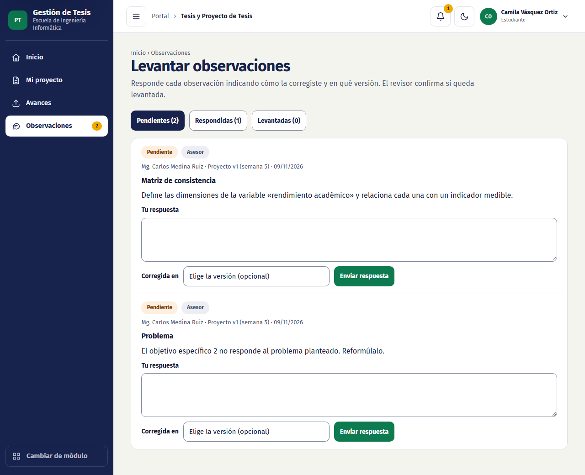

### Después de la revisión del jurado y en la sustentación

- Cuando el jurado aprueba tu proyecto, recibirás un aviso. Tu proyecto pasa a **Tesis en desarrollo** y sigues subiendo avances igual que antes.
- En la semana 8 de la etapa de tesis, el jurado puede dejarte observaciones de **revisión intermedia**. Sirven para orientarte y **no detienen tu avance**.
- Cuando se programe tu sustentación, recibirás un aviso con la fecha, la hora y el aula. La sustentación es **presencial**.

---

## Asesor

Menú: **Mis proyectos**.

### Tu bandeja

En **Mis proyectos** ves los proyectos que asesoras y cifras de lo pendiente. Cada proyecto tiene un botón con la siguiente tarea:

- **Revisar avance**: hay un avance nuevo por revisar.
- **Verificar con rúbrica**: el estudiante subió la versión final.

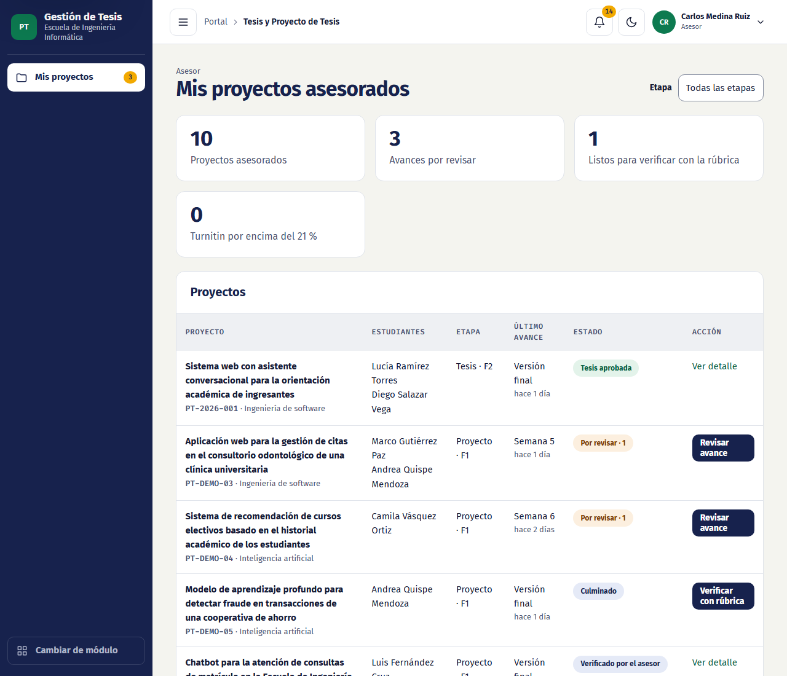

### Revisar un avance

1. Pulsa **Revisar avance**.
2. Con el botón **Ver documento** abres el PDF de esa versión.
3. Si hay algo por corregir, pulsa **+ Agregar observación**, elige la sección del documento y escribe la observación. Puedes agregar varias.
4. Elige el resultado:
   - **Con observaciones**: el avance vuelve a los estudiantes para corregir.
   - **Sin observaciones**: continúan con la siguiente entrega.
   - **Proyecto culminado**: el documento pasa a la verificación con la rúbrica.

   Si escribiste observaciones nuevas, solo puedes elegir «Con observaciones».
5. Si el estudiante respondió observaciones anteriores, puedes marcarlas como **Dar por levantada** en la misma pantalla.
6. Pulsa **Enviar revisión**.

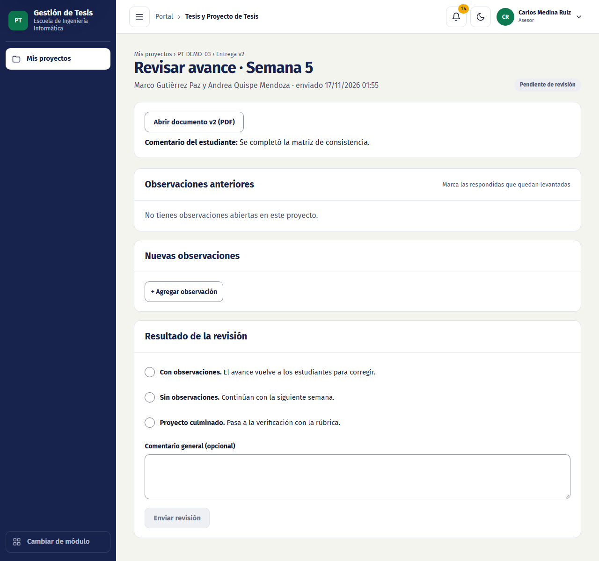

### Dar por levantada una observación

En el detalle del proyecto, sección «Observaciones del proyecto», pulsa **Dar por levantada** en las observaciones que el estudiante ya respondió. Solo puedes levantar las observaciones que tú registraste.

### Verificar con la rúbrica

1. Pulsa **Verificar con rúbrica**. Verás 18 criterios en la etapa de proyecto y 25 en la etapa de tesis.
2. Marca cada criterio:
   - **✓ Cumple**;
   - **✗ No cumple**: escribe la observación;
   - **No aplica**: solo existe en el criterio de la hipótesis.

   **Marcar los pendientes como «cumple»** completa de una vez los criterios que aún no marcaste.
3. La barra inferior te dice si puedes continuar:
   - Con todos en «cumple», pulsa **Dar conformidad**.
   - Si hay alguno en «no cumple», pulsa **Guardar y enviar observaciones**. El estudiante corrige y sube una nueva versión final.

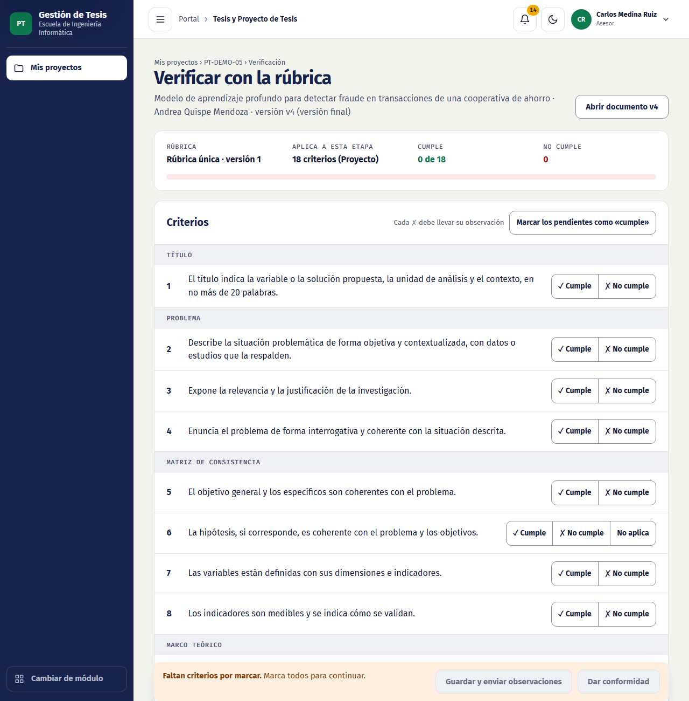

### Turnitin y conformidad

Después de dar la conformidad con la rúbrica:

1. Pulsa **Continuar con Turnitin y conformidad**.
2. Adjunta el reporte de Turnitin en PDF y escribe el porcentaje de similitud.
3. Si es **21 % o menos**:
   - marca la casilla de conformidad;
   - pulsa **Dar conformidad y enviar**;
   - el proyecto pasa al jurado (en la etapa de proyecto, primero al Director para que lo asigne).
4. Si es **más de 21 %**:
   - el botón cambia a **Registrar reporte y devolver a los estudiantes**;
   - el documento vuelve a los estudiantes para corregir.

---

## Director de Escuela

Menú: **Panel general**, **Todos los proyectos**.

### Panel general

Muestra:

- las cifras de investigaciones activas, en proyecto y en tesis;
- la sección **Requieren tu acción**;
- las investigaciones por estado;
- los tiempos promedio de cada etapa;
- las actas recientes.

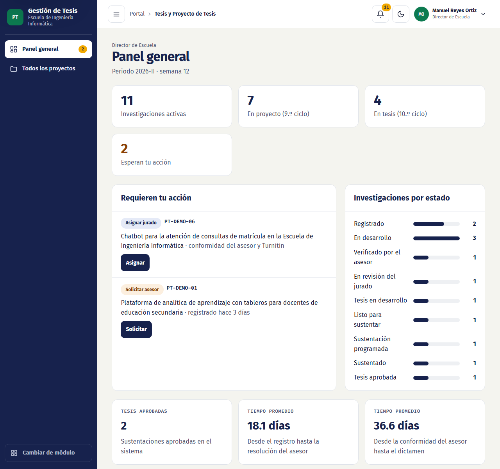

### Solicitar el asesor al Decanato

1. En «Requieren tu acción», pulsa **Solicitar** junto al proyecto nuevo.
2. Revisa los datos de la solicitud (dirigida a, área, asunto, descripción).
3. Si quieres, sugiere un docente especialista en la línea del proyecto. La sugerencia es solo referencial: decide el Decanato.
4. Pulsa **Enviar solicitud al Decanato**. La Secretaría registrará la resolución cuando llegue.

### Asignar el jurado

1. Cuando el asesor da su conformidad, el proyecto aparece en «Requieren tu acción». Pulsa **Asignar**.
2. Elige un docente para cada cargo: **Presidente**, **Secretario** y **Vocal**.
   - El asesor del proyecto no aparece en la lista.
   - Un docente elegido en un cargo no se puede elegir en otro.
3. Pulsa **Asignar jurado y notificar**. Los tres docentes, los estudiantes y el asesor reciben un aviso.

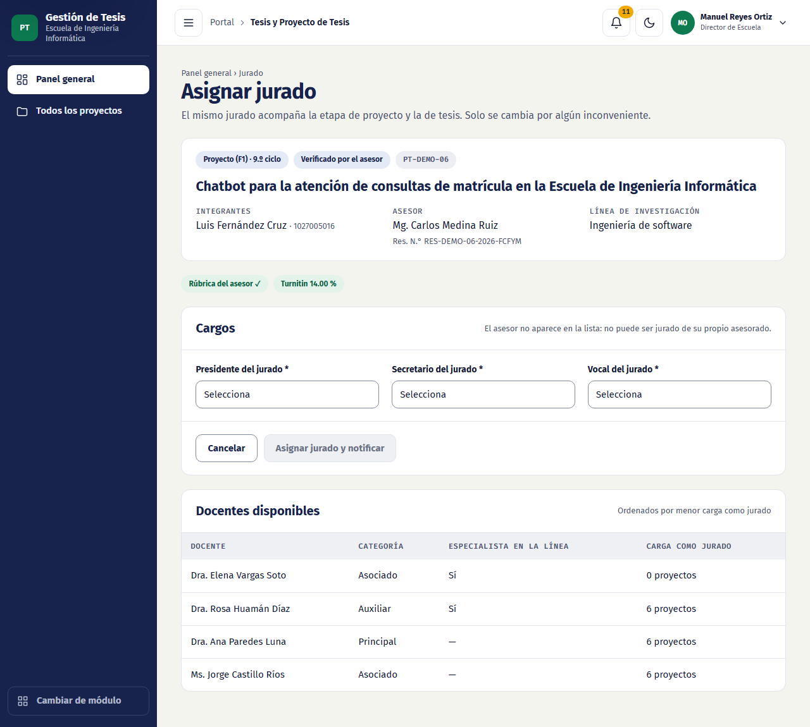

### Reemplazar a un miembro del jurado

En la misma pantalla del jurado, en **Reemplazar a un miembro**:

1. Elige el cargo y el nuevo docente.
2. Escribe el motivo.
3. Pulsa **Reemplazar y notificar**.

No se puede reemplazar cuando la sustentación ya está programada o concluida.

### Todos los proyectos

Lista todos los proyectos con búsqueda y filtro por estado. Según el estado, cada fila ofrece **Solicitar asesor**, **Asignar jurado** o **Ver jurado**.

---

## Secretaría

Menú: **Resoluciones**, **Sustentaciones**, **Actas y dictámenes**.

### Registrar la resolución del asesor

1. Abre **Resoluciones**. En «Solicitudes esperando resolución» elige el proyecto.
2. Completa:
   - el N.° de resolución;
   - la fecha de emisión, que no puede ser futura;
   - el órgano emisor y a quién va dirigida;
   - el **docente designado como asesor**;
   - el asunto.
3. Adjunta la resolución escaneada en PDF y pulsa **Registrar resolución**.

El docente queda como asesor oficial y se avisa al asesor, a los estudiantes y al Director.

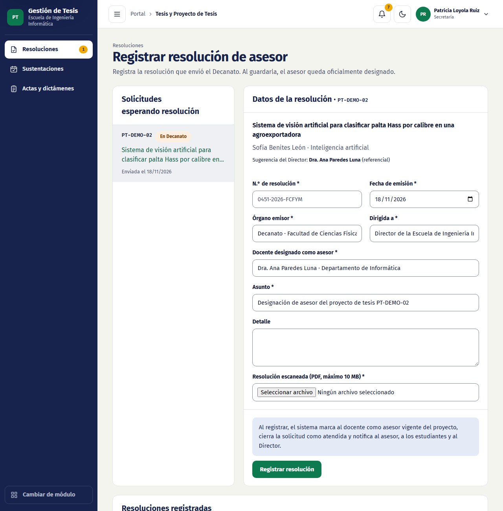

### Programar la sustentación

1. Abre **Sustentaciones**. En «Por programar» aparecen las tesis listas o desaprobadas.
2. Pulsa **Programar** y elige:
   - la fecha, desde hoy;
   - la hora de inicio, entre las 07:00 y las 21:00;
   - el aula.
3. Debajo ves a los participantes (jurado y asesor). A la derecha está la **agenda de la semana**: elige un aula y pulsa **Ver** para revisar sus horarios libres y evitar cruces.
4. Pulsa **Programar y notificar**.

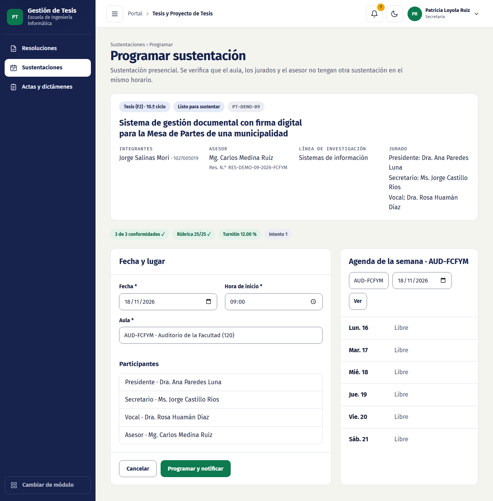

### Actas y dictámenes

Cuando los tres jurados dan su resultado, el sistema prepara el acta. Lo mismo ocurre con el dictamen cuando aprueban el proyecto.

1. Abre **Actas y dictámenes** y pulsa **Abrir**.
2. Pulsa **Imprimir** para llevar el documento a firmar.
3. Escanea el documento firmado, adjúntalo y pulsa **Subir documento firmado**.
4. Pulsa **Informar al Director**. Con un acta aprobada, la tesis pasa a **Tesis aprobada**. Con un acta desaprobada, programa una nueva fecha desde «Sustentaciones».

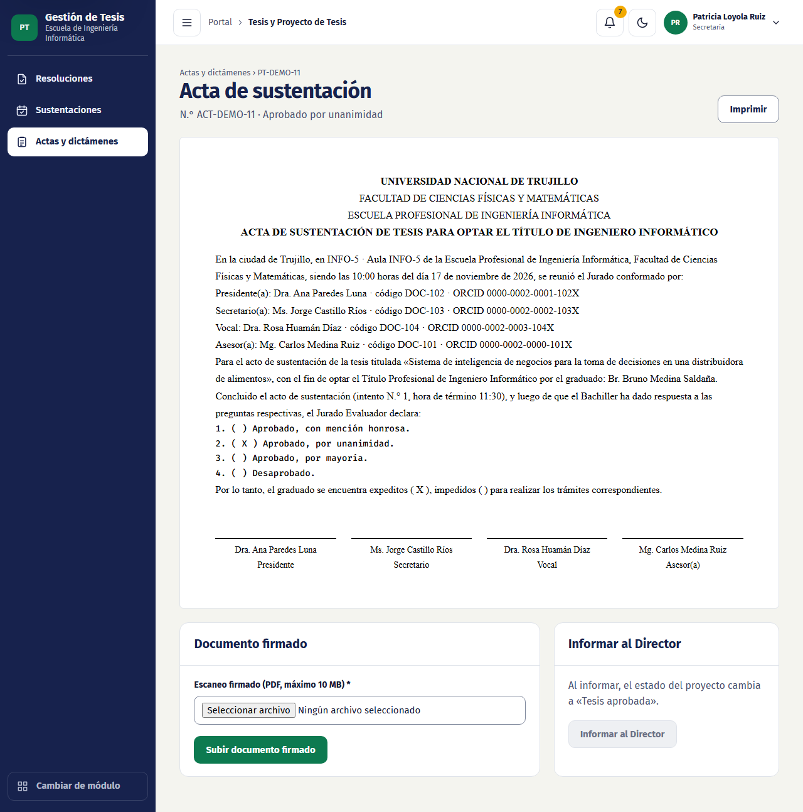

---

## Jurado

Menú: **Proyectos asignados**, **Sustentaciones**.

### Revisar con la rúbrica

1. En **Proyectos asignados** pulsa el botón del proyecto:
   - **Revisar con la rúbrica** en la etapa de proyecto;
   - **Revisión final** en la etapa de tesis.
2. Marca cada criterio como **✓ Cumple** o **✗ No cumple** (con su observación), igual que el asesor.
3. Pulsa **Dar conformidad** si todo cumple, o **Guardar y enviar observaciones** si hay algo por corregir.

Puedes ver si los otros miembros ya revisaron y cuántos criterios marcaron como cumplidos, pero no su detalle. Cuando los tres dan su conformidad, el proyecto avanza solo.

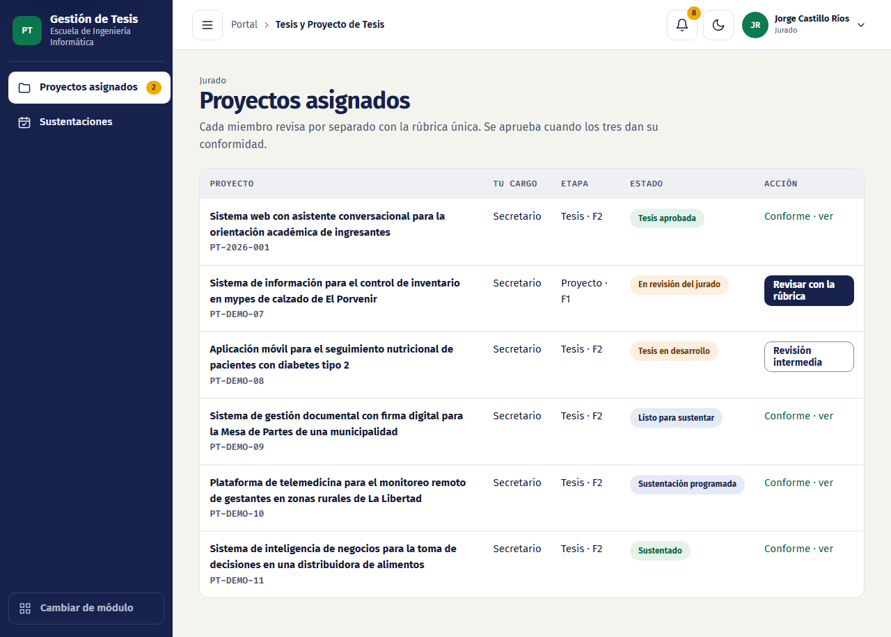

### Revisión intermedia (semana 8 de la tesis)

Desde la semana 8 de la etapa de tesis aparece el botón **Revisión intermedia**. Marca la rúbrica y pulsa **Registrar revisión intermedia**. Esta revisión es **solo orientativa**: no cambia el estado del proyecto. Se hace una vez por jurado.

### Registrar el resultado de la sustentación

1. El día de la sustentación, abre **Sustentaciones** y pulsa **Registrar resultado**.
2. Elige **Aprobatorio** o **Desaprobatorio**. No se pone nota.
3. Si es aprobatorio y lo consideras, marca **Propongo mención honrosa**. La mención solo se otorga si los tres jurados aprueban **y** los tres la proponen.
4. Indica la hora de término y pulsa **Registrar mi resultado**.

El resultado se decide cuando los tres jurados registran el suyo:

| Aprobatorios | Resultado |
|---|---|
| 3 | Aprobado por unanimidad |
| 2 | Aprobado por mayoría |
| 0 o 1 | Desaprobado: se programa una nueva fecha |

Los votos de cada uno se muestran recién cuando están los tres.

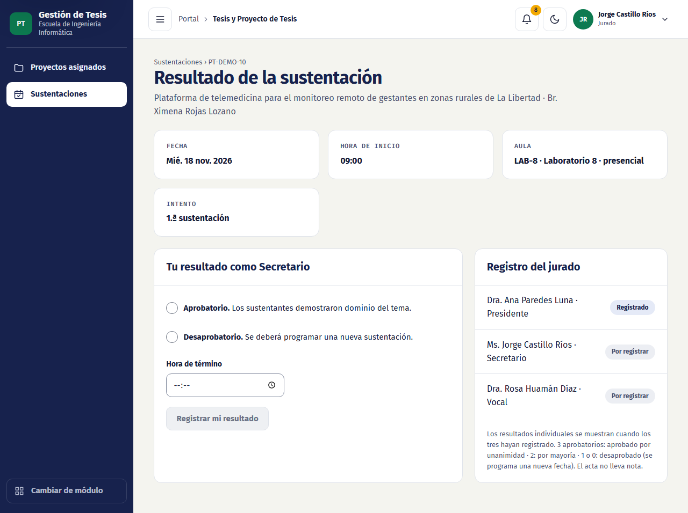

---

## Mensajes frecuentes y qué hacer

### Para todos

| Mensaje o situación | Qué significa | Qué hacer |
|---|---|---|
| «Tu cuenta del portal no está vinculada a un usuario académico…» | Tu cuenta no está asociada a tus datos de estudiante o docente. | Comunícate con la Secretaría de la Escuela. |
| Página de error **403** (acceso no permitido) | Intentaste abrir algo que no te corresponde, como un proyecto ajeno. | Vuelve con el menú. Si crees que es un error, avisa a la Secretaría. |
| Página de error **404** (no encontrado) | El enlace no existe o se escribió mal. Al descargar un documento, puede que el archivo ya no esté disponible. | Entra desde el menú o desde la campana. Si un documento no abre, avisa a la Secretaría. |
| El archivo no se acepta | Solo se aceptan PDF de hasta 10 MB. | Convierte el documento a PDF o redúcelo. |

### Estudiante

| Mensaje | Qué hacer |
|---|---|
| «No existe un estudiante activo con ese código.» | Revisa el código universitario de tu coautor. |
| «No puedes agregarte a ti mismo como coautor.» | Deja el campo vacío si trabajas solo. |
| Junto al nombre de tu coautor aparece un aviso en rojo | Ya tiene otro proyecto activo. Un estudiante solo puede tener uno. |
| «En el estado actual del proyecto (…) no se reciben entregas.» | Espera a que tu asesor sea designado o a que termine la etapa en curso. |
| «Elige una entrega de tu proyecto posterior a la observada.» | Sube primero la versión corregida y luego responde la observación. |
| «Esta observación ya fue levantada por el revisor.» | No necesitas hacer nada más con ella. |

### Asesor y jurado

| Mensaje | Qué hacer |
|---|---|
| «El criterio N está en «no cumple»: registra su observación.» | Escribe la observación de ese criterio. |
| «Solo puedes dar conformidad con todos los criterios en «cumple».» | Usa **Guardar y enviar observaciones**. |
| «Ya registraste tu verificación de la versión vN…» | Espera la nueva versión del estudiante. |
| «Aún no hay una versión final o culminada para verificar.» | El estudiante debe subir su versión final. |
| «Primero verifica la versión vigente con la rúbrica y da tu conformidad.» | Completa la rúbrica antes de registrar Turnitin. |
| «Aún hay observaciones tuyas sin levantar.» | Levanta las observaciones que el estudiante ya respondió. |
| «Si registras observaciones, el resultado debe ser «Con observaciones».» | Cambia el resultado o quita las observaciones nuevas. |
| «Solo se levantan observaciones que el estudiante ya respondió.» | Espera la respuesta del estudiante. |
| «El resultado se registra el día de la sustentación.» | Vuelve el día programado. |
| «Ya registraste tu resultado.» | No puedes cambiarlo; si hubo un error, comunícalo a la Secretaría. |

### Director

| Mensaje | Qué hacer |
|---|---|
| «Ya existe una solicitud pendiente al Decanato para este proyecto.» | Espera a que la Secretaría registre la resolución. |
| «El docente sugerido debe ser especialista activo en la línea del proyecto.» | Elige otro docente o «Sin sugerencia». |
| «El proyecto aún no tiene la conformidad del asesor…» | Espera la conformidad y el reporte de Turnitin del asesor. |
| «Ese docente ya integra (o integró) este jurado.» | Elige otro docente para el reemplazo. |
| «No se puede cambiar el jurado con la sustentación programada o concluida.» | El jurado ya no se puede cambiar. |

### Secretaría

| Mensaje | Qué hacer |
|---|---|
| «Ya existe una resolución con ese número.» | Revisa el número de la resolución. |
| «La fecha no puede ser anterior a hoy.» | Elige hoy o una fecha posterior. |
| «El ambiente ya tiene una sustentación en ese horario.» | Cambia el aula o la hora. Revisa la agenda de la semana. |
| Un mensaje dice que un jurado o el asesor tiene otra sustentación a esa hora | Elige otra hora. |
| «Primero sube el documento firmado.» | Sube el escaneo firmado antes de informar al Director. |

---

## Glosario

| Término | Significado |
|---|---|
| **F1** | Formato del proyecto de tesis que el estudiante registra en el 9.º ciclo (etapa 1). |
| **F2** | Documento de la tesis que se desarrolla en el 10.º ciclo (etapa 2). |
| **Avance** | Entrega parcial del documento que el asesor revisa, normalmente cada semana. |
| **Observación** | Indicación de algo que se debe corregir. Pasa por tres momentos: pendiente, respondida y levantada. |
| **Rúbrica** | Lista única de criterios para revisar el documento. Cada criterio se marca como «cumple» o «no cumple». |
| **Conformidad** | Aprobación del asesor o de un jurado: todos los criterios cumplen. |
| **Turnitin** | Herramienta que mide el porcentaje de similitud del documento con otras fuentes. El máximo permitido es 21 %. |
| **Jurado** | Tres docentes (presidente, secretario y vocal) que revisan el proyecto y la tesis y evalúan la sustentación. |
| **Dictamen** | Documento que aprueba el proyecto cuando los tres jurados dan su conformidad. Con él empieza la etapa de tesis. |
| **Sustentación** | Presentación presencial de la tesis ante el jurado. |
| **Acta** | Documento oficial con el resultado de la sustentación (sin nota), firmado por el jurado. |
| **Mención honrosa** | Reconocimiento especial que solo se otorga si la sustentación es aprobada por unanimidad y los tres jurados lo proponen. |
