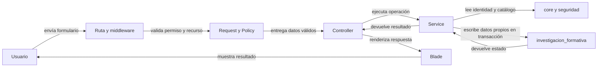

# Arquitectura de Investigación Formativa

## Alcance y estado

El módulo usa el monolito Laravel y PostgreSQL del portal. No inicia servicios separados. La configuración, los grupos, los títulos, las evaluaciones, las encuestas, los reportes y los indicadores 3.1, 3.2 y 3.3 tienen implementación y pruebas funcionales. La carga y descarga de archivos sigue pendiente de G4, el contrato del escritor compartido de archivos.

Las asignaciones de identidad, padrón, competencias y alcance de dirección tienen contratos locales explícitos. Falta confirmar su integración con los responsables de los datos compartidos. No se deducen de correos ni se sustituyen por contenido académico inventado.

## Directorios y responsabilidades

Las rutas de esta tabla son relativas a `app/Modules/InvestigacionFormativa/`, salvo las indicadas con prefijo completo.

| Directorio o archivo | Responsabilidad |
|---|---|
| `Controllers/` | Respuestas HTML, redirecciones, filtros y conflictos. |
| `Requests/` | Autorización inicial y validación del formulario. |
| `Services/IdentidadInvestigacionService.php` | Vinculación entre `users` y la cuenta académica activa. |
| `Services/AccesoInvestigacionService.php` | Alcance por escuela, sección, padrón, grupo y coordinación. |
| `Services/DatosAcademicosService.php` | Consultas de datos compartidos y etiquetas académicas. |
| `Services/ConfiguracionService.php` | Habilitación, competencias, rúbrica, fechas y congelación. |
| `Services/GrupoService.php` | Grupo atómico, membresía fija, título y revisiones. |
| `Services/EvaluacionService.php` | Evaluación por entrega, corrección y observaciones históricas. |
| `Services/EncuestaService.php` | Borrador, publicación, cierre y respuestas individuales. |
| `Services/DecisionTrabajoService.php` | Aprobación final, selección manual del trabajo destacado, historial y evidencia versionada. |
| `Services/ReporteService.php` | Resultados por sección, promedio, empates, historial real e integración de indicadores. |
| `Services/IndicadorService.php` | Cálculo trazable de los indicadores 3.1 y 3.2 con reglas y denominadores explícitos. |
| `Services/LogroCompetenciasService.php` | Cálculo trazable del indicador 3.3 desde mapeos de criterios, pesos y bandas configurables. |
| `Services/ReportePdfService.php` | Genera el PDF del reporte de sección desde datos ya calculados; no crea registros de archivo. |
| `Services/CalificacionService.php` | Normalización y promedios con centésimas enteras. |
| `Models/`, `Policies/` | Tablas del módulo y autorización de sus recursos. |
| `Commands/`, `Support/CsvImportReader.php` | Cuatro importaciones atómicas con validación previa. |
| `Support/ArchivoGateway.php` | Interfaz del archivo compartido. No es un escritor aprobado. |
| `Support/UnavailableArchivoGateway.php` | Rechazo explícito de crear o buscar archivos mientras falte G4. |
| `Database/Migrations/` | Definiciones y cambios aditivos del esquema. |
| `Database/Seeders/` | Permisos aditivos y datos aislados de demostración. |
| `Routes/web.php`, `Routes/api.php` | Rutas propias del módulo. |
| `Providers/InvestigacionFormativaServiceProvider.php` | Políticas, comandos y enlace del gateway cerrado. |
| `resources/views/modules/investigacion-formativa/` | Pantallas Blade por actor y elementos comunes. |
| `tests/Feature/InvestigacionFormativa/` | Pruebas PostgreSQL de comportamiento y demostración. |
| `tests/Browser/investigacion_formativa.py` | Recorrido Firefox mediante WebDriver y formularios reales. |

El proveedor está registrado en `bootstrap/providers.php`. El módulo no importa controladores o modelos de otro módulo. Los modelos de catálogos comunes se encuentran en `App\Shared\Models\Core`.



La lectura sigue las flechas desde el formulario hasta los datos y vuelve a la pantalla.

## Esquema y propiedad de datos

El esquema `investigacion_formativa` tiene 27 tablas. Las claves académicas referencian `core`; los usuarios académicos y módulos referencian `seguridad`. `public.users` es la identidad de inicio de sesión. El catálogo compartido de archivos pertenece a `comun`.

| Grupo | Tablas |
|---|---|
| Identidad y configuración | `identidad_usuario`, `director_escuela`, `secretaria_escuela`, `seccion_configuracion`, `participante_seccion`, `competencia_seccion` |
| Proyecto | `tipo_producto`, `grupo`, `grupo_estudiante`, `proyecto`, `revision_titulo` |
| Evaluación | `rubrica`, `criterio`, `criterio_nivel`, `entregable`, `entrega`, `evaluacion`, `evaluacion_criterio`, `observacion` |
| Encuesta | `encuesta`, `encuesta_pregunta`, `encuesta_respuesta`, `encuesta_respuesta_item` |
| Decisiones | `decision_trabajo` |
| Indicadores | `indicador_experiencia`, `configuracion_indicador`, `indicador_competencia_criterio` |

La base impide múltiples grupos del mismo estudiante en una sección y múltiples coordinadores por grupo. La creación del servicio incluye al coordinador como integrante. Las encuestas tienen unicidad por sección y por estudiante; las claves compuestas de los ítems impiden mezclar preguntas y respuestas de encuestas distintas. `decision_trabajo` es un registro append-only: cada fila guarda tipo, acción, actor, fecha, versión y la instantánea de las tres unidades.

Los cambios no alteran las notas oficiales de matrícula. La migración base del módulo y 22 migraciones posteriores describen el estado actual. Las migraciones posteriores se agregan sin reescribir el historial de otros módulos.

## Contratos de integración

| Contrato | Implementación local | Límite pendiente |
|---|---|---|
| G1: identidad | `identidad_usuario` vincula un `user_id` con `id_usuario_seguridad`. Se comprueban ambos estados activos. | Confirmación del origen y mantenimiento de la vinculación. |
| G2: padrón | `participante_seccion` guarda estudiante, sección, estado, fuente y referencia. La importación no borra filas. | Entrega autorizada desde matrícula. |
| G3: competencias | Instantánea por sección con código, texto, fuente y selección. | Fuente oficial y actualización coordinada del contenido. |
| G4: archivo | `ArchivoGateway` y su implementación que rechaza la operación. | Escritor/modelo compartido, misma conexión y ciclo del archivo privado. |
| G5: alcance | Director por escuela y docente responsable en `core.seccion`. | Confirmación de responsables de las asignaciones. |

Los comandos `investigacion:importar-identidades`, `investigacion:importar-directores`, `investigacion:importar-participantes` e `investigacion:importar-competencias` aceptan `CSV --dry-run` o `CSV --apply`. Valide antes de aplicar. Las importaciones no sustituyen la gestión de roles Spatie.

## Transacciones y concurrencia

La configuración de sección es el primer punto de serialización de las escrituras del dominio. Los servicios vuelven a comprobar el estado después del bloqueo.

| Operación | Orden y garantía |
|---|---|
| Configuración | Configuración de sección; comparación de versión; cambio y nuevo sello dentro de una transacción. |
| Crear grupo | Configuración; nueva comprobación del padrón; grupo, integrantes y proyecto atómicos; restricciones únicas como respaldo. |
| Editar o revisar título | Configuración; proyecto bloqueado; versión esperada; cambio e historial atómicos. |
| Evaluar | Configuración; proyecto; entrega; evaluación. Se reemplazan los criterios actuales y se conservan observaciones anteriores. |
| Encuesta | Configuración; encuesta. Publicación, cierre y respuesta usan el mismo orden. Cabecera e ítems de respuesta se guardan juntos. |
| Decidir aprobación o selección | Configuración; nueva comprobación del docente; versión esperada; evidencia vigente; inserción append-only. La sección se bloquea antes de comparar la versión. |
| Importar padrón | Bloqueo de configuración por sección antes de aplicar sus estados. No elimina integrantes históricos. |

Los conflictos de edición devuelven 409 en los flujos que tienen recuperación de formulario. Recargar permite comparar el estado vigente; no se considera correcto sobrescribirlo silenciosamente. La prueba de concurrencia usa procesos y conexiones PostgreSQL separados, con barreras de bloqueo.

## Cálculo de notas y encuestas

Sea `P` la suma de puntos seleccionados y `M` la suma de máximos de la rúbrica. La nota de unidad es `redondear(20 × P / M, 2)`. Cada puntaje se convierte a centésimas antes de operar. Se usa redondeo medio hacia arriba.

Ejemplo independiente: máximos `4 + 4 + 2 = 10`; seleccionados `3 + 2 + 1 = 6`; nota `20 × 6 / 10 = 12.00`. Si las tres unidades vigentes tienen notas `12.00`, `16.00` y `14.00`, la nota final es `(12.00 + 16.00 + 14.00) / 3 = 14.00`.

La versión más alta de cada entrega determina el avance vigente. Si esa versión no tiene evaluación, la unidad está pendiente. Una evaluación antigua permanece en el historial, pero no sustituye a la vigente.

Solo los proyectos con tres unidades evaluadas tienen nota final. La clasificación incluye todos los empates y los ordena por ID de grupo. El promedio del curso excluye proyectos incompletos e indica el denominador. Con un solo proyecto elegible, mejor y peor coinciden y la pantalla lo explica.

La aprobación final y el trabajo destacado no se calculan a partir de la nota. `DecisionTrabajoService` exige una decisión explícita del docente responsable. Cada decisión guarda una huella canónica de `id_entrega`, `version_entrega`, `id_evaluacion` y `version_evaluacion` de las tres unidades. Si la evidencia actual difiere, la decisión se marca como desactualizada hasta que el docente la confirme. La selección del trabajo destacado es única por sección y conserva el historial de reemplazos y retiros.

Las respuestas de encuesta se cuentan por cabecera. El promedio de una pregunta usa sus ítems reales; no usa el total del padrón. La distribución cuenta valores de 1 a 5. La participación es `100 × respuestas / participantes_activos_actuales`; puede superar el 100% tras retiros. Si el denominador es cero, no hay tasa calculable.

Los reportes limitan las secciones al alcance antes de leer sus datos. El resumen lee los conjuntos por lote; no consulta cada tabla dentro del bucle de secciones. Los comentarios se paginan y se renderizan escapados, sin identidad del estudiante.

El tablero de dirección acepta `escuela`, `periodo`, `curso` y `linea`. El filtro de línea incluye las secciones con al menos un proyecto de esa línea. Dentro de esas secciones, los grupos, las decisiones y los conteos por umbral se restringen a la línea. La encuesta es un dato por sección: no se desagrega por línea y sus totales cubren las secciones incluidas completas. Un `curso` o una `linea` fuera del alcance devuelve 403.

Los umbrales de nota final son estrictos y superpuestos: `> 16` incluye a `> 18`. La base de ambos es el número de proyectos con las tres unidades evaluadas. El tablero presenta barras HTML/CSS con etiquetas numéricas y una tabla equivalente. Los conteos de proyectos, notas y decisiones son estadística descriptiva. No se confunden con los indicadores 3.1, 3.2 y 3.3, que se calculan por separado y muestran regla, denominador y fuente. Si una base es cero, no se calcula un porcentaje.

El filtro de línea no reduce el denominador del indicador 3.1 porque una experiencia curricular no tiene línea. El indicador 3.2 sí usa las secciones visibles por el filtro para respetar que la encuesta no se desagrega por línea. El indicador 3.3 restringe la evidencia y los estudiantes esperados a los proyectos de la línea seleccionada. El resumen agregado 3.1 pertenece al tablero con alcance; el reporte de una sección no lo duplica.

## Indicadores de Calidad

Los indicadores 3.1, 3.2 y 3.3 tienen una implementación local con entradas reemplazables. Las filas del seedor son datos de demostración: la fuente académica y la definición institucional deben sustituirlas. El 3.3 usa una regla provisional porque todavía no existe una matriz, una escala ni una meta institucional confirmadas. Ninguna nota final, título aceptado o aprobación de trabajo se usa como sustituto del logro de competencias.

### Indicador 3.1 — Experiencias curriculares con investigación formativa

**Definición:** Porcentaje de experiencias curriculares que aplican la investigación formativa como estrategia de enseñanza-aprendizaje, sobre el total de experiencias curriculares implementadas.

**Fórmula:** `(N° de experiencias curriculares que aplican la investigación formativa / N° total de experiencias curriculares implementadas) × 100`

**Unidad de conteo:** Un curso del plan implementado en un periodo académico. Varias secciones del mismo curso y periodo cuentan como una sola experiencia.

**Entradas:** `indicador_experiencia` declara, por periodo y curso del plan, si la experiencia aplica Investigación Formativa y conserva su fuente. El denominador incluye todas las experiencias implementadas del alcance, incluidas las que no aplican el módulo. La habilitación o configuración de una sección no sustituye esta entrada. Las experiencias sin clasificación se muestran aparte. Si no hay experiencias, el valor queda sin calcular.

**Alcance:** Escuela, periodo y curso seleccionados en el tablero de dirección. El filtro de línea no reduce el denominador.

### Indicador 3.2 — Satisfacción estudiantil con estrategias de investigación formativa

**Definición:** Porcentaje de estudiantes satisfechos y muy satisfechos con las estrategias de enseñanza-aprendizaje basadas en investigación formativa, por experiencia curricular.

**Fórmula:** `(N° de estudiantes clasificados como satisfechos / N° de estudiantes distintos que respondieron la pregunta de satisfacción) × 100`

**Entradas:** `configuracion_indicador` declara una pregunta exacta de satisfacción y sus categorías. Cada valor pertenece a una sola categoría. En la demostración, `4 = Satisfecho` y `5 = Muy satisfecho`; las demás categorías no son satisfactorias. Esta clasificación es provisional y debe reemplazarse por la definición institucional. El módulo no usa promedios de preguntas arbitrarias.

**Conteo de personas:** Se cuentan estudiantes distintos. Si una persona respondió en más de una sección de la misma experiencia, se usa su respuesta más reciente. Los ítems de la encuesta no son el denominador. En el agregado del tablero, una persona cuenta una vez por cada experiencia en la que respondió.

**Alcance:** Se muestra por sección y se suma por experiencia en el tablero. La encuesta es por sección y no se desagrega por línea.

### Indicador 3.3 — Nivel de logro de competencias del perfil de egreso relacionadas con investigación

**Definición:** Informe de los docentes responsables de experiencias curriculares con responsabilidad directa en el desarrollo de capacidades/competencias relacionadas con la investigación.

**Entradas:** `indicador_competencia_criterio` declara de forma explícita qué criterio evidencia cada competencia y conserva su peso y fuente. `configuracion_indicador` declara las bandas de logro y la cobertura mínima. Los pesos son relativos y se normalizan entre los criterios disponibles. Las bandas no se superponen y deben cubrir el intervalo de 0 a 100.

**Unidad y evidencia:** La unidad es el estudiante dentro de una competencia de la sección. El servicio normaliza el puntaje de cada criterio con su máximo de rúbrica y usa solo evaluaciones vigentes de la versión actual de cada entrega. Un estudiante entra al denominador cuando la cobertura de sus criterios alcanza el mínimo configurado. El porcentaje cuenta los estudiantes que caen en una banda marcada como alcanzada.

**Estado:** Implementación local provisional. La matriz oficial, los pesos, las bandas, la unidad de agregación, la regla de cobertura y la meta no están aprobados. La nota final del módulo, la aceptación del título y la aprobación docente no participan del cálculo ni sustituyen el logro de competencia.

## Exportación a PDF de resultados

El director puede descargar el reporte de una sección como PDF desde «Ver resultados». El servicio `Services/ReportePdfService.php` genera el documento con dompdf a partir de los datos ya calculados por `ReporteService`.

- Fuente DejaVu Sans; recursos remotos y JavaScript deshabilitados; carpeta temporal `storage/app/dompdf`.
- Incluye título, curso, sección, periodo, escuela, filtros activos, hora de generación, tablas de calificaciones, distribuciones de encuesta, los indicadores 3.2 y 3.3 de la sección y notas de lectura.
- Explica que el indicador agregado 3.1 se calcula en el tablero de dirección con alcance. No lo duplica en el PDF de una sección.
- Excluye los comentarios confidenciales de la encuesta. Estos se conservan en la pantalla de resultados con su paginación propia.
- La generación no crea registros en `comun.archivo`, no usa `ArchivoGateway` y no modifica datos.
- El PDF se envía como adjunto con `Cache-Control: no-store, private`.

## Archivos: estado actual y trabajo pendiente

El proveedor enlaza `ArchivoGateway` con `UnavailableArchivoGateway`. Sus métodos `crear` y `buscar` lanzan `ArchivoNoDisponible`. No existen rutas de carga o descarga funcionales. Tampoco existe aún el comando propuesto `investigacion:auditar-archivos`.

El ciclo pendiente debe cubrir almacenamiento privado, metadatos compartidos en la misma conexión, limpieza de temporales al fallar y descargas autorizadas por entrega. Todavía no se declara verificado ese ciclo. No se instala un adaptador de producción ni se escriben metadatos compartidos para aparentar integración.

Las pruebas de lectura pueden insertar entregas y metadatos de prueba dentro de una base exclusiva. El seeder de demostración crea fixtures de entrega y archivo sin binario: tamaño cero, hash nulo y ruta de prueba. No agrega un escritor de producción ni demuestra una carga real. El PDF de muestra tiene 601 bytes y SHA-256 `477ac889a46353abee504e726e420b78d0241f7ff244448376c8160d0644fd0a`; queda disponible para la futura integración.

## Entorno, compilación y pruebas

El README raíz y el Dockerfile definen el entorno del portal. Use una base de prueba nueva con `DB_CONNECTION=pgsql`, `DB_URL` vacío y las variables de conexión correctas. El `phpunit.xml` usa SQLite si no se sustituyen; una ejecución que omite PostgreSQL no valida este módulo.

```bash
php artisan module:migrate all --force
php artisan test tests/Feature/InvestigacionFormativa
php artisan test tests/Unit/InvestigacionFormativa
php artisan test --compact
npm run build
php artisan view:cache
php artisan route:cache
php artisan route:list --path=investigacion-formativa
php artisan route:clear
php artisan view:clear
git diff --check
```

En bases exclusivas con `_test_demo_` también se ejecutan las pruebas del seeder. La prueba de concurrencia necesita otra base nueva con `_test_concurrency_`, todas las migraciones y `RUN_CONCURRENCY_TESTS=1`. No la ejecute sobre datos que quiera conservar. Consulte [manual-flujos.md](manual-flujos.md) para generar datos y ejecutar Firefox.

El Dockerfile crea dependencias sin paquetes de desarrollo, compila Vite y sirve `public` con PHP/Apache. El contenedor de ejecución no es el entorno de PHPUnit. Se intentó construir la imagen con Podman temporal y sin privilegios. El motor pudo iniciar, pero la construcción se bloqueó antes de ejecutar el Dockerfile porque falta el archivo de configuración del host `policy.json`. No se cambió la configuración del sistema. La imagen de producción sigue sin verificar. Las verificaciones locales no sustituyen esa comprobación de despliegue.

## Reglas implementadas y límites de aceptación

Los formularios de configuración, rúbrica, cronograma, grupos, evaluación, encuesta y resultados corresponden a las interfaces requeridas. Las restricciones de membresía fija, versiones, congelación, promedio sin ponderación y publicación sin reapertura son decisiones locales propuestas. Falta su validación académica; no se describen como una norma institucional. El tablero conserva los conteos descriptivos y separa los indicadores 3.1 y 3.2, con fuentes y denominadores visibles. Las entradas de demostración y la configuración provisional de satisfacción no se presentan como valores institucionales ni como metas.

La demostración prueba los flujos disponibles con PostgreSQL y Firefox. La aceptación completa sigue pendiente de G4, su recorrido de archivos y evaluación, la confirmación de contratos compartidos y la revisión de seguridad dedicada que fue diferida. No se ocultan estos límites mediante archivos o notas de ejemplo en la aplicación.
