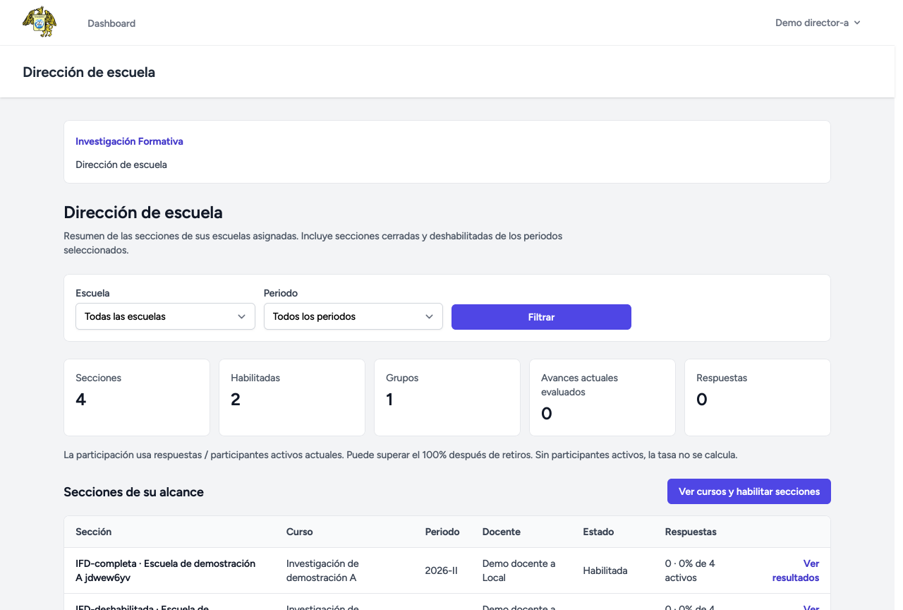
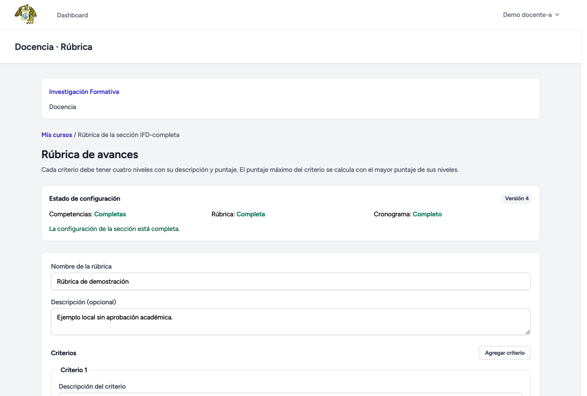
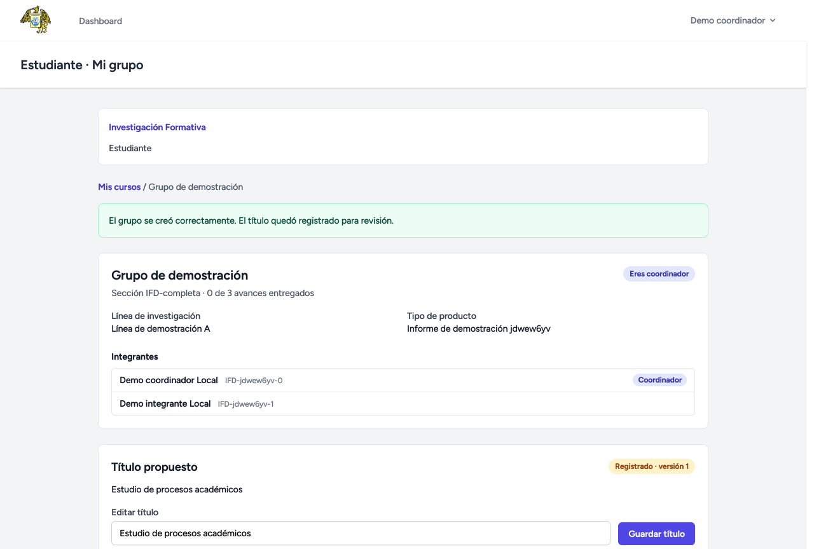
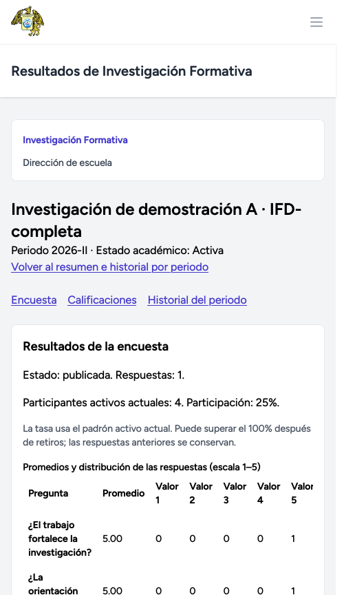

# Manual de usuario de Investigación Formativa

## Acceso y estado del módulo

Ingrese con el correo y la contraseña asignados. Abra Investigación Formativa en el portal. Si tiene varios roles, elija «Docencia», «Estudiante» o «Dirección de escuela». Elegir un espacio no cambia sus permisos.

El módulo permite configurar secciones, formar grupos, revisar títulos, evaluar entregas existentes, aplicar encuestas y consultar resultados. La carga y descarga de archivos permanece pendiente del contrato compartido. No hay una acción de entrega funcional en esta versión.

Si no puede entrar, solicite que revisen su cuenta, su vinculación académica y el rol asignado. No comparta su contraseña. Los datos de demostración son ejemplos locales, no datos académicos oficiales.

## Dirección de escuela

1. Abra el resumen de dirección. Verá las escuelas asignadas a su cuenta.
2. Seleccione escuela, periodo, curso o línea de investigación y aplique el filtro. La lista incluye secciones históricas.
3. Abra «Ver cursos y habilitar secciones» para permitir el trabajo en una sección.
4. Revise el curso, periodo, sección y docente antes de cambiar su estado.
5. Abra la encuesta de la sección para preparar las preguntas.
6. Agregue o quite preguntas. Guarde el borrador antes de publicar.
7. Revise el texto completo. Publicar impide editar las preguntas.
8. Cierre la encuesta al terminar. No se puede reabrir.
9. Abra «Ver resultados» para consultar respuestas, comentarios y calificaciones.

«Habilitada» permite las operaciones del módulo si también se cumplen sus requisitos. «Deshabilitada» detiene las escrituras y conserva los datos. El estado académico de una sección es un dato distinto. Las secciones cerradas siguen disponibles en resultados e historial.

El resumen muestra conteos descriptivos: proyectos por línea, proyectos completos por umbral y decisiones docentes. «> 16» y «> 18» se superponen: un proyecto con nota mayor a 18 también cuenta en mayor a 16. Las barras y tablas describen los datos registrados; no son indicadores oficiales ni metas. Si no hay datos, la pantalla muestra un estado vacío y no inventa ceros ni promedios.

El filtro de línea restringe los grupos, las notas y las decisiones a esa línea. La encuesta se prepara por sección y no se desagrega por línea; los totales de encuesta cubren las secciones incluidas completas.

Los comentarios se muestran sin nombres de estudiantes. Son confidenciales, no anónimos: el sistema conserva la identidad de quien responde para evitar envíos duplicados.

La participación compara respuestas conservadas con estudiantes activos actuales. Si hubo retiros, puede superar el 100%. Si no hay participantes activos, aparece que la tasa no se puede calcular.

## Docente responsable

1. Abra «Mis cursos». Solo verá las secciones que le corresponden.
2. Abra «Competencias». Marque las que se usarán y guarde.
3. Si no aparece contenido, solicite la importación correspondiente; esta pantalla no crea competencias oficiales.
4. Abra «Rúbrica». Escriba el nombre y los criterios.
5. Para cada criterio, complete las descripciones y los puntajes de sus cuatro niveles.
6. Los puntajes no deben disminuir al subir de nivel. El nivel mayor debe tener un puntaje positivo.
7. Guarde y abra «Cronograma». Ingrese las fechas de las unidades 1, 2 y 3.
8. Use hora de Lima y fechas crecientes. Guarde y revise el estado de configuración.
9. Abra «Grupos» para revisar los títulos.
10. Seleccione «Aceptado» o «Cambio solicitado». Si solicita un cambio, explique el motivo y pulse «Registrar revisión».

Cuando una sección tiene entregas, sus competencias y rúbrica quedan fijas. Solo se pueden extender los plazos manteniendo su orden. Deshabilitar la sección también impide guardar cambios.

### Evaluar una entrega existente

La creación de entregas desde la pantalla de estudiante sigue pendiente. Cuando exista una entrega válida, su ficha de grupo permite consultar versiones y evaluar una de ellas.

1. Revise la versión de entrega seleccionada.
2. Marque un nivel para cada criterio.
3. Agregue observaciones o indique que no hay observaciones.
4. Guarde. El sistema calcula la nota a partir de la rúbrica.
5. Si corrige la evaluación, vuelva a revisar todos los criterios antes de guardar.

Las observaciones anteriores permanecen en el historial. Una nueva versión de entrega sin evaluar aparece pendiente; no hereda la nota anterior.

### Aprobar el trabajo y elegir el trabajo destacado

La ficha del grupo tiene un panel separado para las decisiones finales del docente.

1. Confirme que las tres unidades tienen su versión más reciente evaluada.
2. Pulse «Aprobar trabajo final». La aprobación es una decisión explícita; no se toma de la nota ni del estado del título.
3. Para destacar un trabajo, primero debe tener una aprobación vigente.
4. Pulse «Marcar como trabajo destacado». La selección es manual y reemplaza a la anterior.
5. Para quitar la marca, pulse «Retirar selección» y escriba un motivo si corresponde.
6. Revise los historiales de aprobación y de selección. Conservan actor, fecha, versión y la evidencia usada.

Si una entrega o evaluación cambia, la aprobación y la selección aparecen como desactualizadas. Confirme de nuevo la aprobación antes de volver a destacar el trabajo. Una nota alta no selecciona el trabajo por sí sola.

## Coordinador del grupo

1. Abra «Mis cursos» y elija una sección habilitada y completamente configurada.
2. Pulse «Formar grupo».
3. Escriba el nombre del grupo y el título propuesto.
4. Marque a los integrantes. Su propia cuenta queda incluida como coordinador.
5. Seleccione la línea de investigación y el tipo de producto.
6. Revise los integrantes antes de guardar: no existe una acción para cambiarlos después.
7. Guarde y consulte «Mi grupo».
8. Revise el estado del título y el motivo de los cambios solicitados.
9. Edite el título cuando la pantalla lo permita y guarde. La revisión vuelve a estar pendiente.

El nombre del grupo admite hasta 120 caracteres y el título hasta 250. Solo aparecen estudiantes del padrón activo que pueden participar. Un integrante no puede pertenecer a dos grupos de la misma sección.

La coordinación es fija. No hay transferencia de coordinador, incorporación posterior ni eliminación de grupos. El título aceptado queda fijo cuando ya existe una entrega. La pantalla explica otros motivos que impiden editarlo, como el vencimiento del plazo.

No intente registrar archivos por otra pantalla. La carga y descarga aún no están disponibles.

## Integrante del grupo

1. Abra «Mis cursos» y «Mi grupo».
2. Consulte el título, los integrantes y el historial de revisión.
3. Revise las evaluaciones y observaciones disponibles.
4. Acuerde los cambios con el coordinador. La edición del título corresponde a esa cuenta.
5. Revise los indicadores «Trabajo aprobado» y «Trabajo destacado». Solo aparecen cuando el docente registró esa decisión.
6. Responda su propia encuesta cuando esté publicada.

La encuesta es individual. Pertenecer al mismo grupo no permite responder por otra persona.

## Responder la encuesta

1. Abra la encuesta desde su sección.
2. Lea las preguntas y marque una respuesta de 1 a 5 en cada una.
3. Use la escala que muestra la pantalla: de «Muy en desacuerdo» a «Muy de acuerdo».
4. Agregue un comentario si lo desea. El máximo es de 2000 caracteres.
5. Revise antes de enviar. Después del envío no puede reemplazar sus respuestas.
6. Espere la confirmación «Respuesta registrada».

Cerrar o deshabilitar la encuesta impide nuevos envíos. Una respuesta ya registrada se conserva. Un estudiante retirado del padrón no puede enviar una respuesta nueva.

## Interpretar las calificaciones

La nota de cada unidad usa una escala de 0 a 20. «Pendiente» significa que falta una entrega vigente evaluada; no significa cero.

La nota final se calcula cuando las tres unidades vigentes tienen evaluación. El promedio del curso y las mejores y peores notas incluyen solo esos proyectos completos. Se muestran todos los empates. Si solo hay un proyecto completo, aparece tanto en mejor como en peor posición.

Estas reglas son la configuración actual del módulo. No sustituyen una nota oficial de matrícula ni implican que se haya aprobado una regla institucional de ponderación.

La aprobación final y el trabajo destacado no forman parte de la nota. Son decisiones del docente responsable y se muestran aparte de la clasificación por promedio.

## Mensajes frecuentes

| Mensaje o situación | Qué debe hacer |
|---|---|
| No tiene vinculación académica activa | Solicite la revisión de la vinculación de su cuenta. |
| Sin escuelas o sin cursos | Revise el rol, el docente responsable, el alcance y los filtros con el operador. |
| Configuración incompleta | Complete competencias, rúbrica y las tres fechas. |
| Sección deshabilitada | Consulte al director antes de intentar guardar. |
| Conflicto o versión desactualizada | Recargue la pantalla y compare sus cambios con los valores actuales. |
| Acceso denegado o 403 | Confirme que usa su espacio y la sección correcta. |
| No hay respuestas o proyectos completos | Todavía no existen datos suficientes. No es una nota cero. |
| Archivo no disponible | La integración de archivos sigue pendiente. No se considera una entrega registrada. |

No repita un envío sin revisar el resultado. Si una pantalla muestra un conflicto, conserve su texto por separado y recargue antes de continuar.

## Capturas de la demostración verificada

Estas imágenes proceden de la aplicación real con datos locales de demostración. No contienen datos de estudiantes reales. Cada captura muestra una parte visible de la pantalla; no sustituye la revisión completa del formulario.

