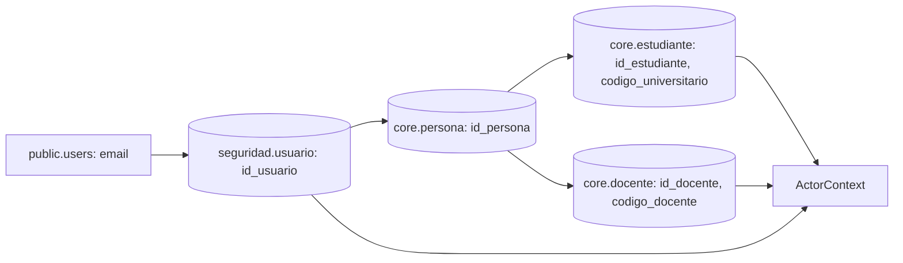

# Autenticación, Roles, Permisos y Middlewares
**Portal de Gestión de Dirección de Escuela — Escuela de Informática UNT**

---

## 1. Matriz de Roles y Permisos (Spatie)

El control de acceso granular se administra a través del paquete `spatie/laravel-permission`:

| Rol | Permiso Asignado | Alcance y Capacidades |
|---|---|---|
| **alumno** | `bienestar.solicitar` | Consulta de información normativa pública, solicitud de apoyo socioeconómico. Bloqueado de paneles docentes y administrativos. |
| **profesor** | `bienestar.reportar` | Reporte preventivo de estudiantes en riesgo académico, búsqueda puntual de estudiantes y seguimiento del estado de sus reportes. |
| **secretaria** | `bienestar.gestionar` | Personal operativo de Bienestar: gestión integral de alertas, apertura de casos, programación directa de citas, emisión de derivaciones y gestión de artículos. |
| **director_escuela** | `bienestar.estadisticas` | Consulta de tableros estadísticos agregados con k-anonimato por periodo lectivo. Acceso estrictamente de solo lectura (403 en mutaciones). |

---

## 2. Exclusión y Bloqueo del Rol Especialista

De acuerdo con el rediseño del módulo solicitado por la Dirección:
1. **Los especialistas externos ya no inician sesión en el sistema.** Su acceso operativo fue completamente revocado y sus credenciales deshabilitadas en el seeder y en las migraciones (`bienestar.especialista.id_usuario` se convirtió en nullable y se incorporaron campos propios de catálogo: `nombres`, `apellidos`, `contacto`, `institucion`).
2. **Catálogo de derivación:** Los especialistas existen únicamente como catálogo de referencia para que el Personal de Bienestar emita fichas de derivación e ingrese contrarreferencias recibidas en físico o por correo formal.
3. **Bloqueo preventivo:** Si un usuario conservara el rol antiguo `especialista`, cualquier intento de autenticación hacia el portal carece de permisos de módulo y es rechazado con código `403 Forbidden`.

---

## 3. Resolución de Actores Multi-Esquema (`ActorBienestarResolver`)

Dado que el Portal almacena la autenticación web en `public.users` y las entidades académicas en esquemas separados (`seguridad.usuario`, `core.persona`, `core.estudiante` y `core.docente`), el módulo implementa el resolvedor unificado `App\Modules\Bienestar\Support\ActorBienestarResolver`:

### Clase inmutable `ActorContext`:
- `idUsuario`: ID en `seguridad.usuario` para claves foráneas de auditoría.
- `idPersona`: Identificador en `core.persona`.
- `idEstudiante`: Identificador de estudiante (si el actor es estudiante).
- `codigoEstudiante`: Código universitario del estudiante.
- `idDocente`: Identificador de docente (si el actor es profesor).
- `codigoDocente`: Código docente para filtrar nóminas académicas.
- `role`: Nombre del rol Spatie principal.
- Métodos helper: `isAlumno()`, `isProfesor()`, `isSecretaria()`, `isDirector()`.

---

## 4. Protección de Rutas y Middlewares

Todas las rutas del módulo (`app/Modules/Bienestar/Routes/web.php`) aplican middlewares acordes al principio de mínimo privilegio:

- **Rutas Públicas:**
  * `/bienestar/informacion` y `/bienestar/informacion/{articulo}` (libres de autenticación).
- **Rutas Docentes:**
  * Middleware: `['auth', 'can:bienestar.reportar']`.
- **Rutas de Gestión de Bienestar:**
  * Middleware: `['auth', 'can:bienestar.gestionar']`.
- **Rutas de Dirección de Escuela:**
  * Middleware: `['auth', 'can:bienestar.estadisticas']`.
  * Filtro de mutaciones: Cualquier verbo `POST`, `PUT`, `PATCH`, `DELETE` invoca `DirectorEstadisticasController::mutacionBloqueada()`, devolviendo `403 Forbidden`.
