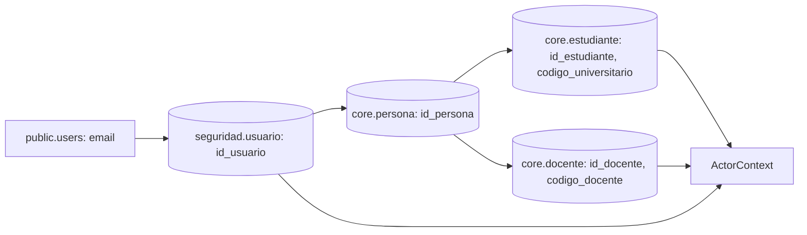

# Autenticación, Roles, Permisos y Middlewares
**Portal de Gestión de Dirección de Escuela — Escuela de Informática UNT**

---

## 1. Matriz de Roles y Permisos (Spatie)

El control de acceso granular se administra a través del paquete `spatie/laravel-permission` y políticas de módulo (`app/Modules/Bienestar/Policies`):

| Rol | Permiso Asignado | Alcance y Capacidades Operativas (Ley 29733) |
|---|---|---|
| **alumno** | `bienestar.solicitar` | Consulta de información normativa pública, catálogo de trámites UNT y requisitos. Envío de solicitudes con carga individual por requisito. Subsanación puntual de requisitos observados. Bloqueado de paneles docentes y administrativos. |
| **profesor** | `bienestar.reportar` | Reporte preventivo de estudiantes en riesgo académico, búsqueda puntual por código universitario y seguimiento del estado de sus reportes (`en_revision`, `remitida_bienestar`, `atendida`, `descartada`) sin acceso al motivo del descarte. |
| **secretaria** | `bienestar.secretaria` | **Mesa de entrada y filtro operativo:** Ve solo datos administrativos del estudiante (código, nombres, ciclo) y metadatos básicos de alerta (tipo, regla, urgencia, categoría). Filtro de alertas (`pasar_bienestar` o `descartar` con motivo en bitácora; salvaguarda institucional contra descarte de riesgo alto). Revisión documental de solicitudes (`recibir`, `observar` requisitos, `remitir` con confirmación de foliado externo físico fuera del sistema). Bloqueada de casos, citas, notas clínicas y diagnósticos (403). |
| **bienestar** | `bienestar.gestionar` | **Gestión especializada de Bienestar:** Gestión de alertas remitidas por Secretaría y reapertura de alertas descartadas. Apertura y seguimiento de casos de bienestar, programación de citas, emisión de derivaciones con consentimiento informado. Administración dinámica del catálogo de trámites UNT (`tipo_solicitud`, requisitos, plantillas). Dictamen de solicitudes remitidas con folio confirmado. |
| **director_escuela** | `bienestar.estadisticas` | Consulta de tableros estadísticos agregados e indicadores KPI con gráficos (Chart.js) por periodo lectivo y rango de fechas. Exportación a CSV y vista imprimible/PDF. **Se eliminó el enmascaramiento `< 5`:** muestra valores reales exactos (incluso 1 o 2 casos). Acceso estrictamente de solo lectura (403 en cualquier intento de mutación). |

---

### Accesos puntuales

| Recurso | Permitido | Resto |
|---|---|---|
| Notificaciones (`/bienestar/notificaciones`) | Cada usuario, solo las propias | 404 |
| Plantilla de requisito | Usuario autenticado | Inicio de sesión |
| Seguimiento de solicitud | Estudiante propietario | 404 ajena, 403 otro rol |
| Expediente y documentos (Bienestar) | `bienestar.gestionar`, desde la remisión | 404 antes de remitir, 403 otro rol |
| Documentos (Secretaría) | `bienestar.secretaria`, solicitudes que le corresponden | 404 |
| Casos y citas | `bienestar.gestionar` | 403 |
| Alta y edición de requisitos | `bienestar.gestionar` | 403 |
| Alerta aún en revisión | Secretaría | 404 para Bienestar |

## 1.1. Seguridad: Cambio Obligatorio de Clave (`password.change`)

Todos los roles operativos del módulo (`secretaria`, `bienestar`, `profesor`, `alumno`, `director_escuela`) están protegidos por el middleware `password.change`:
- Si la columna `seguridad.usuario.debe_cambiar_contrasena` es `true`, cualquier intento de acceder a rutas protegidas redirige automáticamente al formulario `/change-password` hasta que el usuario establezca una nueva contraseña segura.

---

## 2. Exclusión y Bloqueo del Rol Especialista

De acuerdo con el rediseño del módulo solicitado por la Dirección:
1. **Los especialistas externos ya no inician sesión en el sistema.** Su acceso operativo fue completamente revocado y sus credenciales deshabilitadas en el seeder y en las migraciones (`bienestar.especialista.id_usuario` se convirtió en nullable y se incorporaron campos propios de catálogo: `nombres`, `apellidos`, `contacto`, `institucion`).
2. **Catálogo de derivación:** Los especialistas existen únicamente como catálogo de referencia para que el Personal de Bienestar emita fichas de derivación e ingrese contrarreferencias recibidas en físico o por correo formal.
3. **Bloqueo preventivo:** Si un usuario conservara el rol antiguo `especialista`, cualquier intento de autenticación hacia el portal carece de permisos de módulo y es rechazado con código `403 Forbidden`.

---

## 3. Resolución de Actores Multi-Esquema (`ActorBienestarResolver`)

Dado que el Portal almacena la autenticación web en `public.users` y las entidades académicas en esquemas separados (`seguridad.usuario`, `core.persona`, `core.estudiante` y `core.docente`), el módulo implementa el resolvedor unificado `App\Modules\Bienestar\Support\ActorBienestarResolver`:

### Clase inmutable `ActorContext`:
- `idUsuario`: ID en `seguridad.usuario` para claves foráneas de auditoría.
- `idPersona`: Identificador en `core.persona`.
- `idEstudiante`: Identificador de estudiante (si el actor es estudiante).
- `codigoEstudiante`: Código universitario del estudiante.
- `idDocente`: Identificador de docente (si el actor es profesor).
- `codigoDocente`: Código docente para filtrar nóminas académicas.
- `role`: Nombre del rol Spatie principal.
- Métodos helper: `isAlumno()`, `isProfesor()`, `isSecretaria()`, `isDirector()`.

---

## 4. Protección de Rutas y Middlewares

Todas las rutas del módulo (`app/Modules/Bienestar/Routes/web.php`) aplican middlewares y políticas acordes al principio de mínimo privilegio, soportando indistintamente el rol Spatie o el permiso mediante el middleware `role_or_permission`:

- **Mapeo canónico único (`BienestarPermissions::MAP`):**
  * `bienestar.solicitar` $\leftrightarrow$ `alumno`
  * `bienestar.reportar` $\leftrightarrow$ `profesor`
  * `bienestar.secretaria` $\leftrightarrow$ `secretaria`
  * `bienestar.gestionar` $\leftrightarrow$ `bienestar`
  * `bienestar.estadisticas` $\leftrightarrow$ `director_escuela`

- **Rutas Públicas:**
  * `/bienestar/informacion` y `/bienestar/informacion/{articulo}` (libres de autenticación).
- **Rutas de Alumno:**
  * Middleware: `['auth', 'password.change', BienestarPermissions::roleOrPermission(BienestarPermissions::SOLICITAR)]`.
- **Rutas Docentes:**
  * Middleware: `['auth', 'password.change', BienestarPermissions::roleOrPermission(BienestarPermissions::REPORTAR)]`.
- **Rutas de Secretaría:**
  * Middleware: `['auth', 'password.change', BienestarPermissions::roleOrPermission(BienestarPermissions::SECRETARIA)]`.
  * Bandeja de alertas `/bienestar/secretaria/alertas`, solicitudes `/bienestar/secretaria/solicitudes`, indicadores operativos `/bienestar/secretaria/indicadores`.
- **Rutas de Gestión de Bienestar:**
  * Middleware: `['auth', 'password.change', BienestarPermissions::roleOrPermission(BienestarPermissions::GESTIONAR)]`.
  * Panel `/bienestar/panel`, Catálogo de Trámites UNT `/bienestar/catalogo-solicitudes`.
- **Rutas de Dirección de Escuela:**
  * Middleware: `['auth', 'password.change', BienestarPermissions::roleOrPermission(BienestarPermissions::ESTADISTICAS)]`.
  * Tablero `/bienestar/director`. Filtro de mutaciones: Cualquier verbo `POST`, `PUT`, `PATCH`, `DELETE` devuelve `403 Forbidden`.

---

## 5. Manejo Preventivo ante Falta de Datos Demo (`FaltanDatosDemoException`)

Si un usuario autenticado accede a una sección operativa pero su cuenta aún no cuenta con los registros correspondientes en `seguridad.usuario`, `core.estudiante` o `core.docente` (por ejemplo, si no se ejecutó el seeder demo de Bienestar), `ActorBienestarResolver` intercepta la situación y renderiza una vista explicativa limpia (`FaltanDatosDemoException`) con código HTTP 200, **nunca un error 500**:
> *"Faltan datos de demostración: ejecute php artisan db:seed --class=\"App\Modules\Bienestar\Database\Seeders\BienestarDemoSeeder\""*
