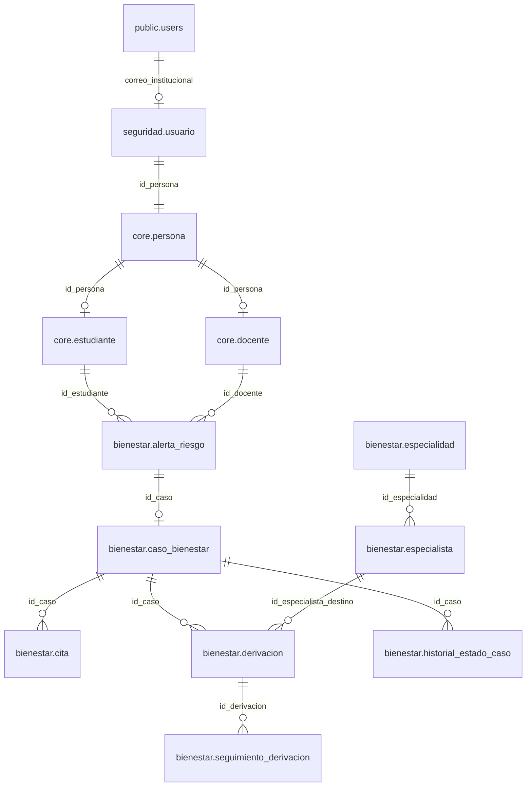

# Manual de Arquitectura del Módulo Bienestar
**Portal de Gestión de Dirección de Escuela — Escuela de Informática UNT**

---

## 1. Arquitectura Modular

El módulo de Bienestar reside de manera autónoma en `app/Modules/Bienestar` respetando los lineamientos de arquitectura monolítica modular de Laravel:

```
app/Modules/Bienestar/
├── Adapters/
│   └── AdaptadorMatriculaLocal.php          # Implementación de FuenteAcademicaInterface
├── Config/
│   └── riesgo_academico.php                 # Umbrales, prioridades y cron de reglas
├── Console/
│   └── Commands/
│       └── DetectarEstudiantesRiesgoCommand.php # Comando artisan bienestar:detectar-riesgo
├── Contracts/
│   └── FuenteAcademicaInterface.php         # Contrato desacoplado con módulo Matrícula
├── Controllers/
│   ├── BienestarController.php             # Landing y catálogo informativo público
│   ├── BienestarPanelController.php        # Hub operativo para Personal de Bienestar
│   ├── DirectorEstadisticasController.php  # Métricas agregadas con k-anonimato
│   └── ProfesorReporteController.php       # Gestión de reportes docentes
├── Database/
│   ├── Migrations/                          # 4 migraciones que completan las 20 tablas
│   └── Seeders/
│       └── BienestarDemoSeeder.php          # Poblador idempotente de prueba
├── DTO/
│   └── RegistroAcademicoDTO.php             # Objeto de transferencia de datos inmutable
├── Models/                                  # Modelos Eloquent de bienestar y core
├── Policies/                                # ArticuloInformativoPolicy, AlertaRiesgoPolicy, etc.
├── Providers/
│   └── BienestarServiceProvider.php         # Bindings, comandos y scheduler de Laravel
├── Requests/                                # Form Requests con sanitización y reglas
└── Support/
    ├── ActorBienestarResolver.php           # Resuelve entidades cruzadas multi-esquema
    ├── ActorContext.php                     # Contexto del actor autenticado
    ├── BienestarPermissions.php             # Constantes y mapeo de permisos Spatie
    └── HtmlSanitizer.php                    # Sanitizador estricto de HTML
```

---

## 2. Modelo de Datos y Esquemas PostgreSQL

El sistema utiliza esquemas lógicos separados en PostgreSQL para garantizar el aislamiento de dominios:



### Relación de Tablas del Esquema `bienestar` (20 tablas exactas)
1. `bienestar.articulo_informativo` (nueva): Publicaciones normativas y artículos de bienestar.
2. `bienestar.alerta_riesgo` (nueva): Registro de alertas automáticas y docentes.
3. `bienestar.especialidad`: Áreas profesionales (Psicología, Medicina General, etc.).
4. `bienestar.especialista` (adaptada): Catálogo externo de especialistas de la UNT.
5. `bienestar.tipo_caso`: Clasificación de casos (Riesgo Académico, Socioeconómico).
6. `bienestar.caso_bienestar`: Expedientes de acompañamiento.
7. `bienestar.historial_estado_caso`: Auditoría de transiciones de estado de casos.
8. `bienestar.cita` (adaptada): Sesiones agendadas por el personal de Bienestar.
9. `bienestar.derivacion` (adaptada): Fichas de interconsulta con consentimiento informado.
10. `bienestar.seguimiento_derivacion` (adaptada): Trazabilidad de contrarreferencias.
11. `bienestar.tipo_condicion`: Tipos de condiciones especiales.
12. `bienestar.deporte`: Catálogo deportivo.
13. `bienestar.beneficio`: Programas de apoyo (Comedor, Becas).
14. `bienestar.perfil_socioeconomico`: Fichas socioeconómicas y SISFOH.
15. `bienestar.estudiante_deporte`: Participación deportiva.
16. `bienestar.estudiante_condicion`: Condiciones de salud o vulnerabilidad.
17. `bienestar.solicitud_apoyo`: Solicitudes presentadas por alumnos.
18. `bienestar.solicitud_documento`: Adjuntos de solicitudes.
19. `bienestar.horario_disponible`: Disponibilidad histórica.
20. `bienestar.reporte`: Reportes consolidados generados por el personal.

---

## 3. Cifrado y Seguridad de Datos Clínicos

En observancia de la **Ley N° 29733 (Ley de Protección de Datos Personales del Perú)**, los datos sensibles no se almacenan en texto claro:
- `bienestar.alerta_riesgo.descripcion_reporte`: Almacenado como texto cifrado (`casts: ['descripcion_reporte' => 'encrypted']`).
- `bienestar.caso_bienestar.descripcion`: Cifrado con la llave simétrica del sistema (`APP_KEY`).
- `bienestar.cita.notas_atencion`: Notas confidenciales de la sesión cifradas.
- `bienestar.derivacion.resultado_especialista`: Informe del especialista externo cifrado.
- `bienestar.seguimiento_derivacion.descripcion`: Anotaciones de seguimiento cifradas.

---

## 4. Estrategia de Índices Únicos y Concurrencia

Para evitar colisiones entre reportes docentes y alertas del sistema:
- **Alertas Automáticas:** Índice único parcial PostgreSQL:
  ```sql
  CREATE UNIQUE INDEX bie_alerta_automatica_uq
  ON bienestar.alerta_riesgo (id_estudiante, periodo, curso, regla)
  WHERE origen = 'automatica';
  ```
  Permite que el cron detecte de forma idempotente la reiterancia y las inasistencias sin duplicados, mientras que múltiples docentes pueden reportar al mismo estudiante en el mismo periodo sin colisión.
- **Alertas Docentes:** Cada reporte docente crea un registro independiente asociado a su propio `id_docente`, manteniendo trazabilidad por emisor.
