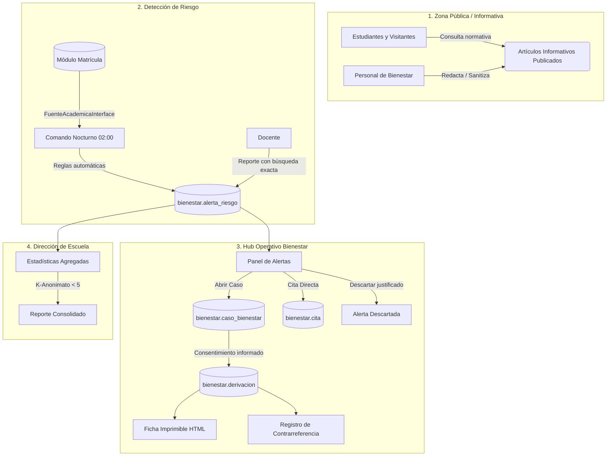

# Manual de Flujos del Módulo de Bienestar Estudiantil
**Portal de Gestión de Dirección de Escuela — Escuela de Informática UNT**

---

## 1. Visión General de los Procesos

El módulo de Bienestar Estudiantil (`app/Modules/Bienestar`) articula cinco grandes flujos de trabajo orientados a la permanencia estudiantil, la detección temprana de riesgos y el acompañamiento oportuno:

---

## 2. Detalle de Flujos de Negocio

### Flujo 1: Información Académica y Bienestar (Público)
- **Superficie de acceso:** `/bienestar/informacion` accesible para cualquier usuario sin necesidad de autenticación, y enlazada en el menú principal del sistema.
- **Contenido regulado:** Reúne las causales críticas de desvinculación académica:
  * Ley Universitaria 30220, Art. 102 (separación por 3ra matrícula y retiro definitivo por 4ta).
  * Ley Universitaria 30220, Art. 99.8 (carga mínima de 12 créditos para condición regular).
  * Ley Universitaria 30220, Art. 100.11 (reserva de matrícula hasta 3 años).
  * Ley Universitaria 30220, Art. 101 (régimen disciplinario y sanciones).
  * Guía de inducción UNT (límite de inasistencias 30%, nota aprobatoria 14, plazos de retiro/reserva).
  * Advertencia formal: *"Pendiente de verificar con el Reglamento Académico vigente de la UNT"*.
- **Gestión:** Personal de Bienestar (`secretaria`) crea, edita y publica artículos desde `/bienestar/informacion/crear`. Todo HTML ingresado es sanitizado con `HtmlSanitizer` (whitelist de tags tipográficos, eliminación estricta de `<script>`, `<iframe>` y eventos `on*`). Los borradores nunca se muestran a usuarios públicos (devuelve 404).

---

### Flujo 2: Detección Automática de Riesgo Académico
- **Programación:** Comando diario `bienestar:detectar-riesgo` a las **02:00 America/Lima** (07:00 UTC) mediante el Scheduler de Laravel.
- **Desacoplamiento:** Consume `FuenteAcademicaInterface` para abstraer la interacción con el módulo de Matrícula desarrollado por otro equipo.
- **Evaluación de reglas:**
  1. *Desaprobación reiterada:* 3ra matrícula (prioridad alta) y 4ta matrícula (prioridad alta).
  2. *Inasistencias:* 20.00% a 30.00% (alerta preventiva, prioridad media); >30.00% (inhabilitación y retiro automático, prioridad alta). Valores menores a 20.00% (ej. 19.99%) no generan alerta.
  3. *Créditos insuficientes:* Matrícula menor a 12 créditos. Evaluada **una sola vez** por estudiante y periodo (`curso = 'GLOBAL'`). Si los créditos pendientes de egreso son menores a 12, el estudiante está **exento**; si el valor es `null`, se marca con estado *"por verificar"*.
- **Unicidad e Idempotencia:**
  * Índice único parcial `bie_alerta_automatica_uq` sobre `(id_estudiante, periodo, curso, regla)` con cláusula `WHERE origen = 'automatica'`.
  * Si la condición cesa en el periodo, la alerta pasa a `resuelta_automaticamente` y se estampa `fecha_resolucion`.
  * Si la condición reaparece, solo se reabre si estaba en `resuelta_automaticamente`. **Nunca** se reabre si fue `atendida` o `descartada` por el personal.
  * Si un estudiante recibido en el DTO no existe en `core.estudiante`, se omite y se registra en el log del sistema.

---

### Flujo 3: Reporte Docente de Estudiantes en Riesgo
- **Acceso:** Docente autenticado con rol `profesor` (`bienestar.reportar`) en `/bienestar/profesor`.
- **Vínculo académico:** El sistema resuelve el `codigo_docente` mediante `core.docente`. El adaptador precarga la nómina de estudiantes a cargo del docente en el periodo lectivo.
- **Búsqueda puntual:** Si el estudiante no está en su lista inmediata, se permite la búsqueda por código universitario exacto (`/bienestar/profesor/buscar-estudiante`) con **límite de tasa (Rate Limiting de 10 intentos/minuto)** y registro de auditoría en los logs. Sin autocompletado masivo para proteger la privacidad.
- **Confidencialidad:**
  * El docente registra motivo, descripción detallada y prioridad estimada.
  * La descripción se cifra en base de datos (`encrypted`).
  * El docente solo puede visualizar el **estado administrativo** de su reporte (`pendiente`, `en_atencion`, `atendida`, `descartada`), sin acceder a notas clínicas ni respuestas internas de Bienestar.

---

### Flujo 4: Panel Operativo de Bienestar (Hub de Atención)
- **Acceso:** Personal de Bienestar con rol `secretaria` (`bienestar.gestionar`) en `/bienestar/panel`.
- **Bandeja unificada:** Filtros dinámicos por origen (automático vs docente), prioridad, estado y buscador por estudiante.
- **Acciones resolutivas:**
  1. *Apertura de Caso:* Crea un registro en `bienestar.caso_bienestar` y vincula la alerta, pasando su estado a `en_atencion`.
  2. *Agendamiento Directo de Citas:* Bienestar agenda citas directamente en `bienestar.cita` con fecha, hora, modalidad (Presencial/Virtual) y notas de atención cifradas, sin depender de horarios de disponibilidad externos.
  3. *Descarte Justificado:* Permite descartar una alerta infundada registrando el motivo en los detalles.
- **Derivaciones interdisciplinarias:**
  * Selección de especialista activo del catálogo (`bienestar.especialista`) o entidad externa de salud mental.
  * **Consentimiento informado obligatorio:** El checkbox de consentimiento informado del estudiante debe ser marcado; de lo contrario, el sistema bloquea la derivación.
  * **Ficha imprimible:** Genera una vista HTML optimizada con estilos `@media print` conteniendo membrete institucional UNT, datos del estudiante, especialista de destino y secciones de firma. Si el consentimiento no fue otorgado, el endpoint devuelve `403 Forbidden`.
  * **Contrarreferencia:** Registro del informe o resultado remitido por el especialista externo con cifrado en reposo.

---

### Flujo 5: Dirección de Escuela (Solo Lectura y K-Anonimato)
- **Acceso:** Usuario con rol `director_escuela` (`bienestar.estadisticas`) en `/bienestar/director`.
- **K-Anonimato:** Cualquier frecuencia o conteo **menor a 5** se enmascara automáticamente con el texto `"menos de 5"`.
- **Privacidad absoluta:** La vista no expone nombres, apellidos, códigos universitarios ni identificadores seudoanonimizados (`EST-***`).
- **Bloqueo de mutación:** Cualquier solicitud `POST`, `PUT`, `PATCH` o `DELETE` dirigida a endpoints de dirección devuelve de forma inmediata `403 Forbidden`.

---

### Flujo 6: Alerta Manual por Personal de Bienestar
- **Acceso:** Personal de Bienestar con permiso `bienestar.gestionar` en `/bienestar/panel/alertas/crear-manual`.
- **Propósito:** Permitir al equipo de Bienestar registrar preventivamente alertas para cualquier estudiante detectado en ventanilla, entrevista espontánea o coordinación interna.
- **Atributos:**
  * Origen: `manual_bienestar`.
  * Requiere estudiante (por código universitario), periodo, prioridad y motivo detallado (cifrado en reposo).
- **Inmunidad ante automatización:**
  * El comando diario `bienestar:detectar-riesgo` **nunca modifica, resuelve ni reabre** alertas con origen `manual_bienestar` o `reporte_docente`. Trabaja exclusivamente con `origen = 'automatica'`.

---

### Flujo 7: Portal del Estudiante y Solicitudes de Apoyo
- **Acceso:** Estudiante autenticado con rol `alumno` y permiso `bienestar.solicitar` en `/bienestar/alumno/solicitudes` y `/bienestar/alumno/citas`.
- **Solicitud de beneficios:**
  * El alumno visualiza los programas y beneficios activos de Bienestar (ej. Comedor Universitario, Beca de Exoneración de Matrícula).
  * Envía su solicitud fundamentada (`motivo` con al menos 10 caracteres) vía `/bienestar/alumno/solicitudes/crear`.
  * La solicitud se registra con estado inicial `Pendiente` y fecha de envío.
- **Evaluación por Secretaría:**
  * La secretaría accede a `/bienestar/panel/solicitudes` para revisar la lista de solicitudes entrantes.
  * Puede evaluar y dictaminar cada solicitud (`Aprobada` o `Rechazada`), estampando la fecha de resolución (`resuelta_en`) y el especialista evaluador.
- **Consulta de Citas:**
  * En `/bienestar/alumno/citas`, el estudiante visualiza sus citas de consejería y acompañamiento agendadas (fecha, horario de inicio/fin, modalidad y estado).
  * Por estricto secreto profesional, las notas clínicas (`notas_atencion`) y diagnósticos sensibles permanecen cifrados y no se exponen al estudiante.
