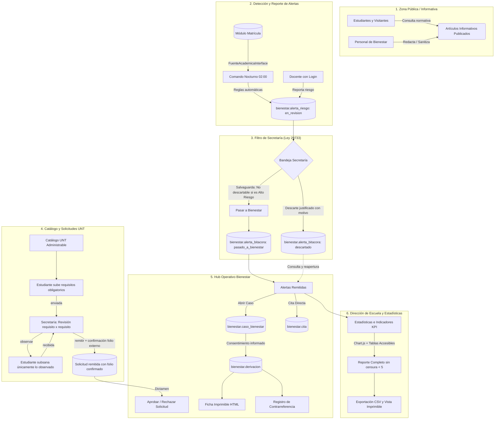

# Manual de Flujos del Módulo de Bienestar Estudiantil
**Portal de Gestión de Dirección de Escuela — Escuela de Informática UNT**

---

## 1. Visión General de los Procesos

El módulo de Bienestar Estudiantil (`app/Modules/Bienestar`) articula cinco grandes flujos de trabajo orientados a la permanencia estudiantil, la detección temprana de riesgos y el acompañamiento oportuno:

---

## 2. Detalle de Flujos de Negocio

### Flujo 1: Información Académica y Bienestar (Público)
- **Superficie de acceso:** `/bienestar/informacion` accesible para cualquier usuario sin necesidad de autenticación, y enlazada en el menú principal del sistema.
- **Contenido regulado:** Reúne las causales críticas de desvinculación académica:
  * Ley Universitaria 30220, Art. 102 (separación por 3ra matrícula y retiro definitivo por 4ta).
  * Ley Universitaria 30220, Art. 99.8 (carga mínima de 12 créditos para condición regular).
  * Ley Universitaria 30220, Art. 100.11 (reserva de matrícula hasta 3 años).
  * Ley Universitaria 30220, Art. 101 (régimen disciplinario y sanciones).
  * Guía de inducción UNT (límite de inasistencias 30%, nota aprobatoria 14, plazos de retiro/reserva).
  * Advertencia formal: *"Pendiente de verificar con el Reglamento Académico vigente de la UNT"*.
- **Gestión:** Personal de Bienestar (`secretaria`) crea, edita y publica artículos desde `/bienestar/informacion/crear`. Todo HTML ingresado es sanitizado con `HtmlSanitizer` (whitelist de tags tipográficos, eliminación estricta de `<script>`, `<iframe>` y eventos `on*`). Los borradores nunca se muestran a usuarios públicos (devuelve 404).

---

### Flujo 2: Detección Automática de Riesgo Académico
- **Programación:** Comando diario `bienestar:detectar-riesgo` a las **02:00 America/Lima** (07:00 UTC) mediante el Scheduler de Laravel.
- **Desacoplamiento:** Consume `FuenteAcademicaInterface` para abstraer la interacción con el módulo de Matrícula desarrollado por otro equipo.
- **Estado Inicial:** Todas las alertas detectadas se crean en estado `en_revision` para ingresar a la bandeja de Secretaría.
- **Evaluación de reglas:**
  1. *Desaprobación reiterada:* 3ra matrícula (prioridad alta) y 4ta matrícula (prioridad alta).
  2. *Inasistencias:* 20.00% a 30.00% (alerta preventiva, prioridad media); >30.00% (inhabilitación y retiro automático, prioridad alta). Valores menores a 20.00% (ej. 19.99%) no generan alerta.
  3. *Créditos insuficientes:* Matrícula menor a 12 créditos. Evaluada **una sola vez** por estudiante y periodo (`curso = 'GLOBAL'`). Si los créditos pendientes de egreso son menores a 12, el estudiante está **exento**; si el valor es `null`, se marca con estado *"por verificar"*.
- **Unicidad e Idempotencia:**
  * Índice único parcial `bie_alerta_automatica_uq` sobre `(id_estudiante, periodo, curso, regla)` con cláusula `WHERE origen = 'automatica'`.
  * Si la condición cesa en el periodo, la alerta pasa a `resuelta_automaticamente` y se estampa `fecha_resolucion`.
  * Si la condición reaparece, solo se reabre si estaba en `resuelta_automaticamente`. **Nunca** se reabre automáticamente si fue `atendida` o `descartada`.

---

### Flujo 3: Reporte Docente de Estudiantes en Riesgo
- **Acceso:** Docente autenticado con rol `profesor` (`bienestar.reportar`) en `/bienestar/profesor`.
- **Vínculo académico:** El sistema resuelve el `codigo_docente` mediante `core.docente`. El adaptador precarga la nómina de estudiantes a cargo del docente en el periodo lectivo.
- **Búsqueda puntual:** Búsqueda por código universitario exacto (`/bienestar/profesor/buscar-estudiante`) con Rate Limiting (10 intentos/minuto).
- **Confidencialidad y Estados:**
  * El reporte se crea en estado inicial `en_revision`.
  * La descripción se cifra en base de datos (`encrypted`).
  * El docente sigue viendo únicamente el estado de su reporte (`en revisión`, `en atención en bienestar`, `atendida`, `descartado`), **sin mostrar jamás el motivo del descarte** (Ley 29733).

---

### Flujo 4: Filtro de la Secretaría sobre las Alertas (Mesa de Entrada)
- **Acceso:** Personal con rol `secretaria` (`bienestar.secretaria`) en `/bienestar/secretaria/alertas`.
- **Principio de mínimo privilegio (Ley 29733):**
  * Ve solo datos administrativos del estudiante (código, nombres, ciclo) y metadatos mínimos de la alerta (tipo, regla, urgencia, categoría del motivo).
  * No ve casos, citas, notas clínicas ni descripciones en texto libre confidencial.
- **Acciones y Bitácora:**
  1. *Pasar a Bienestar:* Estado cambia a `remitida_bienestar`. Se registra en `bienestar.alerta_bitacora` (acción `pasado_a_bienestar`).
  2. *Descartar:* Exige obligatoriamente un motivo justificado. Estado cambia a `descartada` y se audita en `bienestar.alerta_bitacora` con usuario, fecha y motivo.
  3. **Salvaguarda Institucional:** Las alertas automáticas de riesgo alto (ej. tercera matrícula o prioridad alta) **no se pueden descartar**. La Secretaría solo puede pasarlas a Bienestar.

---

### Flujo 5: Hub Operativo de Bienestar
- **Acceso:** Personal especializado de Bienestar con rol `bienestar` (`bienestar.gestionar`) en `/bienestar/panel`.
- **Bandeja de Alertas:** Ve únicamente las alertas que Secretaría le remitió (`remitida_bienestar`, `en_atencion`, `atendida`).
- **Pestaña de Descartadas y Reapertura:** Bienestar puede consultar la lista de alertas descartadas por Secretaría y reabrirlas justificadamente (`bienestar.alerta_bitacora: reabierto`), devolviéndolas a `remitida_bienestar`.
- **Apertura de Caso y Citas:** Apertura de casos (`bienestar.caso_bienestar`), agendamiento de citas y derivaciones con consentimiento informado.

---

### Flujo 6: Catálogo de Trámites UNT y Solicitud del Estudiante
- **Catálogo Administrable por Bienestar:** Creación, edición y activación/desactivación de tipos (`/bienestar/catalogo-solicitudes`).
  * Incluye: nombre, descripción, unidad responsable, plazo hábil, base normativa y estado de verificación ("pendiente de verificar con la Dirección de Bienestar de la UNT").
  * Seeder inicial basado en el TUPA y la convocatoria del comedor UNT (6 procedimientos oficiales).
- **Postulación del Estudiante:**
  * El estudiante selecciona el tipo y visualiza la lista de requisitos con descripción, obligatoriedad, formatos (PDF, JPG, PNG), tamaño máximo y plantilla descargable si existe.
  * Carga obligatoria con almacenamiento privado y nombres UUID. Validación cliente y servidor: bloqueo si falta algún requisito obligatorio.
  * Solicitud se crea en estado inicial `enviada`.
- **Revisión por Secretaría y Foliado Externo:**
  * Secretaría revisa requisito por requisito marcando `conforme` u `observado` con comentario específico.
  * *Observar:* Solicitud pasa a `observada`. El estudiante accede a `/bienestar/alumno/solicitudes/{id}/subsanar` y **solo resube los requisitos observados**, retornando la solicitud a `recibida`.
  * *Foliado Externo:* El sistema **no genera folio, número correlativo, carátula, índice ni PDF del folio**. La Secretaría arma el folio por su cuenta fuera del sistema y, al remitir, confirma obligatoriamente mediante una casilla de verificación que armó el folio fuera del sistema.
  * *Remisión:* Pasa a estado `remitida`.
- **Dictamen de Bienestar:** Bienestar dictamina (`aprobada` o `rechazada`) **únicamente** las solicitudes remitidas con folio confirmado.

---

### Casos, citas y notificaciones

- **Casos y citas** (`/bienestar/panel/casos`): citas, resultado, derivación y cierre se gestionan en ventanas modales. Cada cambio queda en el historial y un caso cerrado no admite citas ni derivaciones.
- **Dictamen**: aprobar abre un caso; rechazar exige motivo, visible para el estudiante.
- **Notificaciones**: solicitud nueva o corregida (Secretaría) y remitida (Bienestar), sin datos sensibles. El estudiante recibe un aviso en **cada** cambio de estado (por ejemplo «Tu solicitud #12 pasó a revisión») y el docente, el estado de su reporte sin el motivo. Aparecen en pantalla sin recargar y en la campana.
- **Modal o página**: modal si la tarea es breve y no necesita consultar otra información (nueva solicitud en dos pasos, corregir, reportar, alerta, derivar, trámite, citas, dictamen). Página con breadcrumb si se consulta o compara (expediente, caso, revisión documental, artículo, edición del trámite con sus requisitos).

### Flujo 7: Reportes, Indicadores y Estadísticas (Dirección y Bienestar)
- **Acceso:** Dirección de Escuela (`bienestar.estadisticas`) y Personal de Bienestar en `/bienestar/director`.
- **Librería de Gráficos:** Implementación ligera con **Chart.js v4 vía CDN** (sin dependencias npm complejas).
- **Visualizaciones mínimas:**
  * Casos por estado (barras).
  * Alertas por regla o prioridad (barras).
  * Solicitudes por tipo y estado (barras apiladas).
  * Citas por mes (barras).
  * Tendencia histórica por periodo académico (línea).
  * Origen de alertas: automáticas vs reporte docente (dona/anillo).
- **Accesibilidad y Filtros:** Cada gráfico incluye su tabla HTML con valores idénticos (WCAG AA), contraste adecuado, títulos en español, filtros por periodo lectivo y rango de fechas.
- **Eliminación estricta de la regla `< 5`:** Se eliminó cualquier enmascaramiento. Todos los reportes, gráficos, tablas y exportación CSV muestran valores reales exactos (incluso 1 o 2 casos).
- **Exportación:** Descarga en formato CSV y vista imprimible/PDF limpia con membrete institucional.

---

### Flujo 7: Portal del Estudiante y Solicitudes de Apoyo
- **Acceso:** Estudiante autenticado con rol `alumno` y permiso `bienestar.solicitar` en `/bienestar/alumno/solicitudes` y `/bienestar/alumno/citas`.
- **Solicitud de beneficios:**
  * El alumno visualiza los programas y beneficios activos de Bienestar (ej. Comedor Universitario, Beca de Exoneración de Matrícula).
  * Envía su solicitud fundamentada (`motivo` con al menos 10 caracteres) vía `/bienestar/alumno/solicitudes/crear`.
  * La solicitud se registra con estado inicial `Pendiente` y fecha de envío.
- **Evaluación por Secretaría:**
  * La secretaría accede a `/bienestar/panel/solicitudes` para revisar la lista de solicitudes entrantes.
  * Puede evaluar y dictaminar cada solicitud (`Aprobada` o `Rechazada`), estampando la fecha de resolución (`resuelta_en`) y el especialista evaluador.
- **Consulta de Citas:**
  * En `/bienestar/alumno/citas`, el estudiante visualiza sus citas de consejería y acompañamiento agendadas (fecha, horario de inicio/fin, modalidad y estado).
  * Por estricto secreto profesional, las notas clínicas (`notas_atencion`) y diagnósticos sensibles permanecen cifrados y no se exponen al estudiante.
