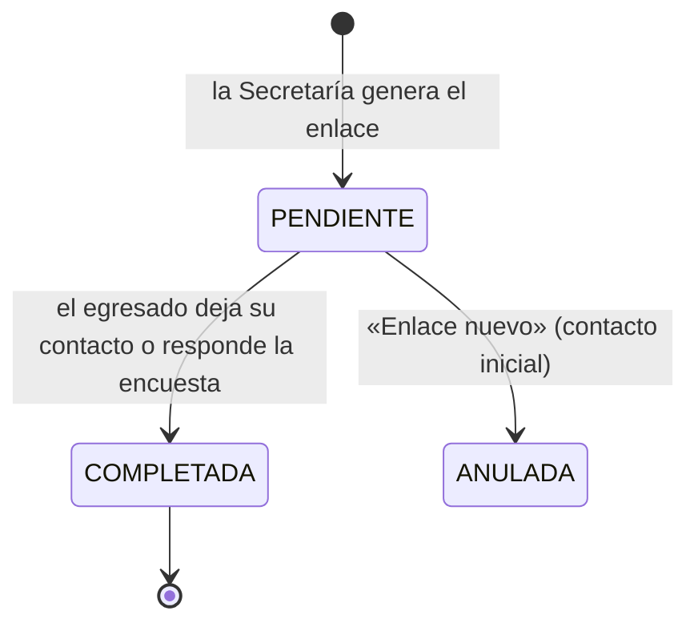
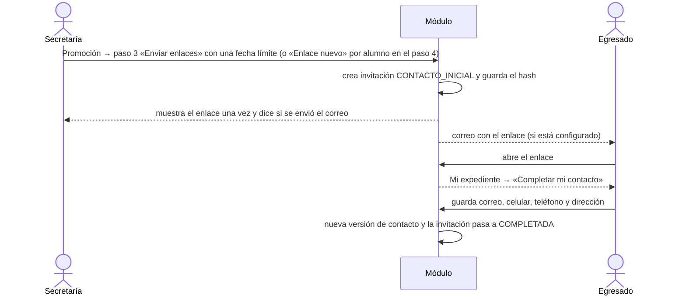
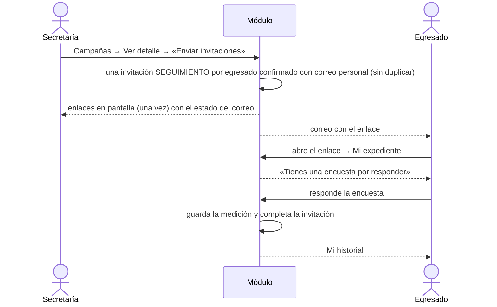

# Manual de flujos · Seguimiento al Egresado

Referencias: [arquitectura.md](arquitectura.md), [permisos-middleware.md](permisos-middleware.md), [correo.md](correo.md) y [manual-usuario.md](manual-usuario.md).

Tiene dos partes. La primera describe cómo recorre el sistema un egresado, desde que la Secretaría le genera un enlace hasta que consulta su historial: cada flujo indica la pantalla, la regla que se aplica y lo que queda en la BD. La segunda, **Pruebas por flujo**, lista los recorridos completos del sistema con sus pasos y el resultado esperado, para ponerlos a prueba.

## Quién entra y cómo

- **Secretaría y Dirección** inician sesión en el portal (roles `secretaria` y `director_escuela`). Cada pantalla exige una capacidad del módulo (ver `docs/seguimiento-egresado/permisos-middleware.md`).
- **Egresado**: sin cuenta, con el enlace personal de una invitación.
- La Secretaría puede abrir en su navegador el enlace de un egresado para ver lo que él ve: ambas identidades conviven.

## Idea central: el enlace personal

El egresado **no tiene cuenta ni contraseña**. Entra con el enlace personal de una invitación: `/seguimiento-egresado/acceso/{token}`. Ese enlace abre su sesión y lo lleva a su expediente.

- Del token solo se guarda su **SHA-256** (`invitacion_egresado.token_hash`). El enlace en claro se muestra una vez, en pantalla, al generarlo.
- Un enlace desconocido, anulado o vencido muestra el mismo aviso (404): no revela cuál es el caso.
- La sesión del egresado vence cuando vence el enlace. Mientras tanto solo ve y modifica **su** expediente: el id sale de la sesión, nunca de la URL.

## Estados de una invitación



| Propósito | Campaña | Se completa cuando | Vigencia |
|---|---|---|---|
| `CONTACTO_INICIAL` | ninguna | El egresado guarda su contacto | `SG_DIAS_CONTACTO_INICIAL` días (30 por defecto) |
| `SEGUIMIENTO` | obligatoria | El egresado envía la encuesta | Hasta la fecha de fin de la campaña |

Una invitación `COMPLETADA` sigue permitiendo **consultar** el expediente hasta que venza el enlace; no permite responder otra vez.

El estado `EXPIRADA` lo admite la BD y el módulo lo respeta, pero no lo asigna: considera vencida toda invitación cuya fecha de vencimiento ya pasó, aunque siga `PENDIENTE`. Una vencida no abre el expediente ni se puede responder.

## Flujo 0 · De alumno apto a egresado

El padrón se carga con alumnos **aptos para egresar** y solo después se confirma su egreso con la fecha real. El sistema no completa lo que el archivo no trae.

```mermaid
sequenceDiagram
    actor S as Secretaría
    participant M as Módulo
    S->>M: Promoción → paso 2: carga el CSV/Excel (matrícula, documento, nombres, correo institucional); los alumnos quedan unidos a esa promoción
    M->>M: egresado + historial «PROXIMO» (apto); sin fechas, créditos ni contacto
    S->>M: Contacto inicial (flujo 1): el alumno deja su correo personal y celular
    S->>M: Ficha del alumno → «Confirmar egreso» con la fecha real
    M->>M: cierra «PROXIMO», abre «EGRESADO», guarda fecha y periodo
```

Reglas:

- La carga se hace dentro de la promoción, así que todos los alumnos del archivo se unen a ella (si el archivo trae una columna `cohorte`, debe coincidir). Correo institucional obligatorio y válido; matrícula única; las fechas del archivo no pueden ser futuras. La carga es todo o nada: una fila inválida cancela el archivo y cada fila queda registrada con su motivo en `importacion_fila`.
- Estado inicial `PROXIMO` (apto), salvo que el archivo traiga `estado` explícito. Créditos, resoluciones, fecha de egreso y periodo quedan vacíos; el contacto solo se guarda si el archivo trae correo personal **y** celular.
- «Confirmar egreso» exige una fecha real (no futura, no anterior al ingreso si se conoce) y solo vale para quien está en `PROXIMO`. El periodo sale de la fecha (`I` hasta julio, `II` después). Se conservan el expediente, el historial y los contactos.
- Las campañas de seguimiento solo convocan a quienes ya están en `EGRESADO`, `BACHILLER` o `TITULADO`.

En la BD: `egresado` (`correo_institucional`, `fecha_egreso`, `periodo_egreso`), `historial_estado_academico` (una fila por etapa, con `vigente_desde`/`vigente_hasta`) e `importacion_padron` / `importacion_fila` (qué se aceptó y qué se rechazó, con el motivo).

## Flujo 1 · Contacto inicial

Sirve para tener los datos de contacto antes de cualquier campaña. El enlace llega al **correo institucional** del alumno.



Reglas:

- «Enviar enlaces» pide una **fecha límite** (por defecto 30 días desde hoy; máximo un año): `expira_en` es el final de ese día. Genera un enlace por cada alumno que **aún no dejó su contacto** y no tiene un enlace pendiente vigente, e informa cuántos se omitieron y por qué.
- **El contacto es obligatorio para egresar.** El correo y el formulario lo dicen; «Confirmar egreso» no se bloquea, pero avisa si el alumno no completó su contacto.
- El paso 4 «Quién completó su contacto» resume la promoción cuántos completaron, cuántos siguen en plazo, cuántos vencieron y cuántos no tienen enlace; al abrir su enlace ya completado, el alumno ve «Ya completaste esta invitación» en verde.
- «Enlace nuevo» anula el enlace pendiente anterior y genera otro con la misma fecha límite: el viejo deja de funcionar. Sirve si se perdió o se compartió por error.
- El contacto **se versiona**: cada cambio cierra la versión vigente (`vigente_hasta`) y crea otra. Nada se sobrescribe y el egresado ve sus datos anteriores.

## Flujo 2 · Campaña de seguimiento



Reglas:

- Solo se convoca a **egresados confirmados** (flujo 0) que dejaron su **correo personal**: la campaña va únicamente a ese correo, nunca al institucional. Quien no lo dejó no se convoca y el aviso lo cuenta.
- La campaña **se abre y se cierra sola según sus fechas** (`EstadoDeCampanias`): Programada, Abierta o Cerrada. No se elige el estado; en cada entrada al módulo se pone al día. Una campaña cerrada no admite invitaciones, recordatorios ni respuestas.
- «Recordar a los pendientes» genera un enlace nuevo para cada egresado que no respondió (el anterior deja de servir) y lo envía.
- Emitir dos veces no duplica: quien ya tiene invitación en esa campaña se omite.
- La encuesta tiene seis secciones: contacto, perfil profesional, situación laboral, desarrollo profesional continuo, satisfacción y habilidades, y contacto del empleador. Los campos con formato se validan en el navegador y todo se valida otra vez en el servidor.
- Quien no trabaja no guarda datos de empleo.
- La respuesta se guarda **completa o no se guarda** (una transacción): medición laboral, satisfacción, brechas y fortalezas, formación posterior y, si cambió, una versión de contacto.
- Una invitación admite **una sola respuesta** y no se puede modificar después. Si se envía dos veces a la vez, solo se guarda una.
- No se puede responder si el enlace venció, la invitación fue anulada o la campaña ya no está abierta.

## Flujo 3 · Un mismo enlace, varias tareas

El expediente ofrece todo lo pendiente, entre con el enlace que entre.

- Con un enlace de contacto inicial pendiente aparece «Completa tus datos de contacto».
- Aparecen además **todas las encuestas pendientes de campañas abiertas** del egresado, cada una con su botón «Responder la encuesta».
- Al abrir una encuesta, la sección 1 dice «Confirma tus datos de contacto» si ya hay contacto (se pueden corregir) o «Tus datos de contacto» si todavía no hay.
- La encuesta que se responde se elige con `?invitacion=` y siempre se verifica que sea del propio egresado. Un número de otro egresado no abre nada.

## Flujo 4 · Enlace perdido o recordatorio

- El enlace no se puede recuperar. Si se perdió, la Secretaría genera uno nuevo.
- En Campañas, «Reenviar recordatorio» sustituye el enlace de esa invitación por uno nuevo, lo envía por correo y lo muestra una vez. El enlace anterior deja de funcionar.

## Flujo 5 · Historial

- **Mi historial** lista las campañas a las que fue invitado y si respondió. «Ver respuesta» abre el detalle de lo que respondió ese día.
- También muestra los cambios de contacto (versiones anteriores).
- Es de solo lectura.

## Qué queda en la BD

| Hecho | Tablas |
|---|---|
| Generar un enlace | `invitacion_egresado` (hash, vencimiento, canal, `enviado_en`, estado) |
| Dejar el contacto | `contacto_egresado` (versiones), `invitacion_egresado` (`COMPLETADA`, `respondido_en`) |
| Responder la encuesta | `medicion_laboral`, `satisfaccion_egresado`, `medicion_habilidad`, `formacion_posterior`, `contacto_egresado`, `invitacion_egresado` |

`enviado_en` solo se marca si el correo salió de verdad (ver `docs/seguimiento-egresado/correo.md`).

---

## Pruebas por flujo

Sirven para comprobar que el módulo funciona de punta a punta. Se hacen sobre una **base nueva** con las migraciones del portal y el seeder general (cuentas `secretaria@portal.local` y `director@portal.local`, ver [README.md](README.md)). Para el recorrido desde cero se usa el archivo [`datos/alumnos-aptos-demo.csv`](datos/alumnos-aptos-demo.csv). Si se quiere ver el sistema ya con datos, se carga además `SeguimientoEgresadoSeeder`. Para comprobar la entrega real de correos, ver [correo.md](correo.md).

| Caso | Pasos | Resultado esperado |
|---|---|---|
| F01. Ingreso | Entra como Secretaría desde el acceso del portal y abre el módulo desde el selector. Repite como Dirección. Abre el padrón sin haber iniciado sesión. | El menú muestra las operaciones del perfil. Sin sesión, el acceso interno vuelve al inicio de sesión. |
| F02. Plan y promoción | **Padrón y promociones → + Nueva promoción**. Año 2019 y seis ingresantes. Si falta el plan, **+ Otro plan** con su vigencia. Guarda y vuelve a abrir la promoción. | Se muestra el paso de carga y los valores se conservan. |
| F03. Padrón | **Descargar el formato modelo**. Carga el CSV desde la promoción. Repite la carga y prueba una copia con una fila inválida. | Se crean los alumnos aptos. La repetición no duplica. Con una fila inválida se indica cuál y se rechaza todo el archivo. |
| F04. Contacto | Elige una fecha límite y pulsa **Enviar enlaces**. Abre uno con otra sesión, prueba un correo inválido y luego guarda un correo y un celular válidos. | Hay un enlace por alumno y el correo llega al destino configurado. Al volver a la promoción se ve el contacto completado. |
| F05. Egreso | En **Consultar alumnos y grados**, abre una ficha y confirma el egreso con una fecha pasada. Prueba una fecha futura y un alumno sin contacto. | El alumno pasa a Egresado con su periodo (por ejemplo 2025-I) y conserva su contacto. La fecha futura se rechaza. Sin contacto se confirma, pero se avisa que falta. |
| F06. Campaña | Crea una campaña de egresados con la promoción, el periodo vigente y fechas que incluyan hoy. En **Ver detalle**, envía invitaciones, repite y recuerda a un pendiente. | Se convoca solo a egresados confirmados con correo personal. La segunda emisión no duplica. El recordatorio genera un enlace nuevo. |
| F07. Encuesta del egresado | Abre su enlace. Marca **Trabaja**, responde sobre su trabajo y su satisfacción, autoriza contactar a su empresa y envía. Abre **Mi historial**. Repite sin empleo o sin autorización. | Aparecen solo las preguntas que corresponden. Se guarda la respuesta y la invitación pasa a respondida. Un segundo envío no se acepta. |
| F08. Empresas | Crea una campaña de empleadores. Genera un enlace de desempeño para quien autorizó el contacto y otros de mercado. Responde sin iniciar sesión y vuelve a abrir uno ya usado. | Se guardan las respuestas. El enlace usado no acepta otra respuesta. Las de mercado no entran en I5. |
| F09. Ver respuestas | En el detalle de la campaña pulsa **Ver respuesta** en un egresado. En **Encuesta empresarial**, en una empresa. Repite como Dirección. | La respuesta se abre en una ventana sobre la misma lista. La Dirección ve las de empresas, no las individuales de egresados. |
| F10. Evaluación | La Secretaría guarda informes de objetivos y competencias en borrador, un cambio propuesto y un plan. La Dirección revisa y valida, y marca el cambio como implementado con documento y fecha. | I3 cuenta el informe validado. I6 suma el cambio implementado. |
| F11. Indicadores y descargas | Filtra **Indicadores** por promoción, años desde el egreso y fecha. Exporta. Descarga los CSV de campañas e invitados y los formatos F5, F7, F8, F9, F10 y F11 en Excel. | Los archivos abren con sus encabezados y las cifras coinciden con las de pantalla. |
| F12. Permisos | La Dirección consulta el padrón y los indicadores. Intenta cargar alumnos. La Secretaría intenta validar un informe. Cierra sesión y vuelve a abrir el padrón. | La Dirección no ve los botones de carga y, si fuerza la dirección, recibe 403. La Secretaría no puede validar. Sin sesión se pide el acceso. |

Además, en cada repetición conviene probar: búsquedas sin resultados, enlaces vencidos o inventados (muestran «Este enlace no es válido o ya venció»), una nueva descarga después de cambiar los filtros, y que ningún dato de demostración aparezca en una base que partió vacía.

**Cómo comprobar bien un cambio.** Una página que carga no confirma que se guardó. Después de guardar, vuelve a abrir la ficha o el detalle y verifica el valor. Si algo falla, anota con qué cuenta partiste, qué dato usaste y en qué orden actuaste.

**Usabilidad (Secretaría).** Observa si una persona nueva puede, sin ayuda, encontrar una promoción, abrir la ficha de un alumno, enviar un enlace y localizar un reporte.
