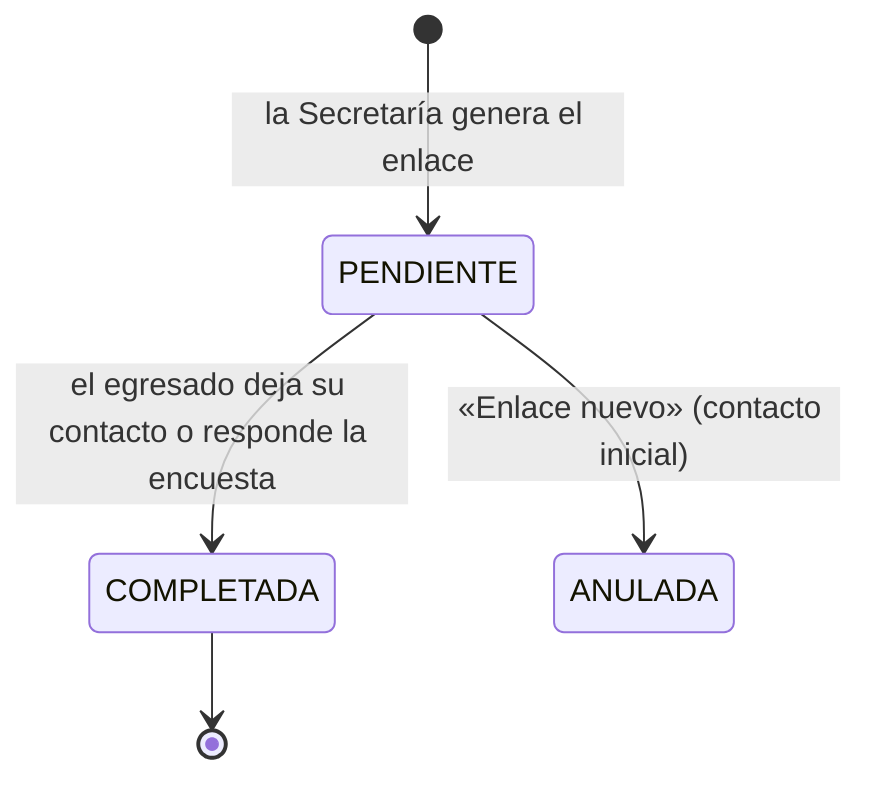
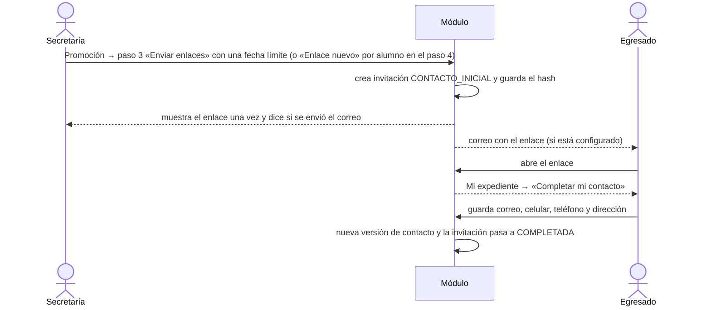
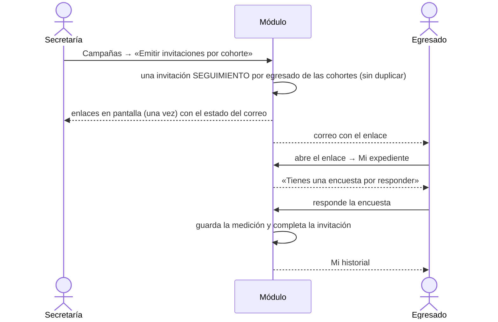

# Manual de flujo · contacto, encuesta e historial del egresado · S3-17 a S3-22

**Responsable:** Álvaro. **Referencias:** `docs/seguimiento-egresado/arquitectura.md`, `docs/seguimiento-egresado/permisos-middleware.md`, `docs/seguimiento-egresado/correo.md` y `docs/seguimiento-egresado/manual-usuario.md`.

Describe cómo recorre el sistema un egresado, desde que la Secretaría le genera un enlace hasta que consulta su historial. Cada flujo indica la pantalla, la regla que se aplica y lo que queda en la BD.

## Quién entra y cómo

- **Secretaría y Dirección** inician sesión en el portal (roles `secretaria` y `director_escuela`). Cada pantalla exige una capacidad del módulo (ver `docs/seguimiento-egresado/permisos-middleware.md`).
- **Egresado**: sin cuenta, con el enlace personal de una invitación.
- La Secretaría puede abrir en su navegador el enlace de un egresado para ver lo que él ve: ambas identidades conviven.

## Idea central: el enlace personal

El egresado **no tiene cuenta ni contraseña**. Entra con el enlace personal de una invitación: `/seguimiento-egresado/acceso/{token}`. Ese enlace abre su sesión y lo lleva a su expediente.

- Del token solo se guarda su **SHA-256** (`invitacion_egresado.token_hash`). El enlace en claro se muestra una vez, en pantalla, al generarlo.
- Un enlace desconocido, anulado o vencido muestra el mismo aviso (404): no revela cuál es el caso.
- La sesión del egresado vence cuando vence el enlace. Mientras tanto solo ve y modifica **su** expediente: el id sale de la sesión, nunca de la URL.

## Estados de una invitación



| Propósito | Campaña | Se completa cuando | Vigencia |
|---|---|---|---|
| `CONTACTO_INICIAL` | ninguna | El egresado guarda su contacto | `SG_DIAS_CONTACTO_INICIAL` días (30 por defecto) |
| `SEGUIMIENTO` | obligatoria | El egresado envía la encuesta | Hasta la fecha de fin de la campaña |

Una invitación `COMPLETADA` sigue permitiendo **consultar** el expediente hasta que venza el enlace; no permite responder otra vez.

El estado `EXPIRADA` lo admite la BD y el módulo lo respeta, pero no lo asigna: considera vencida toda invitación cuya fecha de vencimiento ya pasó, aunque siga `PENDIENTE`. Una vencida no abre el expediente ni se puede responder.

## Flujo 0 · De alumno apto a egresado

El padrón se carga con alumnos **aptos para egresar** y solo después se confirma su egreso con la fecha real. El sistema no completa lo que el archivo no trae.

```mermaid
sequenceDiagram
    actor S as Secretaría
    participant M as Módulo
    S->>M: Promoción → paso 2: carga el CSV/Excel (matrícula, documento, nombres, correo institucional); los alumnos quedan unidos a esa promoción
    M->>M: egresado + historial «PROXIMO» (apto); sin fechas, créditos ni contacto
    S->>M: Contacto inicial (flujo 1): el alumno deja su correo personal y celular
    S->>M: Ficha del alumno → «Confirmar egreso» con la fecha real
    M->>M: cierra «PROXIMO», abre «EGRESADO», guarda fecha y periodo
```

Reglas:

- La carga se hace dentro de la promoción, así que todos los alumnos del archivo se unen a ella (si el archivo trae una columna `cohorte`, debe coincidir). Correo institucional obligatorio y válido; matrícula única; las fechas del archivo no pueden ser futuras. La carga es todo o nada: una fila inválida cancela el archivo y cada fila queda registrada con su motivo en `importacion_fila`.
- Estado inicial `PROXIMO` (apto), salvo que el archivo traiga `estado` explícito. Créditos, resoluciones, fecha de egreso y periodo quedan vacíos; el contacto solo se guarda si el archivo trae correo personal **y** celular.
- «Confirmar egreso» exige una fecha real (no futura, no anterior al ingreso si se conoce) y solo vale para quien está en `PROXIMO`. El periodo sale de la fecha (`I` hasta julio, `II` después). Se conservan el expediente, el historial y los contactos.
- Las campañas de seguimiento solo convocan a quienes ya están en `EGRESADO`, `BACHILLER` o `TITULADO`.

En la BD: `egresado` (`correo_institucional`, `fecha_egreso`, `periodo_egreso`), `historial_estado_academico` (una fila por etapa, con `vigente_desde`/`vigente_hasta`) e `importacion_padron` / `importacion_fila` (qué se aceptó y qué se rechazó, con el motivo).

## Flujo 1 · Contacto inicial

Sirve para tener los datos de contacto antes de cualquier campaña. El enlace llega al **correo institucional** del alumno.



Reglas:

- «Enviar enlaces» pide una **fecha límite** (por defecto 30 días desde hoy; máximo un año): `expira_en` es el final de ese día. Genera un enlace por cada alumno que **aún no dejó su contacto** y no tiene un enlace pendiente vigente, e informa cuántos se omitieron y por qué.
- **El contacto es obligatorio para egresar.** El correo y el formulario lo dicen; «Confirmar egreso» no se bloquea, pero avisa si el alumno no completó su contacto.
- El paso 4 «Quién completó su contacto» resume la promoción cuántos completaron, cuántos siguen en plazo, cuántos vencieron y cuántos no tienen enlace; al abrir su enlace ya completado, el alumno ve «Ya completaste esta invitación» en verde.
- «Enlace nuevo» anula el enlace pendiente anterior y genera otro con la misma fecha límite: el viejo deja de funcionar. Sirve si se perdió o se compartió por error.
- El contacto **se versiona**: cada cambio cierra la versión vigente (`vigente_hasta`) y crea otra. Nada se sobrescribe y el egresado ve sus datos anteriores.

## Flujo 2 · Campaña de seguimiento



Reglas:

- Solo se convoca a **egresados confirmados** (flujo 0). El correo va al correo personal si el egresado ya lo dejó; si no, al institucional.
- Emitir dos veces no duplica: quien ya tiene invitación en esa campaña se omite.
- La encuesta tiene seis secciones: contacto, perfil profesional, situación laboral, desarrollo profesional continuo, satisfacción y habilidades, y contacto del empleador. Los campos con formato se validan en el navegador y todo se valida otra vez en el servidor.
- Quien no trabaja no guarda datos de empleo.
- La respuesta se guarda **completa o no se guarda** (una transacción): medición laboral, satisfacción, brechas y fortalezas, formación posterior y, si cambió, una versión de contacto.
- Una invitación admite **una sola respuesta** y no se puede modificar después. Si se envía dos veces a la vez, solo se guarda una.
- No se puede responder si el enlace venció, la invitación fue anulada o la campaña ya no está abierta.

## Flujo 3 · Un mismo enlace, varias tareas

El expediente ofrece todo lo pendiente, entre con el enlace que entre.

- Con un enlace de contacto inicial pendiente aparece «Completa tus datos de contacto».
- Aparecen además **todas las encuestas pendientes de campañas abiertas** del egresado, cada una con su botón «Responder la encuesta».
- Al abrir una encuesta, la sección 1 dice «Confirma tus datos de contacto» si ya hay contacto (se pueden corregir) o «Tus datos de contacto» si todavía no hay.
- La encuesta que se responde se elige con `?invitacion=` y siempre se verifica que sea del propio egresado. Un número de otro egresado no abre nada.

## Flujo 4 · Enlace perdido o recordatorio

- El enlace no se puede recuperar. Si se perdió, la Secretaría genera uno nuevo.
- En Campañas, «Reenviar recordatorio» sustituye el enlace de esa invitación por uno nuevo, lo envía por correo y lo muestra una vez. El enlace anterior deja de funcionar.

## Flujo 5 · Historial

- **Mi historial** lista las campañas a las que fue invitado y si respondió. «Ver respuesta» abre el detalle de lo que respondió ese día.
- También muestra los cambios de contacto (versiones anteriores).
- Es de solo lectura.

## Qué queda en la BD

| Hecho | Tablas |
|---|---|
| Generar un enlace | `invitacion_egresado` (hash, vencimiento, canal, `enviado_en`, estado) |
| Dejar el contacto | `contacto_egresado` (versiones), `invitacion_egresado` (`COMPLETADA`, `respondido_en`) |
| Responder la encuesta | `medicion_laboral`, `satisfaccion_egresado`, `medicion_habilidad`, `formacion_posterior`, `contacto_egresado`, `invitacion_egresado` |

`enviado_en` solo se marca si el correo salió de verdad (ver `docs/seguimiento-egresado/correo.md`).
