# Manual de usuario · Seguimiento al Egresado

Portal de Gestión de la Dirección · Escuela de Ingeniería Informática, UNT. Para saber cómo funciona por dentro, ver [flujo.md](flujo.md); para configurar el correo, [correo.md](correo.md).

Tiene dos partes: la de la **Secretaría y la Dirección**, que preparan y revisan el trabajo, y la del **egresado**, que responde con su enlace. La Secretaría y la Dirección inician sesión en el portal con su cuenta; el egresado no necesita cuenta ni contraseña: entra con su enlace personal.

---

## Parte 1 · Secretaría y Dirección

### Entrar

Inicia sesión en el portal con tu cuenta y abre el módulo **Seguimiento al Egresado**. En la parte superior derecha ves tu nombre y tu rol; al pulsarlo aparecen **Mi perfil** y **Cerrar sesión**. **Cambiar de módulo** está abajo a la izquierda del menú. La Dirección entra igual y ve las mismas pantallas, con permisos propios (por ejemplo, solo la Dirección valida los informes de evaluación institucional).

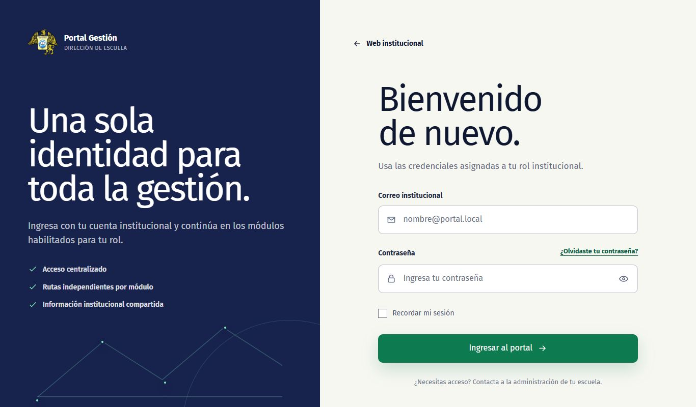

### Inicio

La portada muestra, arriba, **Por cerrar**: hasta cinco avisos de lo que sigue abierto y espera respuestas, ordenados por la fecha de cierre más cercana. Pueden ser campañas de egresados, campañas de empleadores y el **contacto inicial** de cada promoción mientras sigue en plazo. Cada aviso dice cuándo cierra, cuántos respondieron (**«12 de 14 · faltan 2»**) y lleva un botón para abrir el detalle; los que cierran en una semana o menos se marcan en ámbar. Si hay más de cinco, **Ver todas las campañas** lleva a la lista. Sin campañas abiertas dice «No hay campañas abiertas». Debajo están los accesos a las cinco áreas. Esta información solo la ve el personal con sesión iniciada.

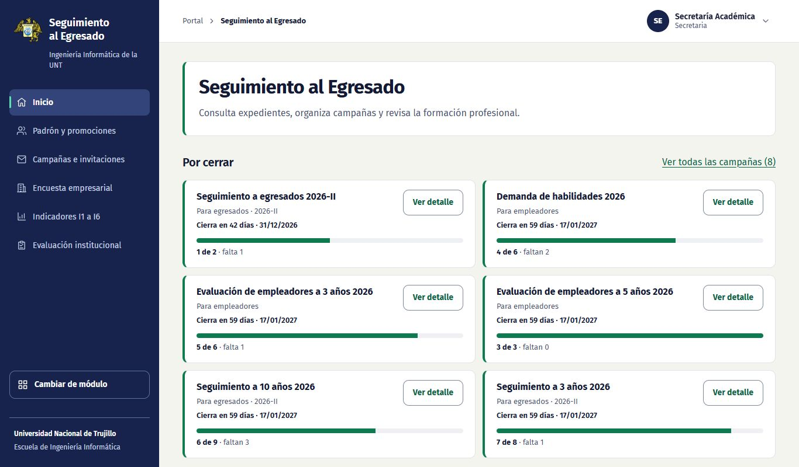

### Padrón y promociones: un flujo de cuatro pasos

Una **promoción** es el grupo de alumnos que ingresó el mismo año. En **Padrón y promociones** ves la lista de promociones y, de cada una, el paso en que va (✓ Promoción · Alumnos · Enlaces · Contacto). El botón de la derecha (**Cargar alumnos →**, **Enviar enlaces →**, **Ver seguimiento →**) te lleva a su página, directo al paso que toca. Así puedes dejar el trabajo a medias y retomarlo después.

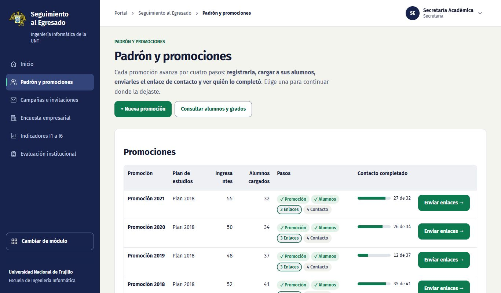

La página de cada promoción tiene los cuatro pasos uno debajo de otro, sin cambiar de pantalla. Cada paso se habilita al terminar el anterior:

1. **Promoción y total de ingresantes.** Con **+ Nueva promoción** registras su año de ingreso, su total de ingresantes (con él se calcula qué porcentaje llega a egresar) y su plan de estudios; si falta el plan, **+ Otro plan** lo registra ahí mismo. **Editar** corrige estos datos.

   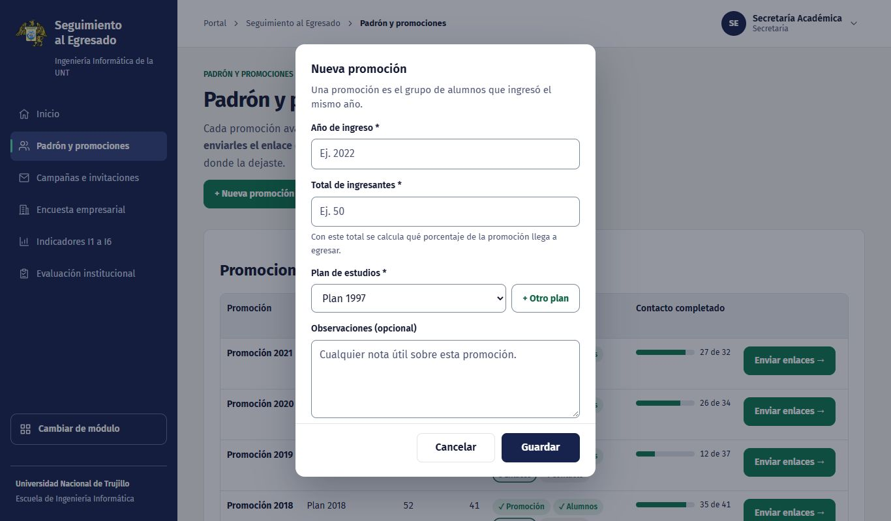
2. **Cargar a los alumnos.** Sube un archivo **CSV** o Excel con los alumnos que ya cumplen para egresar. Como estás dentro de la promoción, **todos quedan unidos a ella**. Hay un formato modelo descargable y un ejemplo en `docs/seguimiento-egresado/datos/alumnos-aptos-demo.csv`.
   - Columnas obligatorias: `matricula`, `tipo_doc`, `numero_documento`, `nombres`, `apellido_paterno` y **`correo_institucional`** (válido). Opcionales: `apellido_materno`, `fecha_ingreso`, `fecha_egreso` (no puede ser futura) y, si ya se conocen, `correo_personal` y `celular`. Si el archivo trae una columna `cohorte` (año), debe coincidir con la promoción.
   - La carga es **todo o nada**: si una fila tiene un problema (matrícula repetida, correo faltante o inválido, fecha futura, otra promoción), no se guarda ninguna. Un cuadro dice qué filas corregir; también queda en **Consultar alumnos y grados → Historial de cargas**. Si todo sale bien, el cuadro dice cuántos alumnos se cargaron.
   - Los alumnos quedan como **Apto para egresar**, sin fecha de egreso, sin créditos y sin contacto. **Cargar más alumnos** vuelve a abrir el paso 3 para los nuevos.
   - **Otra forma, sin archivo:** **Elegir de los estudiantes del portal** abre una ventana con los estudiantes que ingresaron ese año y todavía no están en el padrón. Se busca por matrícula, documento o nombre, se marcan los que correspondan (o **todos** a la vez) y se pulsa **Agregar a la promoción**. Quedan igual que si vinieran de un archivo y la carga aparece en el historial como «Estudiantes del portal». Quien no tiene un correo registrado se indica y no se puede agregar; a los demás el enlace de contacto les llega a su correo personal.

   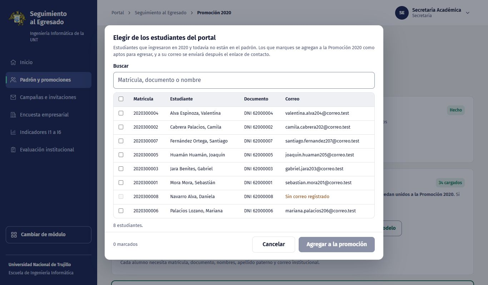
3. **Enviar el enlace de contacto.** Elige la **fecha límite** (se sugiere 30 días desde hoy; máximo un año) y pulsa **Enviar enlaces**; confirma en el cuadro. Cada alumno sin contacto recibe en su **correo institucional** un enlace personal que funciona hasta el final de ese día. **Completar el contacto es obligatorio para poder egresar**: el correo y el formulario se lo dicen. Los que ya dejaron su contacto o ya tienen un enlace pendiente se omiten y el aviso dice cuántos.
4. **Quién completó su contacto.** Una tabla (matrícula, alumno, fecha de envío, estado del enlace, fecha de respuesta y acción) muestra a cada alumno de la promoción:

   | Estado | Significa |
   |---|---|
   | COMPLETADA (verde) | Ya dejó su contacto. |
   | PENDIENTE | Tiene un enlace vigente («hasta el dd/mm»). Debajo dice si el correo salió, falló o hay que entregarlo a mano. |
   | VENCIDA (rojo) | Pasó la fecha límite sin completar. |
   | SIN ENLACE | Aún no se le generó uno. |

   Arriba de la tabla un resumen cuenta cuántos completaron, cuántos siguen en plazo, cuántos vencieron y cuántos no tienen enlace, y un aviso dice cuántos alumnos **aún no deberían egresar** por no haber completado su contacto. Quien no completó tiene **Enlace nuevo** (conserva la misma fecha límite) y la nota «Aún no debería egresar». Un filtro permite ver solo quienes pasaron la fecha límite sin completar.

   Los enlaces se muestran **una sola vez** al generarlos (botón **Copiar**); en la base solo queda su huella.

   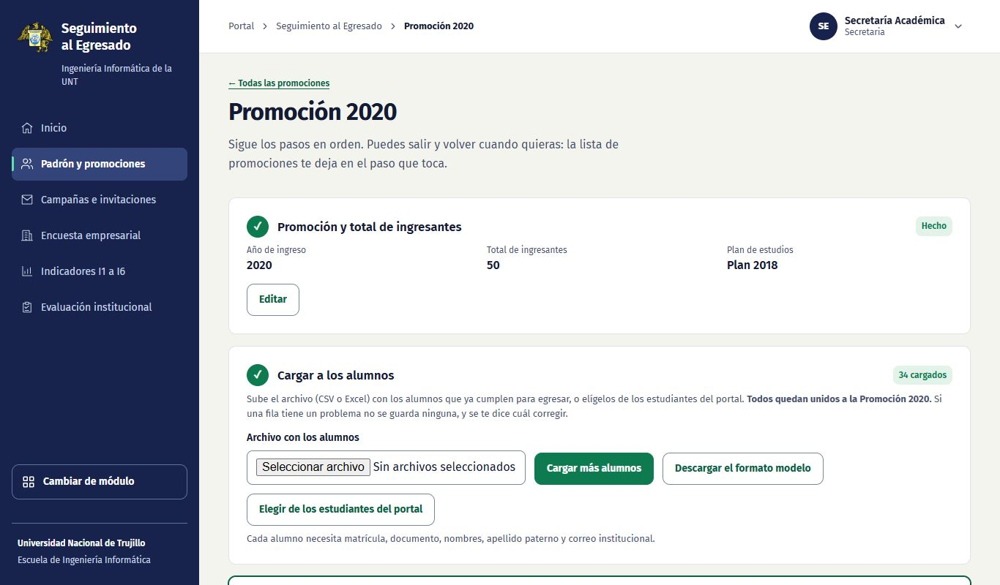

   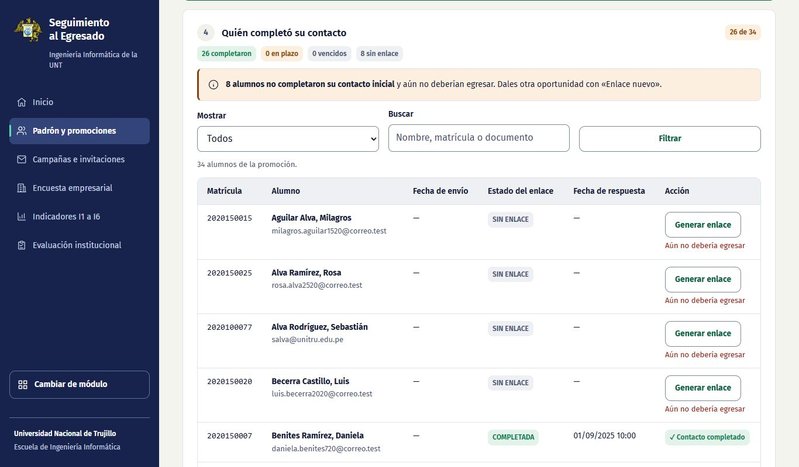

**Consultar alumnos y grados** (botón de la lista) conserva la lista completa de alumnos con su ficha (donde se ven y actualizan el grado y sus resoluciones) y el historial de cargas.

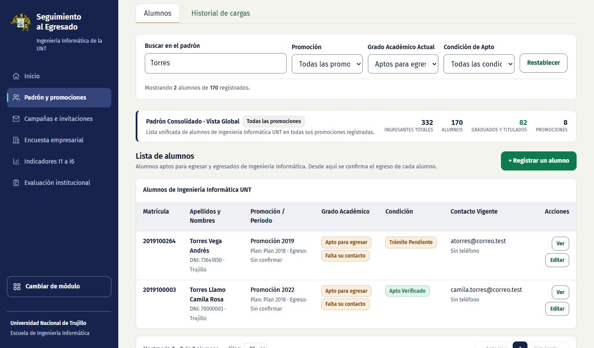

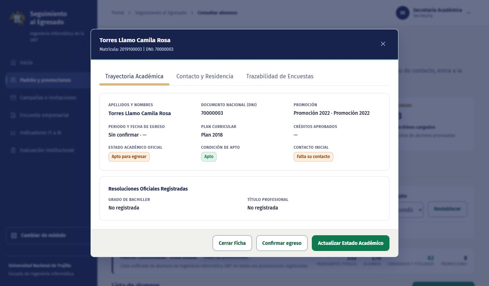

### Confirmar el egreso

Cuando el alumno egresó de verdad:

1. En **Consultar alumnos y grados** abre su ficha y pulsa **Confirmar egreso**.
2. Escribe la **fecha real de egreso** (no puede ser futura ni anterior a su ingreso, si se conoce) y confirma.
3. El alumno pasa a **Egresado**; el periodo (por ejemplo `2025-I`) se calcula con esa fecha. Su historial conserva la etapa anterior y sus contactos no se pierden.

Solo la Secretaría confirma egresos; la Dirección consulta. Solo se puede confirmar a quien está como «Apto para egresar».

**El contacto se ve antes de confirmar.** Junto a «Apto para egresar», la lista y la ficha muestran si el alumno completó su contacto inicial (**Contacto completo** o **Falta su contacto**). Como ese contacto es obligatorio para egresar, si falta, la ventana de confirmación lo avisa **antes** de pedir la fecha; se puede confirmar de todos modos. Al confirmar, la lista se actualiza sin recargar la página: la búsqueda y los filtros se conservan, y se puede seguir con el siguiente alumno.

### Estado del correo de los enlaces

| Lo que dice | Qué hacer |
|---|---|
| Correo enviado | Nada: el alumno ya lo recibió. |
| Enlace listo para entregar | El correo no salió hacia esa dirección: entrega el enlace por otro medio (por ejemplo, un mensaje directo). |
| Falló el envío | Entrega el enlace por otro medio y avisa al responsable del correo. |

### Campañas e invitaciones

La pantalla muestra todas las campañas (nombre, periodo, fechas, promociones, estado y cuántos respondieron). **Ver detalle** abre una ventana encima de la lista, sin bajar la página.

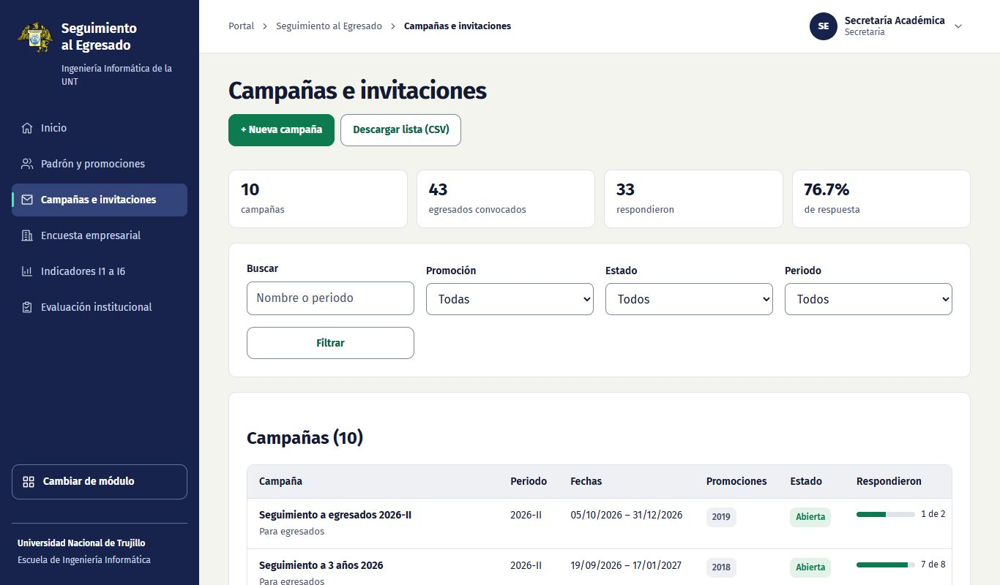

**Crear una campaña.** Pulsa **+ Nueva campaña** y llena: nombre, para quién es (egresados o empleadores), periodo académico (lista), años desde el egreso (opcional: 1, 3, 5 o 10), la fecha en que se abre y la fecha en que se cierra, y las promociones que participan (se muestra cuántos egresados confirmados tiene cada una; las que no tienen ninguno no se pueden elegir).

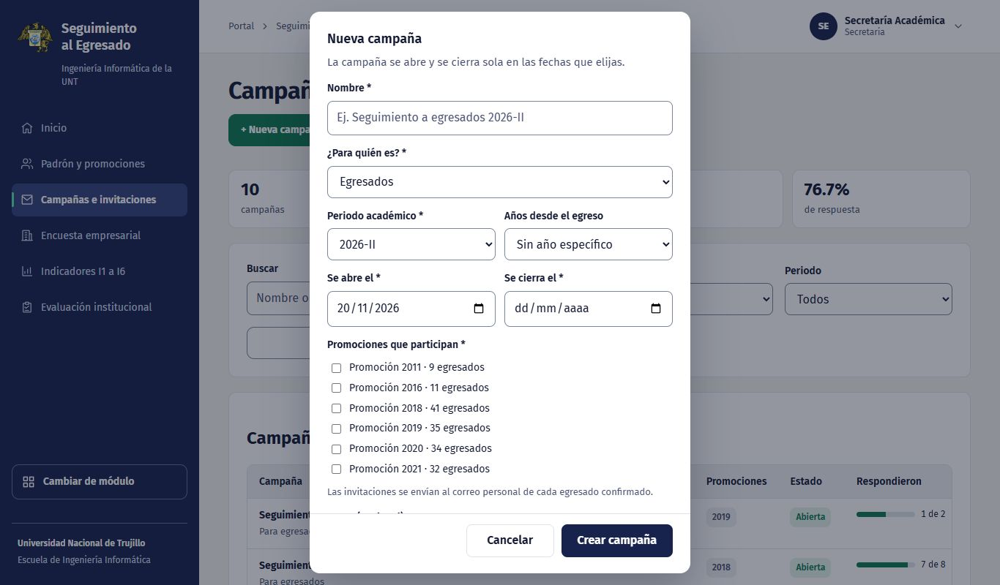

**La campaña se abre y se cierra sola según sus fechas**: antes de la fecha de apertura está *Programada*, entre las dos fechas está *Abierta* (y los egresados pueden responder) y después de la fecha de cierre queda *Cerrada*. Para cerrarla antes o alargarla, edita sus fechas. Al editar no se cambia para quién es.

**Enviar las invitaciones** (en el detalle de una campaña de egresados):
1. Pulsa **Enviar invitaciones** y confirma. Cada **egresado confirmado** de las promociones de la campaña recibe un enlace personal **en su correo personal**, el que dejó en el contacto inicial.
2. Quien aún no dejó su contacto **no se convoca**: el aviso dice cuántos son y que deben completarlo desde su promoción en el Padrón. Quien ya tiene invitación se omite. Los alumnos que siguen como «Apto para egresar» tampoco se convocan.
3. Los enlaces recién generados aparecen en el mismo detalle, una sola vez, con el estado del correo (**Copiar** para entregarlos a mano). Una campaña cerrada no permite enviar.

**Ver una respuesta.** En la tabla del detalle, cada fila respondida tiene **Ver respuesta**: abre, encima de la misma ventana, la respuesta completa del egresado (situación laboral, residencia e idiomas, satisfacción, habilidades y formación posterior; solo lo que respondió). Se cierra con **Cerrar** y vuelves a la lista sin recargar nada. Solo la Secretaría ve las respuestas individuales de los egresados; la Dirección ve las cifras agregadas.

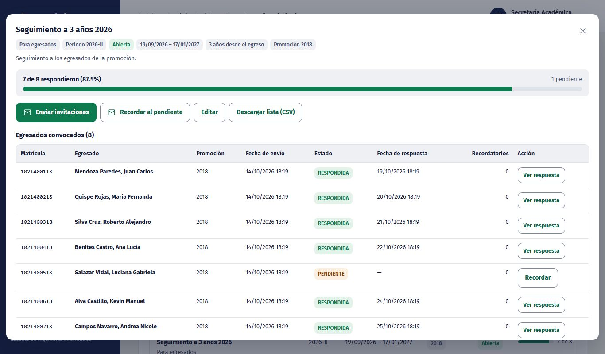

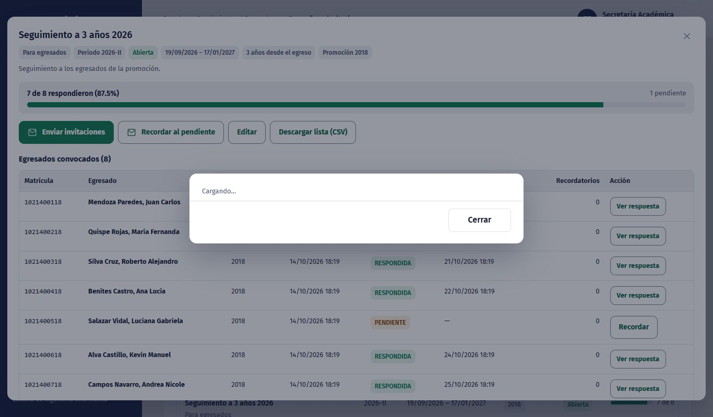

**Seguir quién respondió.** La tabla del detalle muestra matrícula, egresado, promoción, fecha de envío, estado (PENDIENTE, RESPONDIDA o VENCIDA), fecha de respuesta, recordatorios enviados y la acción. **Descargar lista (CSV)** baja esa tabla.

**Recordar.** **Recordar a los N pendientes** envía un recordatorio a todos los que aún no respondieron (después de confirmar); **Recordar** en una fila lo hace con uno solo. Cada recordatorio genera un **enlace nuevo y el anterior deja de funcionar**.

**Campañas para empleadores** se crean igual (también desde Encuesta empresarial, con **+ Nueva campaña de empleadores**), pero sus enlaces se generan en **Encuesta empresarial**.

### Encuesta empresarial

Las empresas responden con un enlace, sin cuenta. El sistema **no envía nada a la empresa**: la Secretaría copia el enlace y se lo entrega por su cuenta (al número que figura en la tabla).

1. **Elige la campaña de empleadores** arriba (se propone la abierta). Los enlaces valen hasta el cierre de la campaña.
2. **Opinión de la empresa sobre cada egresado**. La tabla lista a los egresados de las promociones de la campaña que **autorizaron contactar a su empresa**, con la empresa y el contacto del jefe que ellos mismos dejaron en su encuesta, y el estado de su enlace: *Sin enlace*, *Pendiente* (con su fecha y si ya se entregó), *Respondida* o *Vencida*.
   - **Generar enlace** (en una fila) o **Generar los enlaces que faltan** (todos a la vez, con confirmación). No hay que escribir ningún dato.
   - Al generar, una ventana muestra egresado, empresa, contacto y enlace, con **Copiar** por fila, **Copiar todos** y **Descargar lista (CSV)**. **Se muestran una sola vez**: cópialos o descárgalos antes de cerrar.
   - **Enlace nuevo** genera otro y el anterior deja de funcionar; si ya lo entregaste, pide confirmación.
3. **Demanda de habilidades** (encuesta general): no trata de un egresado. Indica **cuántos enlaces** necesitas y se generan uno por empresa (cada enlace admite una sola respuesta).
   - En las filas respondidas, **Ver respuesta** abre en una ventana lo que contestó la empresa (quién responde, sector, satisfacción, comentario y habilidades).
4. **Resultados**: los totales (cobertura, I5, encuestas de mercado) y las gráficas de habilidades más demandadas, aspectos por reforzar y satisfacción, de la campaña elegida.

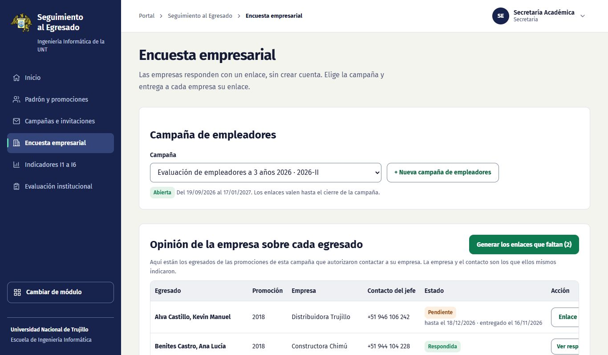

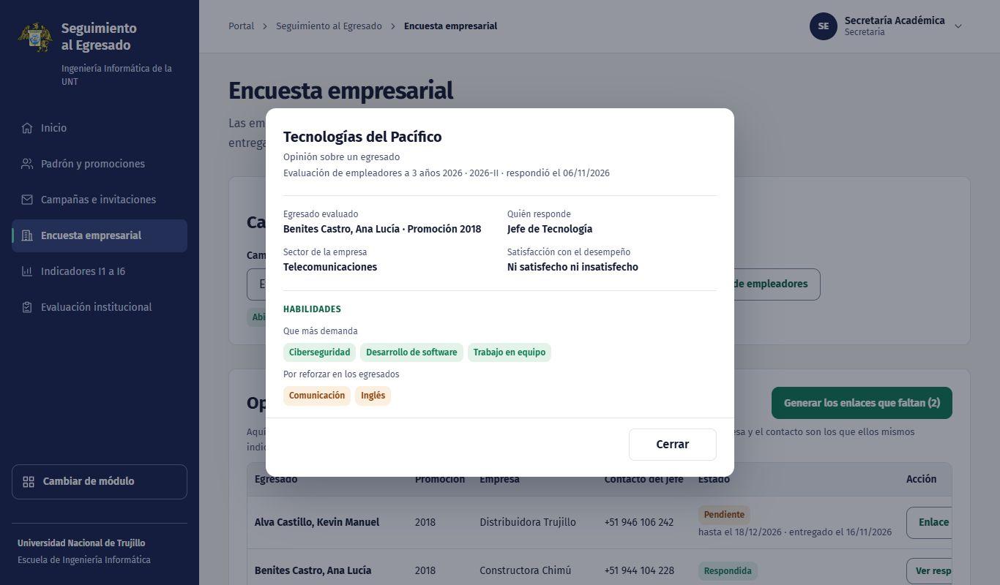

### Indicadores I1 a I6

Un tablero con los seis indicadores oficiales, sus gráficas y el detalle de cómo se calculan. Se lee igual para Secretaría y Dirección (la Dirección ve además el logro por objetivo y la evidencia de las mejoras).

- **Filtros**: **Promoción** (todas o una), **Años desde el egreso** (todo el histórico, 3, 5 o 10 años) y **Datos hasta** (la fecha hasta la que se toman los datos; por defecto, hoy). **Limpiar** vuelve a todo.
- **I1 · Egresados por promoción**: egresados de la promoción entre sus ingresantes. En el total **solo entran las promociones que ya cumplieron su duración** (año de ingreso + años de la carrera); las que siguen cursando se muestran en la gráfica como «en curso» y el cuadro lo avisa («No incluye la promoción 2022 (aún en curso)»). Si eliges una promoción en curso, ves su avance con el aviso de que es parcial.
- **I2 y I4** salen de la encuesta de seguimiento (no responder no cuenta como desempleo), **I5** de la encuesta empresarial sobre cada egresado, **I3** y **I6** de la **Evaluación institucional** (ver abajo).
- **Cómo se calcula** muestra, por indicador, la fórmula, el numerador, el denominador y la fuente. **Exportar a Excel** descarga lo mismo que se ve, con el mismo filtro.

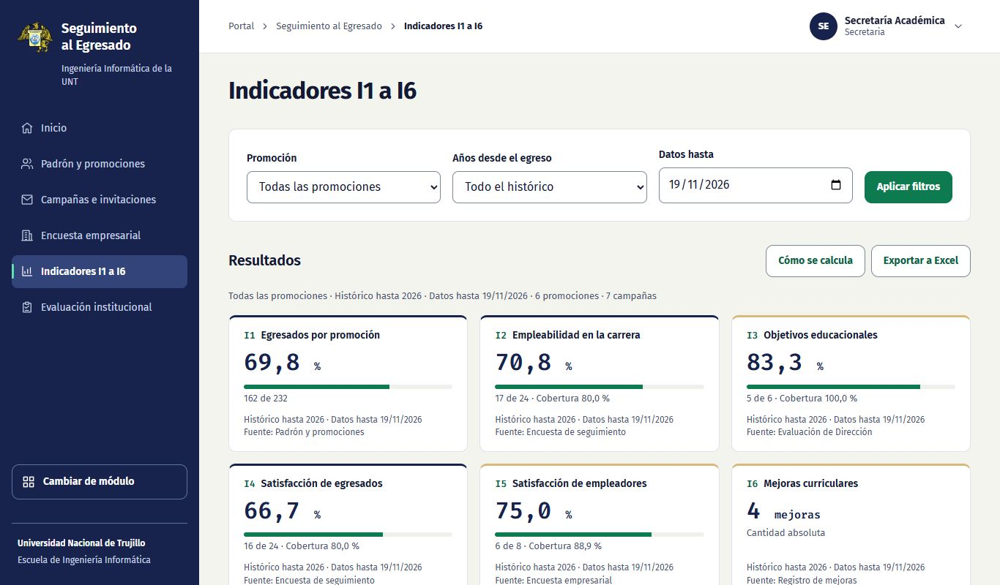

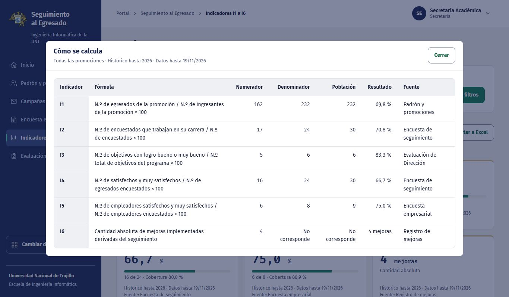

### Evaluación institucional

Es el registro de si se lograron los objetivos del programa y de qué se cambia a partir de los resultados. **La Secretaría prepara los registros y la Dirección los valida**: solo lo validado cuenta en los indicadores.

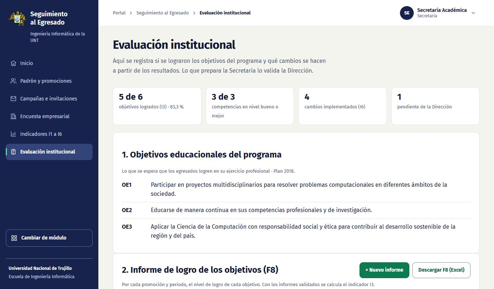

1. **Objetivos educacionales**: los tres del programa (proyectos multidisciplinarios, educación continua, responsabilidad social y ética).
2. **Informe de logro de los objetivos (F8)**: **+ Nuevo informe** → elegir la **promoción** y el **periodo** → el **nivel de logro** de cada objetivo (muy bueno, bueno, regular, malo, muy malo), conclusiones y toma de decisiones. Hay un informe por promoción y periodo. La Secretaría lo deja en **Guardar borrador**; la Dirección lo abre con **Revisar y validar** y usa **Guardar y validar**. Un informe validado solo lo modifica la Dirección.

   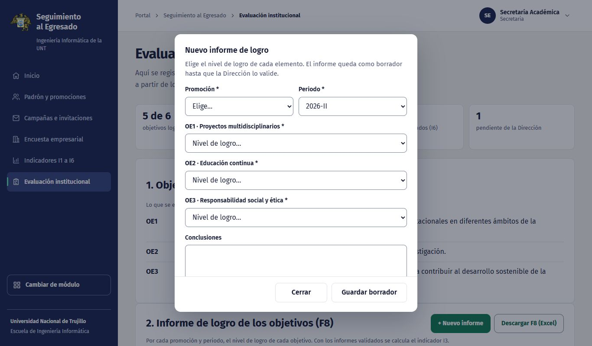

   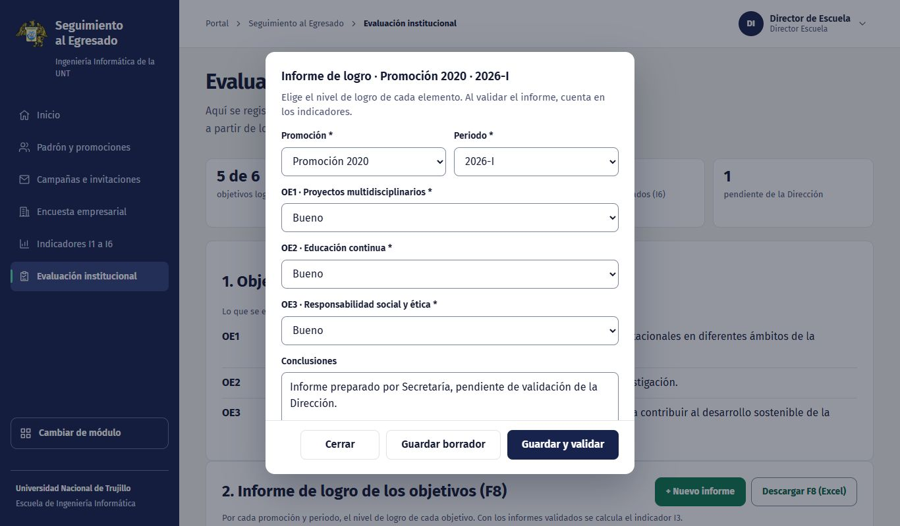
   - **I3** = objetivos con nivel bueno o muy bueno entre el total de objetivos de cada promoción evaluada, con el último informe validado de cada promoción. Así, «7 de 9» son 7 objetivos logrados entre 9 (3 promociones × 3 objetivos).
3. **Informe de logro de las competencias (F9)**: igual, con las competencias genéricas y específicas del perfil de egreso.
4. **Cambios que se deben hacer (F10 y F11)**: **+ Registrar cambio** → qué se cambia (perfil de egreso, objetivos educacionales u otro cambio del currículo), **qué dice hoy** y **cómo debe decir**, y por qué. La Secretaría los registra como **Propuesta** o **En evaluación**; la Dirección los **aprueba, pone en ejecución, implementa o descarta**.
   - **I6** = cantidad de cambios **implementados**, con **fecha** y **documento de respaldo** (resolución o acta). Cada uno suma 1.
5. **Planes de acción (F5 y F7)**: los planes de vinculación con los egresados y de mejora de la inserción laboral, con su avance. Con avance de 100 % se marcan como cumplidos; si no, el informe muestra el plazo.

Los botones **Descargar F5, F7, F8, F9, F10 y F11 (Excel)** entregan cada formato oficial de la UNT en un libro de Excel con **una hoja por informe** (por promoción y periodo, o por periodo): promoción o cohorte, año y semestre, fecha de informe, el cuadro del formato, conclusiones, toma de decisiones y la línea de **V° B° del Director de Escuela**. Los cambios de «otro tipo» salen en el formato F10.

### Qué ve la Dirección

La Dirección consulta el padrón, las campañas, la encuesta empresarial y los indicadores, pero no carga alumnos ni envía enlaces: esos botones no aparecen en su pantalla. Sí valida los informes de evaluación institucional y marca los cambios como implementados.

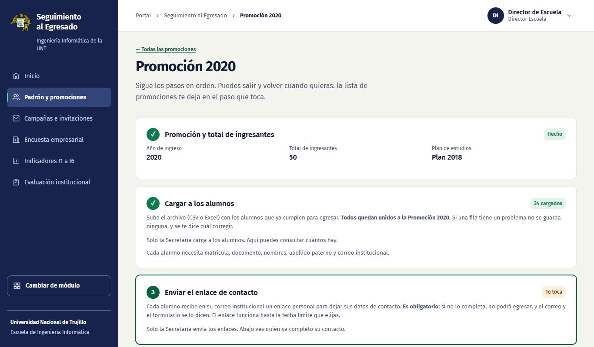

---

## Parte 2 · Egresado

### Entrar

Abre el enlace que te dio la Escuela, por correo o por otro medio. No pide contraseña ni datos: te lleva directo a **Mi expediente**.

- El enlace es **personal**: no lo compartas. Quien lo tenga puede ver y modificar tu expediente hasta que venza.
- Si dice que el enlace no es válido, es que venció o fue reemplazado. Pide uno nuevo a la Secretaría.

### Mi expediente

Es tu página de inicio. Muestra tus datos académicos y lo que tienes pendiente:

- **Completa tus datos de contacto**, si la Escuela aún no los tiene.
- **Tienes una encuesta por responder**, con la campaña y la fecha límite. Si tienes varias, aparece cada una con su botón.

El menú de la izquierda tiene tres opciones: **Inicio**, **Mi contacto** y **Mi historial**.

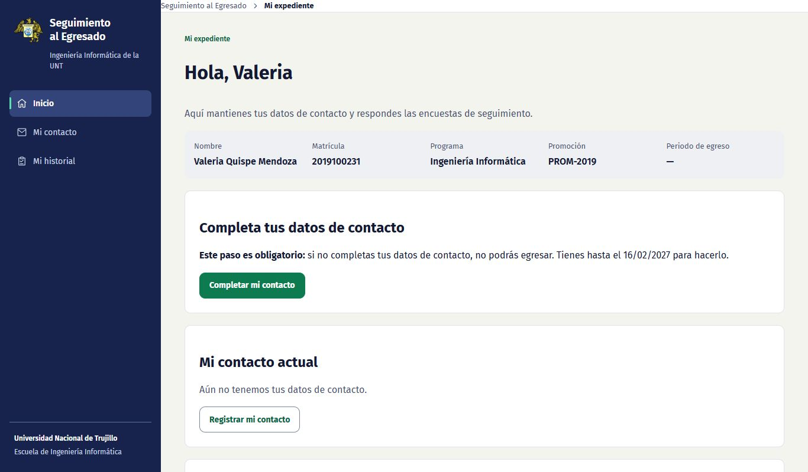

### Dejar o actualizar tu contacto

1. Pulsa **Completar mi contacto** (o **Mi contacto** en el menú).
2. Llena el correo personal y el celular (obligatorios); el teléfono fijo y la dirección son opcionales.
3. Pulsa **Guardar mis datos**. Si algún dato no tiene el formato correcto, la página te lo indica.

Cuando cambias tus datos, la Escuela **conserva los anteriores** en tu historial: nada se pierde.

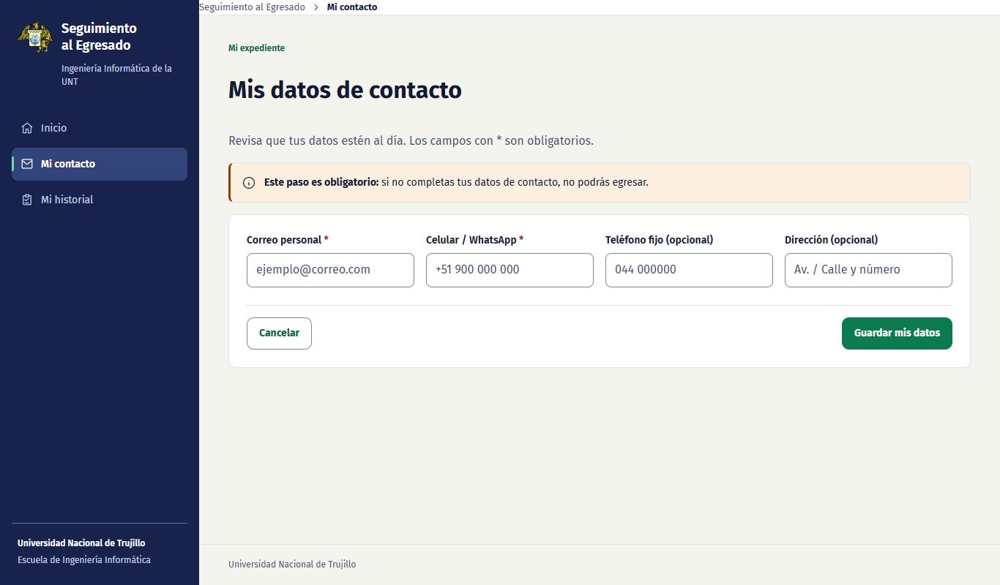

### Responder la encuesta de seguimiento

1. Pulsa **Responder la encuesta** en Mi expediente.
2. Completa las seis secciones: contacto, perfil profesional, situación laboral, desarrollo profesional continuo, satisfacción y habilidades, y contacto del empleador. Los campos con * son obligatorios.
   - En la primera sección verás tus datos de contacto: confírmalos o corrígelos.
   - Si no trabajas, no se te pedirán datos de empleo.
3. Revisa y pulsa **Enviar mi respuesta**. Los campos con formato (celular, correo, contacto del jefe) te avisan mientras escribes; si falta algo, la página te lo marca.

**Una vez enviada, la encuesta no se puede modificar ni responder de nuevo.** Tu respuesta queda en tu historial.

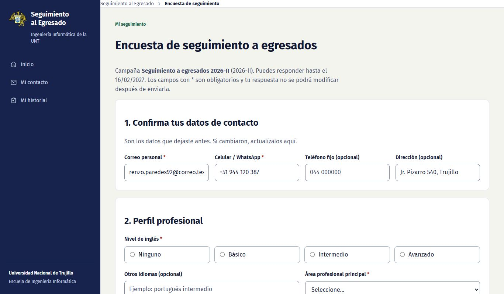

### Mi historial

- **Campañas de seguimiento:** las campañas a las que te invitaron y si respondiste. **Ver respuesta** abre lo que contestaste.
- **Cambios de contacto:** tus datos anteriores.

Es de solo lectura.

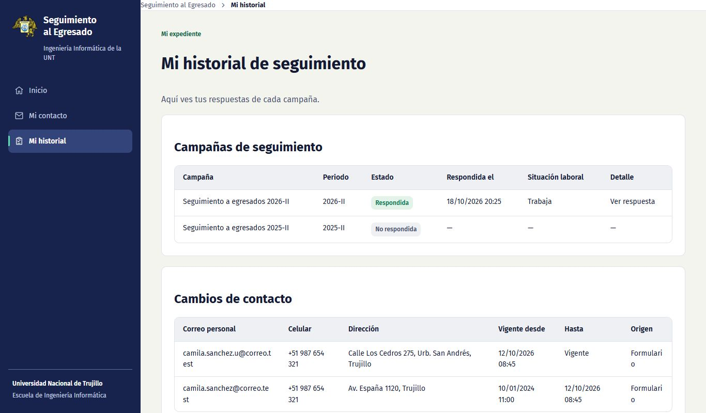

---

## Problemas frecuentes

### En la Secretaría

| Si ves esto | Qué hacer |
|---|---|
| La carga de alumnos dice «No se cargó ningún alumno» | Lee la fila que indica el aviso, corrígela en el archivo y vuelve a cargarlo. El detalle queda en **Consultar alumnos y grados → Historial de cargas → Ver detalle**. |
| La campaña aparece cerrada | Revisa sus fechas en **Ver detalle → Editar**. Se abre y se cierra sola según esas fechas. |
| Un egresado no recibió la invitación | Quien no dejó su contacto no se convoca. Pídele que lo complete desde su promoción, o usa **Recordar** para darle un enlace nuevo. |
| El tablero dice «Sin datos» o «Sin medición» | Revisa el filtro y la fecha «Datos hasta». Faltan respuestas o informes validados para ese filtro. |
| No ves el botón para cargar alumnos o enviar enlaces | Esas acciones son solo de la Secretaría. La Dirección consulta. |

### Para el egresado

| Problema | Qué hacer |
|---|---|
| «El enlace no es válido» | Pide un enlace nuevo a la Secretaría: pudo vencer o haber sido reemplazado. |
| No me llegó el correo | Revisa la carpeta de spam. Si no está, la Secretaría puede generarte un enlace nuevo y entregártelo por otro medio. |
| La sesión se cerró sola | Tu enlace venció. Pide uno nuevo. |
| Dice que ya respondí | La encuesta admite una sola respuesta. Puedes verla en Mi historial. |
| La campaña ya no está abierta | Pasó la fecha de la campaña. No se puede responder; consulta a la Escuela. |
| Me equivoqué en mi contacto | Entra a Mi contacto y corrígelo: se guarda como una versión nueva. |
